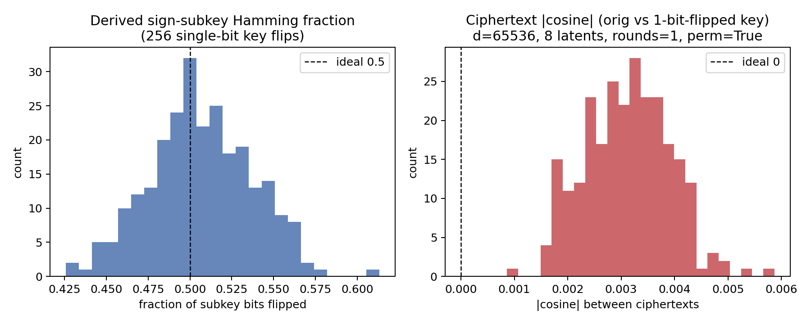

# 稽核週摘要（AUDIT Summary）

> 本檔由稽核方（Claude）撰寫，**每週一節，新週次加在最下面**，舊週次只在「更正」小節補充，不改寫內文。
> 詳細的稽核過程、finding 與證據在 `AUDIT.md`；本檔只濃縮成「這週完成了什麼、結果代表什麼、哪些素材可以寫進論文」。兩者有出入時以 `AUDIT.md` 為準。
> 論文可用的圖、表、原始資料放在 `appendix_audit/weekNN_<任務群>/`，規範見 `appendix_audit/README.md`。

---

## 撰寫方式（每週固定格式）

### 規則

1. **語言**：內文用中文；圖的標籤與標題用英文（可直接放進論文），圖說與分析用中文。
2. **每個數字都要有來源**：寫明 `appendix_audit/` 內的表格檔或原始資料檔；數字必須與該檔一致。
3. **標記**：沿用專案慣例。`[事實]` 必須附來源；`[推定]` 是由事實推論；`[假設]` 是尚未驗證。
4. **樣本數與不確定性**：每個量化結果都寫 n；n ≥ 20 時附 95% bootstrap CI（B=10,000、seed 1911）；n ≤ 4 的結果一律標為「診斷」，不得當主結果。
5. **證據強度**（沿用 `AUDIT.md` §4.2）：`INDEP`（稽核方以獨立實作驗證）> `RERUN`（重跑原指令）> `CODE`（讀程式）> `DOC`（文件比對）。論文素材清單須標示強度。
6. **圖**：`wNN_figXX_<slug>.png`，300 dpi，由 `scripts/make_figures.py` 產生；每張圖都有對應的 `wNN_tabXX_<slug>.csv`。色盤用 dataviz 參考色的 light 模式（已驗證）；每根柱都有數值標籤。
7. **素材複製**：實作方檔案以 `wNN_src_` 前綴複製；稽核方原始資料以 `wNN_aud_` 前綴；都記在 `MANIFEST.csv`（含 SHA-256 與複製時的 git HEAD），由 `scripts/collect_assets.py` 產生。
8. **不得過度宣稱**：遵守 PROPOSAL §5；攻擊未成功不等於安全；可逆性一律同時看影像端指標。

### 每週章節樣板

```markdown
## Week NN（MM/DD–MM/DD）· 任務群 · 一句話總結

### 1. 範圍與 Gate 狀態
子任務 × 交付物 × 稽核判定 × 稽核輪次 的表格；Gate 是否通過。

### 2. 本週完成重點
≤ 8 條，每條附標記與來源。

### 3. 關鍵實驗結果
每個結果：圖（嵌入）＋ 圖說 ＋ 一句結論 ＋ 資料表連結 ＋ n／CI ＋ 證據強度。

### 4. 重要發現、對前作的評論與更正
包含稽核方自己的更正。

### 5. 使用者裁決紀錄
日期、內容、影響範圍。

### 6. 未結 findings 與下週風險

### 7. 論文素材清單
檔案 → 建議放在論文哪一節 → 證據強度 → 使用注意。

### 8. 限制（不能宣稱的事）

### 9. 檔案索引
指向 `appendix_audit/weekNN_<任務群>/MANIFEST.csv`。
```

---

## Week 1（10/05–10/10）· E0–E2 · 前作流程被忠實重現，並找到前作可逆性損失的真正原因

### 1. 範圍與 Gate 狀態

**G0：通過**（`AUDIT.md` AUD-20261010-03）。

| 子任務 | 內容 | 主要交付 | 稽核判定 | 稽核輪次 |
|---|---|---|---|---|
| E0.1 | 證據重整：舊數字重建或撤回 | `canonical_preflight.csv`、`reports/evidence_reset.md` | Achieved | AUD-20261008-02 |
| E1.1 | 環境與 checkpoint 盤點 | `artifacts/environment_baseline.txt`、`model_inventory.csv` | Achieved | AUD-20261008-02、AUD-20261009-01 |
| E1.2 | 速度與 VRAM | `results/E1.2_benchmark.json` | Achieved | AUD-20261008-02 |
| E1.3 | dev split（20 張） | `splits/dev_v1.1.csv` | Achieved | AUD-20261008-02 |
| E1.4 | DDIM smoke（推論流程） | `results/E1.4_ddim_smoke.csv` | Achieved | AUD-20261008-02、AUD-20261010-01 |
| E1.5 | run artifact 驗證器 | `scripts/artifact_schema.py`、tests | Achieved | AUD-20261009-01 |
| E2.1 | formal split（200 張） | `splits/security_v1.csv` | Achieved | AUD-20261008-02 |
| E2.2 | S0/S1 前作 wrapper | `scripts/e2_legacy_wrapper.py`、`results/E2.2.json` | Achieved | AUD-20261009-01、AUD-20261010-01 |
| E2.3 | latent cache | `results/E2.3_DONE.json`（cache 本身不進 Git） | Achieved | AUD-20261010-03 |
| E2.4 | 指標語意 | `reports/metric_semantics.md` | Achieved | AUD-20261010-03 |
| E2.5 | P/S0/S1 dev round-trip | `paper_assets/tables/table_baseline_correctness.csv` | Achieved | AUD-20261010-03 |

本週共 13 輪稽核（AUD-20261008-01 至 AUD-20261010-07），開立 AF-001～AF-025，其中 23 項已關閉。

### 2. 本週完成重點

1. `[事實]` **可重現的實驗環境**：`CFG_DDIM`（Python 3.10.19、PyTorch 2.14.0+cu130、RTX 5090、Pillow 8.4.0），統一經 `scripts/run_cfg_ddim.sh` 執行。`~/.local` 套件會遮蔽 env，因此加上 `env_guard` 讓不安全的執行直接失敗；長任務經 `managed_run.py` 記錄真實 stdout／stderr、exit code、狀態與 GPU lock。來源：`data/w01_src_environment_baseline.txt`。
2. `[事實]` **資料**：
   - dev_v1.1：CheXpert valid 的 20 位病人，健康與積水各 10。
   - security_v1：200 位病人，各 100，取自重建學長訓練抽樣（每類 16,000 張、`random_state=1911`）後**模型未見過**的 train 病人；排除 22,253 位病人；健康類可用池 627 位。
   - 稽核方獨立重建，hash 一致。來源：`data/w01_src_security_v1_manifest.json`、`data/w01_aud_e2_security_split_verify.json`。
3. `[事實]` **前處理與學長完全一致**：20/20 張逐值相同（equalizeHist → INTER_AREA 256² → JPEG100 → per-image min-max）。來源：`data/w01_aud_e1_preprocess_legacy_check_pillow9.0.0.json`。
4. `[事實]` **前作流程忠實重現**：
   - wrapper 直接呼叫學長的 `ddim_sample_loop_anonymization`，與直接呼叫逐位元相同。
   - 生成條件依學長原始碼寫死的 `guidance_scale=-1`，也就是 y=0 健康類條件生成，不是無條件。
   - latent cache 抽 6 張由稽核方獨立重算，**6/6 逐位元相同**。
   - 來源：`data/w01_src_E2.2.json`、`data/w01_aud_e2_cache_recompute_verify.json`。
5. `[事實]` **重現了前作報告的可逆性數字**：S1 解密輸出對不加密輸出為 30.2 dB、影像 cosine 0.9985；前作報告為 30.23 dB、0.998978。這是類比：前作比較的是假健康輸出。來源：`tables/w01_src_table_baseline_correctness.csv`。
6. `[事實]` **前作「cosine 0.9989」其實是影像 cosine**，不是論文所寫的 latent cosine。X 光像素全為非負值，兩個**不同病人**之間的 cosine 中位數就有 0.884（圖 6）。
7. `[事實]` **前作的可逆性損失主要來自存檔**：per-image min-max 後沒有保存值域。改為保存值域後，S0／S1 的 M1 還原從 31.5／31.3 dB 回到 38.4／39.2 dB（圖 1、圖 4）。
8. `[推定]` **安全面預覽**：
   - S0 在只拿到匿名影像（T2-WB）時，|z| 仍與真值高度相關（r=0.976）。
   - WHT 讓前作依賴的 |z| 與排序 |z| 特徵降到隨機水準（n=4，診斷）。
   - 保存值域會讓 norm-only 攻擊在 T2-WB 下可行（dev 20 張：14–18/20）。
   - 這些都待 A4／D7 正式量測。

### 3. 關鍵實驗結果

#### 圖 1｜M1 可逆性：存檔方式決定一切


* 圖說：dev_v1.1 20 張，學長加密流程（guidance −1，T=500），解密還原影像對原圖 x0 的 PSNR（平均 ± 95% bootstrap CI）。虛線為 T1（保存精確 latent）的上限 42.2 dB。
* 結論：
  - 學長的 PNG 存法讓 S0/S1 掉到 31.5 [30.6, 32.3]／31.3 [30.8, 31.9] dB。
  - 保存值域的 PNG（本專案協定）為 38.4 [38.0, 38.8]／39.2 [39.0, 39.3] dB，與不存檔的 float 上限（38.7／39.4 dB）相差 ≤ 0.3 dB。
  - P 不受存檔方式影響（37.6–37.8 dB）。
* 資料：`tables/w01_tab01_m1_reversibility_by_storage.csv`；原始：`data/w01_src_E2.5_roundtrip_per_sample.csv`、`data/w01_src_AF024_m1_storage_per_sample.csv`。證據強度：RERUN＋INDEP（稽核方獨立量測逐張一致）。

#### 圖 2｜latent cosine 無法預測影像可逆性


* 圖說：每點為一張影像（n=20／方案，學長 PNG 交接）。x 軸是原始 latent 與解密 latent 的 cosine，y 軸是還原影像 PSNR。
* 結論：
  - P 的 latent cosine 只有 0.30 [0.18, 0.41]，影像卻有 37.7 dB。
  - S0/S1 的 latent cosine 高達 0.990，影像只有約 31 dB。
  - **latent 指標只能當診斷，可逆性必須看影像端。**
* 資料：`tables/w01_tab02_latent_cosine_vs_image_psnr.csv`。證據強度：RERUN＋INDEP。

#### 圖 3｜誤差的「方向」決定影像影響


* 圖說：在同一個 latent z 上加入不同誤差後生成，對 G(z) 的 PSNR（n=4，診斷）。
* 結論：
  - P 的 re-inversion 誤差和大的白雜訊一樣大（RMSE 約 1.12），影像卻幾乎不變（43.9 對 6.4 dB）。
  - S0 的解密誤差則和同樣大小的白雜訊效果相同（31.8 對 31.3 dB）。
  - `[推定]` 生成器是多對一的：P 的誤差落在不敏感的方向；S0/S1 的誤差被金鑰反運算打散成隨機方向，所以傷害影像。
* 資料：`tables/w01_tab03_latent_error_direction.csv`。證據強度：INDEP（稽核方）。

#### 圖 4｜前作 PNG 損失的來源是 min-max，不是 8-bit


* 圖說：把學長 PNG 交接拆成「只做 per-image min-max」與「只做 8-bit 量化（保留值域）」（n=4，診斷）。
* 結論：
  - 只做 min-max 幾乎等於學長 PNG 的結果；只做量化幾乎等於 float。
  - 加密後的匿名影像值域約為 [−0.4, 0.7–1.0]，min-max 等於對整張圖做了一次亮度／對比改變，而學長沒有保存原值域。
  - 16 個加密樣本中，min-max 失真與還原 PSNR 的相關為 −0.88。
  - WHT R=1 與 R=2 的差異來自各金鑰生成的值域不同，配對檢定 p=0.27，與 R 無關。
* 資料：`tables/w01_tab04_png_handoff_decomposition.csv`。證據強度：INDEP。

#### 圖 5｜保存值域也讓 norm 攻擊變得可行（安全與可逆的取捨）


* 圖說：T2-WB 下只用 latent norm 認人的 Top-1。gallery 為 dev 20 張；攻擊者已用自備影像校正系統性偏差；隨機為 5%。
* 結論：
  - 學長的 PNG 存法下 norm 誤差約 ±0.6，大於不同影像 norm 的間距（中位數 0.028），攻擊失效（1–2/20）。
  - 保存值域後誤差約 ±0.006，攻擊成功 18/20（S0）、14/20（S1）。
  - `[推定]` S2 是正交變換、必然保留 norm，會面臨同一攻擊（PROPOSAL §5.4）。N=200 時須由 D7 實測。
* 資料：`tables/w01_tab05_norm_linkage_by_storage.csv`。證據強度：INDEP（由實作方既有結果計算）。

#### 圖 6｜前作「cosine 0.9989」只是 PSNR 約 30 dB 的另一種寫法


* 圖說：dev 20 張中不同病人兩兩之間的像素 cosine 分布（190 對），以及同一張圖加雜訊到 30.6 dB 時的 cosine。
* 結論：
  - 不相關的 X 光 cosine 就已在 0.74–0.97；任何 PSNR 約 30 dB 的影像對都約 0.9987。
  - 前作把影像 cosine 寫成「latent 一致性」並據此宣稱零失真，不成立。
* 資料：`tables/w01_tab06_pixel_cosine_baseline.csv`。證據強度：INDEP＋RERUN（E2.4 報告數字一致）。

#### 圖 7｜推論流程的誤差歸因（附錄，診斷）


* 圖說：學長推論流程（`ddim_sample_loop_known`，非加密流程），從學長設定出發只改一個因子，M1 端到端 PSNR 的變化（n=4）。
* 結論：
  - schedule 錯位 +1.36 dB、無條件生成 +1.21 dB、移除 t=0 雜訊 +0.88 dB；clip 沒有影響。三項合計 35.7 → 41.7 dB。
  - 加密流程本身沒有 t=0 雜訊，但仍有生成 schedule 錯位 1 階與條件生成（主表依使用者裁決維持原樣）。
* 資料：`tables/w01_tab07_inference_error_attribution.csv`。證據強度：INDEP。

#### 表 8｜WHT 結構化變換的初步結果（n=4，診斷）

| 方案 | 變換 float32 逐位元比例 | M1 float（dB） | M1 學長 PNG（dB） | 解密 latent cos | T1 逐元素 \|z\| r | T2-WB 逐元素 \|z\| r | 排序 \|z\| Top-1（T1／T2-WB） | norm Top-1（T1／T2-WB） |
|---|---|---|---|---|---|---|---|---|
| P | 1.000 | 38.1 | 38.1 | 0.275 | 1.00 | 0.43 | 4/4／2/4 | 4/4／1/4 |
| S0 | 1.000 | 38.5 | 32.7 | 0.991 | **1.00** | **0.98** | 4/4／4/4 | 4/4／1/4 |
| S1 | 1.000 | 39.5 | 32.6 | 0.991 | 0.00 | 0.00 | **4/4／4/4** | 4/4／1/4 |
| WHT R=1 | 0.637 | 39.4 | 29.9 | 0.990 | 0.00 | 0.00 | 1/4／1/4 | **4/4**／1/4 |
| WHT R=2 | 0.639 | 39.6 | 32.0 | 0.990 | 0.00 | 0.00 | 1/4／1/4 | **4/4**／1/4 |

* 結論：WHT 讓前作的兩種攻擊特徵（逐元素 |z|、排序 |z|）降到隨機（隨機為 1/4）；L2 norm 仍保留，T1 下 4/4 可連結。WHT 的可逆性與 S0/S1 相同，瓶頸在存檔。這裡的 PNG 欄是學長存法；保存值域後的 norm 風險見圖 5。
* 資料：`tables/w01_tab08_wht_smoke_n4.csv`。證據強度：INDEP（金鑰為測試鷹架，非 HKDF）。

#### 視覺範例（實作方）


* 每列依序為：原圖、匿名影像、T1 還原、M1 PNG 還原（學長存法）、|x0 − M1| 差異（0–0.1）。dev_v1.1_000 與 010 × P/S0/S1。
* 觀察：S0 的匿名影像仍可見胸廓輪廓（與 |z| 被保留一致）；S0/S1 的 M1 PNG 還原有明顯的對比與紋理失真（與圖 4 的 min-max 一致）。

### 4. 重要發現、對前作的評論與更正

**對前作的評論（論文可用）**

| 前作宣稱或做法 | 本週證據 | 依據 |
|---|---|---|
| 「解密 latent 與原始 latent 的 cosine ≈ 0.9989，證明零失真、無損還原」 | 程式實際算的是兩張**輸出影像**（假健康輸出）的 cosine；影像 cosine 在不同病人間就有 0.88；真實的 latent cosine 約 0.990（PNG），對應影像僅約 31 dB | 圖 2、圖 6；`docs/w01_src_metric_semantics.md` |
| 「徹底杜絕反轉攻擊」 | S0 在 T2-WB 下 \|z\| 與真值相關 0.976；匿名影像仍可見胸廓輪廓 | 表 8、E2.5 grid；A4 待正式量測 |
| 約 30 dB 的可逆性被歸因於擴散模型 | 主因是存檔：per-image min-max 後未保存值域；保存後回到約 39 dB | 圖 1、圖 4 |
| 「guidance 0／uncond」 | 學長加解密的生成寫死 `guidance_scale=-1`，等同 y=0 健康類條件生成 | `AUDIT.md` AUD-20261009-02 |
| 推論流程的 timestep 安排 | inversion t=1..499 與生成 t=498..0 錯位 2 階；加密流程錯位 1 階 | `AUDIT.md` AUD-20261008-01／-03 |

**稽核方的更正（本週）**

- AF-001 的修正建議曾讓 P 與 S0/S1 分屬不同流程 → 由 AF-017 更正為三者共用加密流程。
- 曾推測「加密本身使解密變差」 → 實際主因是 PNG min-max 存檔（圖 4）。
- 曾推測「T2-WB 攻擊可能因 inversion 誤差而失效」 → 只適用於 P；S0/S1 的 re-inversion 保真度很高。
- 曾把「還原圖對 P 輸出」標為「學長的比較方式」 → 只是類比，學長比較的是假健康輸出。

### 5. 使用者裁決紀錄

| 日期 | 裁決 | 影響 |
|---|---|---|
| 10/08 | pytest 與 Pillow 由使用者安裝；Pillow 改回 8.4.0 | 環境（AF-004） |
| 10/08 | formal split 採方案 (a)：只用模型未見過的 train 病人 | E2.1（AF-012） |
| 10/08 | 主線不使用病灶定位 | P/S0/S1/S2 共用設定（AF-011） |
| 10/08 | 實作方代寫 WORKFLOW／PROPOSAL 可接受，前提是內容與裁決一致 | 文件流程 |
| 10/09 | 生成條件完全依學長原始碼：`guidance_scale=-1`（y=0 條件、無 CFG 混合） | 全部生成（AF-018、AF-021） |
| 10/09 | formal N 維持 200；擴大時另建 security_v2 | E2.1、算力（AF-016） |
| 10/10 | T2-WB `Inconclusive` 規則：攻擊成功照實報告；未成功才看該方案以正確金鑰解密後的 latent linkage | A4／D7（AUD-20261010-02） |
| 10/10 | 前作可逆性損失歸因於存檔；之後的影像必須記錄實際值域 | M1 協定（AF-024） |

### 6. 未結 findings 與下週風險

| Finding | 內容 | 期限 |
|---|---|---|
| AF-024（剩 D5 部分） | S2 的 HMAC 須涵蓋 lo/hi | D5（Week 3） |
| AF-025 | 新存檔也幫到攻擊者：A4／D7 須分欄報告兩種存檔、測 lo/hi 旁道、必含校正後的 norm 攻擊；norm 旁道的處置方向待使用者裁決 | A4 T2-WB 結果與 D7 前 |

下週（A3／A4）風險：
- T2-WB 結果可能需要依新規則標 `Inconclusive`。
- norm 旁道在保存值域後可能成為 S2 的主要限制。
- GPU 與其他專案（ollama）共用，runtime 數字需在獨占時另行量測。
- 正式執行固定 batch 1（batch 4 會改變結果），N=200 預算約 22.3 GPU-hours。

### 7. 論文素材清單

| 素材 | 建議放在論文 | 證據強度 | 使用注意 |
|---|---|---|---|
| `figures/w01_fig01_m1_reversibility_by_storage.png`＋`tables/w01_tab01_*.csv` | 結果：前作可逆性重現與存檔歸因 | RERUN＋INDEP | 寫明 n=20、dev split、guidance −1 |
| `tables/w01_src_table_baseline_correctness.csv` | 結果：前作重現主表 | RERUN＋INDEP | PSNR 未 clip 到 [0,1]（`docs/w01_src_metric_semantics.md` §3.3） |
| `tables/w01_src_table_m1_storage_comparison.csv` | 結果／方法：M1 存檔協定 | RERUN | 與圖 1 同源 |
| `figures/w01_fig02_*`、`w01_fig03_*` | 討論：為何不用 latent cosine 衡量可逆性 | INDEP | 圖 3 為 n=4 診斷，只當示意 |
| `figures/w01_fig04_*` | 討論：前作損失歸因 | INDEP | n=4；以圖 1（n=20）為主證據 |
| `figures/w01_fig05_*` | 限制／安全分析：norm 旁道 | INDEP | dev gallery 只有 20，正式數字待 D7 |
| `figures/w01_fig06_*`、`docs/w01_src_metric_semantics.md` | 方法：評估指標選擇；相關研究中對前作的評論 | INDEP＋RERUN | 用語見 metric_semantics §4 |
| `figures/w01_src_E2.5_roundtrip_grid.png` | 結果：視覺範例 | RERUN | 範例只有 2 張 |
| `figures/w01_src_AF017_P_anonymization_smoke.png` | 限制：生成模型的局部幻覺 | RERUN | n=4，目視觀察 |
| `figures/w01_fig07_*` | 附錄：推論流程誤差歸因 | INDEP | 推論流程，非加密流程；n=4 |
| `tables/w01_tab08_wht_smoke_n4.csv` | 方法前導（可放附錄） | INDEP | n=4、測試金鑰；正式結果以 D6／D7 為準 |
| `data/w01_src_security_v1_manifest.json`、`data/w01_aud_e2_security_split_verify.json` | 方法：資料集與 split | INDEP | 訓練抽樣重建屬 `[假設]`（見 §8） |
| `docs/w01_src_preprocessing_audit.md` | 方法：前處理 | INDEP | — |
| `data/w01_src_environment_baseline.txt`、`tables/w01_src_model_inventory.csv` | 附錄：實驗環境 | RERUN | — |
| `tables/w01_src_canonical_preflight.csv` | 附錄：合成資料的可行性 | RERUN | 合成高斯資料，非 CXR |

### 8. 限制（不能宣稱的事）

- **學長訓練抽樣的重建是 `[假設]`**：內部一致（每類 16,000、路徑 hash 相符），但當年的訓練影像目錄不在，無法與實際訓練清單比對。
- **「重現前作」**指的是以前作原始程式與參數重新執行；學長當年的輸出檔已不存在，無法與當年的檔案逐位元比較。學長當年加密腳本用的是 `data/tif_pleural/testing`，本專案用 CheXpert 前處理。
- **n ≤ 4 的結果**（圖 3、圖 4、圖 7、表 8）只用於說明機制，不作為主結論。
- **安全面**（圖 5、表 8）目前都是 dev 規模或 n=4 的初步證據；任何「攻擊成功／失敗」的論文結論須等 A4／D7 的 N=200 與正負控制。攻擊未成功也不等於安全。
- **推論流程與加密流程不同**：E1.4 與圖 7 屬推論流程（病灶定位用），不可直接當作加密方案的可逆性數字。
- **runtime** 是在 GPU 與其他程序共用下量測，只能當參考。

### 9. 檔案索引

- 素材資料夾：`appendix_audit/week01_E0-E2/`（49 個素材檔，另有 `MANIFEST.csv` 與 2 支腳本，合計約 5.8 MB）
- 完整清單與 SHA-256：`appendix_audit/week01_E0-E2/MANIFEST.csv`
- 重新產生：`scripts/run_cfg_ddim.sh python appendix_audit/week01_E0-E2/scripts/make_figures.py`，接著 `scripts/run_cfg_ddim.sh python appendix_audit/week01_E0-E2/scripts/collect_assets.py`
- 詳細稽核紀錄：`AUDIT.md`（AUD-20261008-01 至 AUD-20261010-07）

---

## Week 2（10/11–10/13）· A3–A4 · 前作在每一種威脅模型下都能被攻破，最弱的情境只需要一張密文

> 本週 G1（10/18）尚未判定；本節涵蓋到 10/13 為止已稽核完成的 A3、A4、P3.1、P4.1。G1 判定後若有變動，在 Week 3 摘要的「更正」中補充。

### 1. 範圍與 Gate 狀態

**G1：尚未判定（10/18）**。A3、A4 的子任務均已 Achieved，相關 finding 全部關閉。

| 子任務 | 內容 | 主要交付 | 稽核判定 | 稽核輪次 |
|---|---|---|---|---|
| A3.1 | 前作金鑰空間：宣稱 vs 實際 | `paper_assets/tables/table_keyspace.csv`、`reports/keyspace_method_note.md` | Achieved | AUD-20261011-01、AUD-20261012-03、-04 |
| A3.2 | 縮小空間暴力搜尋＋唯密文攻擊 | `results/A3.2.json`（E1–E7） | Achieved | AUD-20261011-01／-02、AUD-20261012-03、-04 |
| A3.3 | S0/S1 幅值與 norm 不變量 | `results/A3.3.json` | Achieved | AUD-20261011-01 |
| A3.4 | T1 gallery（精確 latent） | `paper_assets/tables/table_T1_magnitude.csv` | Achieved | AUD-20261011-01、AUD-20261012-03 |
| P3.1 | 攻擊總覽圖 | `image/P3.1_attack_overview.png` | Achieved | AUD-20261011-01、AUD-20261012-04 |
| A4.1 | T2-WB 攻擊者 re-inversion（N=200 × 2 方案 × 2 存檔） | `paper_assets/tables/table_T2_WB_inversion.csv`、query cache | Achieved | AUD-20261012-05 |
| A4.2 | T2-WB gallery | `paper_assets/tables/table_T2_WB_magnitude.csv` | Achieved | AUD-20261012-05、AUD-20261013-01 |
| A4.3 | 已知明文攻擊（KPA） | `paper_assets/tables/table_KPA.csv` | Achieved | AUD-20261012-05 |
| A4.4 | 選擇明文攻擊（CPA） | `paper_assets/tables/table_CPA.csv` | Achieved | AUD-20261012-05、AUD-20261013-01 |
| A4.5 | 竄改 baseline | `paper_assets/tables/table_tamper_{baseline,deployment}.csv` | Achieved | AUD-20261012-05、AUD-20261013-01 |
| P4.1 | 攻擊素材包 | `paper_assets/attack_package/` | Achieved | AUD-20261012-05、AUD-20261013-01 |

本週共 10 輪稽核（AUD-20261011-01 至 AUD-20261013-01），開立 AF-026～AF-036，其中 10 項已關閉；AF-030（S2 金鑰材料，D5／D6）仍開啟。Week 1 留下的 AF-024（D5）、AF-025（D7）仍開啟。

### 2. 本週完成重點

1. `[事實]` **前作宣稱的金鑰空間完全不成立**：
   - 宣稱 S0 為 2^d（65,536 bits）、S1 為 2^d·d!（約 1,019,573 bits）。
   - 實際金鑰上界只有 S0 = 32、S1 = 64 bits（SHA-256 只取前 4 bytes 當 32-bit seed）。
   - 密碼 `Ki@13579` 寫死在前作 11 處啟動腳本與設定中，拿到程式碼時秘密為 0 bits。
   - 來源：`tables/w02_src_table_keyspace.csv`、`docs/w02_src_keyspace_method_note.md`。
2. `[事實]` **只要一張密文就能找回金鑰**（唯密文，不需任何明文）：
   - S0 對 200/200 張影像，正確金鑰都遠高於 2^32 個錯誤金鑰的預期最大值。
   - S1 置換階段 199/200 張單張即可；前作所有影像共用一把金鑰，攻擊者可挑最強的一張。
   - 圖 1。
3. `[事實]` **持有一對明密文或一次加密查詢，就完全不需要搜尋**：
   - S0 一對即讀出金鑰；S1 一對因 float32 量值重複留下 114–150 個歧義座標，第 2 對即完全消除。
   - 選擇明文只需 **1 次查詢**（d=65,536，逐位元正確）。
   - 來源：`tables/w02_src_table_KPA.csv`、`tables/w02_src_table_CPA.csv`、`data/w02_aud_check_cpa_onequery.json`。
4. `[事實]` **不需要金鑰也能認人**：
   - 攻擊者拿到精確 latent（T1）時，S0/S1 認人 Top-1 = 1.00。
   - 只拿到前作存檔的匿名影像（T2-WB）時，S0 仍 1.00、S1 為 0.465。
   - 圖 2。
5. `[事實]` **攻擊者反推 latent 的保真度很高**（A4.1，N=200）：
   - 攻擊者 latent cosine 在 legacy 存檔為 0.990（S0／S1），在 range-preserving 存檔為 0.9997。
   - 稽核方獨立重算 16 個 query：range-preserving 8/8 逐位元相同；legacy 只差 1e-5 量級。
   - 來源：`tables/w02_src_table_T2_WB_inversion.csv`、`data/w02_aud_a4_t2wb_inversion_recompute.json`。
6. `[事實]` **前作沒有任何完整性保護**：
   - container／latent 層 30 種竄改全部被接受。
   - 部署路徑「匿名影像 → 存檔 → inversion → 解密」2/2 也被接受，輸出與未竄改時不同。
   - 來源：`tables/w02_src_table_tamper_*.csv`。
7. `[事實]` **稽核方修正了攻擊評估的方法**：
   - 原本的 sorted |z| 計分會被共用的尺度偏差干擾，前作存檔下的 S1 攻擊被低估一半以上（0.19 → 0.465）。
   - 改為尺度不變計分，並用 dev 凍結選擇規則，D7 評估 S2 時沿用。
   - 圖 3。
8. `[推定]` **S2 的設計方向得到支持，但 norm 仍是殘留風險**：
   - WHT 原型把明文的空間結構與 |·| 相關都降到約 0，只剩 norm（`data/w02_aud_s2_keyless_stats_check.json`）。
   - 單張示範中，S2 原型還原 39.8 dB，HMAC 拒絕所有竄改（n=1，表 7）。
   - 保存值域時 norm-only 攻擊在 N=200 為 0.26–0.29（圖 2、圖 4）；S2 是否同樣受影響，由 D7 實測。

### 3. 關鍵實驗結果

#### 圖 1｜單一密文就能辨識金鑰（唯密文攻擊）


* 圖說：security_v1 每張影像的正確金鑰分數（以錯誤金鑰分布的標準差 σ 為單位），依分數排序（n=200）。虛線為 2^32 個錯誤金鑰的預期最大值 6.66σ。
* 結論：
  - S0（以及 S1 的符號階段）：最小 29.0σ、中位數 37.0σ，200/200 都遠高於門檻。原理是 latent 平均為正（約 0.14），正確金鑰翻回後會一致偏正。
  - S1 置換階段：中位數 21.0σ、p05 13.1σ；只有 security_v1_0018 為 4.9σ，低於門檻（該張 |z| 的空間相關只有 0.014）。
  - `[推定]` 前作所有影像共用一把金鑰，攻擊者挑最強的一張密文找回金鑰，就能解開全部影像。
  - 單執行緒 CPU 窮舉 2^32：S0 最壞約 26 天、S1 置換階段約 8.8 天；可完全平行化。
* 資料：`tables/w02_tab01_coa_single_ciphertext_strength.csv`；原始：`data/w02_aud_a3_coa_all_images_check.json`、`data/w02_src_A3.2.json`（E5–E7，實作方獨立重現且數字一致）。證據強度：INDEP。

#### 圖 2｜不需要金鑰的認人攻擊：T1 與 T2-WB


* 圖說：gallery 為 security_v1 200 張原圖的 latent，query 為同 200 張的密文（T1）或攻擊者從匿名影像反推的 latent（T2-WB）。Top-1 附 Wilson 95% CI；隨機為 0.005。sorted |z| 在 T2-WB 用尺度不變計分；norm 在 T2-WB 用 dev 20 張校正的偏差。
* 結論：
  - **T1（精確 latent）**：S0／S1 的 |z|、sorted |z|、norm 全部 1.00 [0.981, 1.00]。
  - **T2-WB，前作存檔（前作的實際部署）**：S0 |z| 1.00；S1 sorted |z| **0.465 [0.397, 0.534]**；norm 只有隨機水準 0.005。
  - **T2-WB，保存值域**：S1 升到 0.995；norm 升到 0.255（S0）／0.285（S1），達顯著。
  - 每格的正控制（以正確金鑰解密後認人）都是 1.00，沒有 Inconclusive 格。
* 資料：`tables/w02_tab02_linkage_t1_vs_t2wb.csv`；原始：`tables/w02_src_table_T1_magnitude.csv`、`tables/w02_src_table_T2_WB_magnitude.csv`。證據強度：INDEP（稽核方逐格重算一致）。

#### 圖 3｜共用的尺度偏差會遮住指紋（AF-033）


* 圖說：同一份 T2-WB 資料，比較原本的 sorted |z| L2 計分與先除以自身長度的尺度不變計分（n=200，Wilson CI）。
* 結論：
  - 前作存檔丟掉值域，攻擊者反推的 latent 整體大約偏大 1%，這個共用偏差會壓過人與人之間的差異。
  - 尺度不變計分讓 S1 從 0.190 升到 0.465、S0 從 0.065 升到 0.145；保存值域時兩者都接近 1。
  - 選擇規則只用 dev 20 張凍結（dev 上 S1 0.75 → 0.80、S0 0.40 → 0.50）。不過這個問題是稽核方先在 formal 資料上發現的，論文方法節應如實說明。
* 資料：`tables/w02_tab03_scorer_scale_invariance.csv`；原始：`data/w02_aud_a4_t2wb_gallery_verify.json`。證據強度：INDEP。

#### 圖 4｜norm 攻擊何時有效：攻擊者誤差 vs 人與人的間距


* 圖說：攻擊者以 dev 校正後，估計的 latent norm 與真實 norm 的絕對誤差（每格 n=200，log 軸）。虛線為 gallery 中相鄰兩人 norm 的中位間距 0.0024（gallery norm 平均 248.26、標準差 0.209）。
* 結論：
  - 前作存檔下誤差中位數約 0.48，是間距的 200 倍，所以 norm 攻擊失效。
  - 保存值域時誤差中位數為 0.0043（S0）／0.0037（S1），和間距同一量級，所以 Top-1 只有 0.26–0.29，而不是接近 1。
  - `[推定]` 若 S2 也保存值域，且攻擊者反推保真度相同，norm 攻擊會落在相近的水準。依使用者裁決，AF-025 的處置以 D7 的 S2a／S2 實測為準。
* 資料：`tables/w02_tab04_attacker_norm_error.csv`；原始：`data/w02_src_A4.1_formal_per_sample.csv`、`data/w02_src_A4.2_T2WB_gallery.json`。證據強度：RERUN（由實作方逐筆結果計算）。

#### 圖 5｜匿名影像「像不像肺」不是隱私指標（診斷）


* 圖說：dev_v1.1 20 張的匿名影像，分別與「其他人原圖的平均」及「本人原圖」計算 Pearson，以及只用匿名影像像素認人的 Top-1（隨機 0.05）。
* 結論：
  - P（不加密）三項都很高，等於沒有匿名化。
  - S0／S1／WHT 三項都接近 0 或隨機；S1／WHT 看起來「有肺的形狀」，但那是生成器在隨機位置畫出的器官狀紋理，與一般胸片版面無關（0.04／−0.02）。
  - 真正的洩漏在 latent 層級（圖 2），不在肉眼外觀。
* 資料：`tables/w02_tab05_anon_image_appearance.csv`；範例：`figures/w02_aud_anon_image_appearance_examples.png`。證據強度：INDEP；n=20，屬診斷。

#### 表 6｜前作在各威脅模型下的攻擊成本總覽

| 威脅模型 | 攻擊者需要的資訊 | 方案 | 成本／結果 | 證據強度 |
|---|---|---|---|---|
| 程式碼外洩 | 前作程式碼 | S0、S1 | 0（密碼寫死） | CODE |
| T3 KPA | 一對明密文 latent | S0 | 0 搜尋，k = sign(c·z) | INDEP |
| T3 KPA | 兩對明密文 latent | S1 | 0 搜尋（一對留 114–150 個歧義座標） | INDEP |
| T3 CPA | 固定金鑰的加密 oracle | S0、S1 | **1 次查詢**，d=65,536 逐位元正確 | INDEP |
| T1 COA | 一張精確密文 latent | S0 | ≤ 2^32 個 seed；單執行緒 CPU 最壞約 26 天，可平行化 | INDEP |
| T1 COA | 一張精確密文 latent（199/200 張） | S1 | 約 2·2^32 個 seed；置換階段單執行緒約 8.8 天 | INDEP |
| T1 gallery | 精確密文＋原圖庫 | S0、S1 | 不需金鑰，Top-1 = 1.00 | INDEP |
| T2-WB gallery | 匿名影像＋模型＋原圖庫 | S0／S1 | 不需金鑰，前作存檔下 1.00／0.465 | INDEP |
| T4 竄改 | 可寫入存檔 | S0、S1 | 前作沒有驗證器，32/32 情境被接受 | INDEP |
| 金鑰重用（假設情境） | n 張同一把完全隨機 65,536-bit S0 金鑰的密文 | S0（長金鑰） | 逐座標平均，n=100 時符號正確 89% | INDEP（診斷） |

* 資料：`tables/w02_tab06_attack_cost_summary.csv`。最後一列說明：即使把 S0 金鑰換成完全隨機的長金鑰，只要跨影像重用，仍會被逐步估計，所以 S2 必須每張影像使用不同 nonce。

#### 表 7｜單張完整示範（n=1，示意）

| 方法 | 存檔 | 重構 PSNR（dB） | SSIM | L∞ | 匿名影像對原圖 PSNR（dB） | 驗證後才解密 |
|---|---|---|---|---|---|---|
| S0 | legacy PNG | 30.59 | 0.845 | 0.341 | 5.70 | — |
| S0 | range-preserving PNG | 39.35 | 0.965 | 0.121 | 5.70 | — |
| S1 | legacy PNG | 29.14 | 0.774 | 0.424 | 6.08 | — |
| S1 | range-preserving PNG | 39.22 | 0.965 | 0.117 | 6.08 | — |
| S2a 原型 | range-preserving PNG | 39.76 | 0.965 | 0.122 | 6.23 | — |
| S2 原型 | range-preserving PNG | 39.76 | 0.965 | 0.122 | 6.23 | 是（竄改皆被拒絕） |

* 資料：`tables/w02_tab07_demo_full_workflow_n1.csv`；視覺：`figures/w02_aud_demo_full_workflow_contact_sheet.png`。dev_v1.1_013 一張；S2a／S2 是稽核方原型（HKDF-SHA256＋SHAKE-256＋WHT R=2），不是實作方的 D5／D6 實作。只能當示意。

#### 視覺範例（實作方）


* 每列：原圖、latent、sorted |z| 差異（藍：與另一位病人的差，非零；橘：同一人 z 與 S1 密文的差，恆為 0；symlog）、S0 與 S1 匿名影像。dev_v1.1_000 與 010。
* 觀察：S0 匿名影像（第一列）仍可見本人胸廓輪廓，與 S0 保留 |z| 的空間分布一致。

### 4. 重要發現、對前作的評論與更正

**對前作的評論（論文可用）**

| 前作宣稱或做法 | 本週證據 | 依據 |
|---|---|---|
| 「金鑰空間 2^d／2^d × d!，天文數字」 | 金鑰上界 32／64 bits；密碼寫死；一對明密文或一次查詢即可得到完整映射 | 表 6；`tables/w02_src_table_keyspace.csv` |
| 「需要金鑰才能還原或辨識」 | 一張密文即可找回金鑰；不需金鑰即可認人（T1 1.00；T2-WB 前作存檔 1.00／0.465） | 圖 1、圖 2 |
| 「徹底杜絕反轉攻擊」 | 攻擊者以公開模型反推的 latent cosine 0.990，足以支撐 S0 100% 認人 | 圖 2；`tables/w02_src_table_T2_WB_inversion.csv` |
| 匿名影像看起來與原圖不同，因此隱私受保護 | 外觀與洩漏無關；洩漏在 latent 層級 | 圖 5 |
| 未提及完整性 | 沒有任何驗證器，竄改會靜默產生不同的還原結果 | `tables/w02_src_table_tamper_deployment.csv` |

**稽核方的更正（本週）**

- 曾引用 subagent 估計「S1 在金鑰重用下需要 10–50 張密文」 → 實測單張即可（AUD-20261011-02），再以全樣本修正為 199/200（AUD-20261012-03）。
- 曾推測「S1／S2a 會生成典型位置的一般胸片」 → 實際是隨機位置的器官狀紋理（AUD-20261012-02，圖 5）。
- AF-025 原要求「S0／S1 的安全結論以 range-preserving 欄為準」 → 依使用者裁決，前作重現以 legacy 欄為準，range 欄只作參考（AUD-20261012-05）。
- 稽核方操作失誤：以 `--help` 呼叫沒有 argparse 的實作方腳本，覆寫了 `results/A3.3.json`；已還原，SHA 一致，並促成 AF-029 的覆寫保護。

**對 Week 1 摘要的補充**

- Week 1 §2 第 8 點與圖 5 的 norm-only 結果（dev 20 張 14–18/20）在 N=200 下為 0.255／0.285（本週圖 2、圖 4）：gallery 變大後人與人的 norm 間距縮小約 10 倍，與 Week 1 的 `[假設]` 一致。
- Week 1 §6 對 AF-025 的描述（「A4／D7 以 range-preserving 欄為準」）已依本週裁決修正，見下方 §5。

**環境事件**：10/11 NVIDIA 驅動被系統自動更新（580.173.02 → 580.178.04），重開機前 GPU 無法使用；重開機後稽核方重算 6 張 latent，與舊驅動的 cache **6/6 逐位元相同**，既有結果有效（AUD-20261012-01；AF-031 已讓 manifest 記錄驅動版本）。

### 5. 使用者裁決紀錄

| 日期 | 裁決 | 影響 |
|---|---|---|
| 10/11 | PROPOSAL §2.1 Signed Permutation 列依稽核方建議文字修訂（兩個獨立 32-bit seed、密碼寫死、可分開窮舉） | PROPOSAL（AF-026） |
| 10/11 | 週摘要兩份並存：實作方 `PROGRESS_summary.md`＋`appendix/`、稽核方本檔＋`appendix_audit/` | 文件流程 |
| 10/12 | PROPOSAL §2.1 進一步改為「S0 與 S1 僅憑密文即可對 seed 窮舉（前作所有影像共用一把金鑰，單一密文即可找回）」 | PROPOSAL（AUD-20261012-03 §9） |
| 10/12 | AF-025 的處置要等 D7 數據：只以 S2a／S2 在保存與不保存（或加密）值域下的攻擊比較作依據；S0／S1 的部署本就不保存值域，其對比不作依據 | AF-025、A4.2 框定、D7（AUD-20261012-05） |
| 10/12 | 實作方可自行開 subagent 處理 CPU、獨立的任務；GPU 預估超過 30 分鐘的實驗須先告知使用者並取得同意 | 執行規則（`CLAUDE.md`） |

### 6. 未結 findings 與下週風險

| Finding | 內容 | 期限 |
|---|---|---|
| AF-024（剩 D5 部分） | S2 的 HMAC 須涵蓋 lo/hi | D5（Week 3） |
| AF-025 | 保存值域讓 norm-only 攻擊可行；處置依 D7 中 S2a／S2 的跨存檔比較，交由使用者裁決 | D7 |
| AF-030 | S2 金鑰材料須直接由 CSPRNG 產生，不得經短 seed 或非密碼學 PRNG；password 模式需記憶體困難 KDF | D5／D6 |

下週（D5、G1）風險：
- D5 的金鑰管線必須同時滿足 AF-024、AF-030；稽核會檢查 seed 位元數、nonce 唯一性，以及 HMAC 涵蓋 lo/hi 與版本欄位。
- `[推定]` S2 若保存值域，norm-only 攻擊可能落在 0.2–0.3（圖 4）；需要預先準備 AF-025 的候選處置（值域加密、固定 norm 等）以便 D7 比較。
- 待使用者決定：是否在 11/30 凍結前，把 NVIDIA 驅動排除在自動更新之外。

### 7. 論文素材清單

| 素材 | 建議放在論文 | 證據強度 | 使用注意 |
|---|---|---|---|
| `tables/w02_src_table_keyspace.csv`、`docs/w02_src_keyspace_method_note.md` | 相關研究／前作分析：金鑰空間 | CODE＋RERUN（重建逐位元相同） | 區分「金鑰上界」與「攻擊工作量」 |
| `figures/w02_fig01_*`＋`tables/w02_tab01_*` | 結果：唯密文攻擊 | INDEP | 寫「199/200 單張即可；部署層級單張」，不寫「每張都可」；2^32 外推屬 `[推定]` |
| `figures/w02_fig02_*`＋`tables/w02_tab02_*` | 結果：T1／T2-WB 主圖 | INDEP | 前作重現以 legacy 欄為準；range 欄只作存檔影響參考 |
| `tables/w02_src_table_T1_magnitude.csv`、`tables/w02_src_table_T2_WB_magnitude.csv` | 結果：攻擊主表 | INDEP | T2-WB 指定 scorer 為尺度不變版（AF-033） |
| `figures/w02_fig03_*` | 方法：攻擊者 scorer 的設計 | INDEP | 說明 scorer 的發現經過與 dev 凍結 |
| `figures/w02_fig04_*` | 討論／限制：norm 旁道 | RERUN | S0／S1 的結果不作 AF-025 的裁決依據 |
| `tables/w02_src_table_T2_WB_inversion.csv` | 結果：攻擊者反推保真度 | INDEP | legacy 欄與稽核方重算差 1e-5 量級 |
| `tables/w02_src_table_KPA.csv`、`tables/w02_src_table_CPA.csv` | 結果：T3 | INDEP | KPA 使用前作由寫死密碼導出的金鑰；CPA 報 1 次查詢 |
| `tables/w02_src_table_tamper_*.csv` | 結果：T4 baseline | INDEP | 前作沒有驗證器，接受是必然；作為 S2 HMAC 的對照 |
| `tables/w02_tab06_attack_cost_summary.csv` | 結果／討論：攻擊成本總表 | 見表 | 時間為單執行緒 CPU 外推 |
| `figures/w02_fig05_*`、`figures/w02_aud_anon_image_appearance_examples.png` | 討論：為何不能用視覺外觀論證隱私 | INDEP | n=20，診斷 |
| `figures/w02_src_P3.1_attack_overview.png` | 本文：攻擊示意圖 | RERUN | 範例 2 張 |
| `data/w02_aud_s2_keyless_stats_check.json`、`data/w02_aud_s0_longkey_reuse_check.json` | 方法：S2 設計動機（per-image nonce、WHT） | INDEP | 長金鑰重用為假設情境 |
| `tables/w02_tab07_*`、`figures/w02_aud_demo_full_workflow_contact_sheet.png` | 簡報或附錄示意 | INDEP | n=1；S2 為稽核方原型，正式結果以 D5–D7 為準 |
| `tables/w02_src_attack_package_claims.csv`、`docs/w02_src_attack_package_index.md` | 寫作時的 claim 對照 | INDEP（逐列核對） | headline 依來源檔產生 |

### 8. 限制（不能宣稱的事）

- **唯密文攻擊在完整 2^32 空間並未實際窮舉**：實測是 2^14 縮小空間＋植入 seed，加上全樣本的正確金鑰分數；外推到 2^32 依賴錯誤金鑰分數的高斯尾部假設（`[推定]`）。
- **S1 的「單一密文」**對 199/200 張影像成立；security_v1_0018 需要第二張同金鑰密文（前作部署下必然存在）。
- **T2-WB 的攻擊者使用目標 checkpoint**（白箱）；黑箱（P4.2）未做。
- **norm 校正使用 dev 20 張已知樣本**，屬於有少量已知樣本的強攻擊者，不是純唯密文。
- **lo/hi 旁道 `not_evaluable`**：每人只有一筆紀錄，無法建立不同影像的 enrollment；依裁決改在 D7 對 S2a／S2 評估。
- **S0／S1 的 range-preserving 欄不是前作的部署**，只說明存檔方式的影響，不能用來評論前作，也不能作 AF-025 的依據。
- **攻擊時間**是單執行緒 CPU 的外推，與硬體有關，只用來說明量級。
- **S2 相關數字**（表 7、WHT 統計）都是稽核方原型或 n ≤ 20 的診斷，正式結論以 D5–D7 為準。攻擊未成功也不等於安全。

### 9. 檔案索引

- 素材資料夾：`appendix_audit/week02_A3-A4/`（51 個素材檔，另有 `MANIFEST.csv` 與 2 支腳本，合計約 4 MB）
- 完整清單與 SHA-256：`appendix_audit/week02_A3-A4/MANIFEST.csv`
- 重新產生：`scripts/run_cfg_ddim.sh python appendix_audit/week02_A3-A4/scripts/make_figures.py`，接著 `scripts/run_cfg_ddim.sh python appendix_audit/week02_A3-A4/scripts/collect_assets.py`
- 詳細稽核紀錄：`AUDIT.md`（AUD-20261011-01 至 AUD-20261013-01）

---

## Week 3（10/13–10/19）· D5 · 標準密碼學元件就位，S2 不再有前作那種「一把全域金鑰」的弱點

> 本節涵蓋 D5（key pipeline、CSPRNG、nonce、container、HMAC）與 G1 判定，以及使用者指示的 A4.6 延伸實驗。D5 全部在 CPU 上執行。G2（10/25）尚未判定。

### 1. 範圍與 Gate 狀態

**G1：通過**（`AUDIT.md` AUD-20261013-02，提前於 10/18）。**G2（10/25）：尚未判定**。

| 子任務 | 內容 | 主要交付 | 稽核判定 | 稽核輪次 |
|---|---|---|---|---|
| D5.1 | master key／password mode | `src/crypto/kdf.py` | Achieved | AUD-20261013-03 |
| D5.2 | HKDF domain separation | `src/crypto/kdf.py`、tests | Achieved | AUD-20261013-03 |
| D5.3 | CSPRNG sign／permutation | `src/crypto/prng.py`、tests | Achieved（剩 AF-037） | AUD-20261013-03 |
| D5.4 | nonce registry | `src/crypto/nonce.py`、`results/D5.4_nonce_registry.json` | Achieved | AUD-20261013-03 |
| D5.5 | authenticated container | `src/crypto/container.py`、tests | Achieved | AUD-20261013-03 |
| D5.6 | HMAC 與竄改矩陣 | `src/crypto/mac.py`、`table_D5_tamper_matrix.csv` | Achieved | AUD-20261013-03 |
| D5.7 | no-pickle key format | `src/crypto/key_io.py`、tests | Achieved | AUD-20261013-03 |
| A4.6 | 只有影像的金鑰還原（使用者指示的 A4 延伸） | `results/A4.6.json`、`table_A4.6_*.csv` | 複驗通過（逐格一致） | AUD-20261013-04 |

本週共 2 輪稽核（AUD-20261013-03、-04）。開立 AF-037、AF-038（皆 MINOR）。Week 2 留下的 AF-024 於本週關閉；AF-030 的 D5 部分完成，剩 D6；AF-025 待 D7。

### 2. 本週完成重點

1. `[事實]` **金鑰材料改為標準密碼學產生**：256-bit 隨機主金鑰（OS CSPRNG）→ HKDF-SHA256（每輪 sign-pre／perm／sign-post 與 MAC 各一個互異 label，以 128-bit 影像 nonce 為 salt）→ ChaCha20 keystream 直接驅動符號與排列。沒有任何整數 seed 或非密碼學 RNG 路徑（AST guard 強制）。這直接消除前作的 32-bit seed 弱點（W1）。來源：`docs/w03_src_kdf.py`、`docs/w03_src_prng.py`。
2. `[事實]` **primitive 由成熟函式庫提供**：`cryptography==50.0.2`（OpenSSL backend），沒有自行實作 SHA／ChaCha／HMAC。稽核方以 RFC 5869（HKDF）與 RFC 8439（ChaCha20）官方測試向量獨立核對，全部相符（表 2）。
3. `[事實]` **每張影像一個唯一 nonce**：SQLite `UNIQUE(scope, nonce)` 持久化登記，跨程序原子；10 萬次測試 0 碰撞，顯式重用被拒絕，不同主金鑰 scope 可登記相同 nonce；registry 只存主金鑰的 HMAC 指紋，不存原始金鑰。這消除前作「一把全域金鑰、一組配對危及所有病人」的弱點（W4）。來源：`data/w03_src_D5.4_nonce_registry.json`。
4. `[事實]` **authenticated container 與 verify-before-open**：HMAC-SHA256 涵蓋 version、nonce、parameters、ciphertext bytes、AAD 與 M1 的 storage_protocol／quantization／lo／hi（float32 bit hex）。14 例竄改矩陣中，未竄改接受、13 個負控制（含「只改 lo」「只改 PNG 的 lo」「只改 record 的 lo」）全部拒絕，且**驗證失敗時 opener 從未被呼叫**（圖 1）。來源：`data/w03_src_D5.6_tamper_matrix.json`。
5. `[事實]` **AF-024 關閉**：M1 保存值域（Week 1 已完成）＋ 本週 HMAC 涵蓋 lo／hi、只改 lo／hi 必被拒絕、驗證前不讀回，三項全部滿足。
6. `[事實]` **A4.6（使用者指示的延伸）複驗通過**：稽核方以完全獨立的實作重算「只有（原圖, 匿名圖）配對時的前作金鑰還原」，16 格（S0/S1 × 兩存檔 × K∈{1,2,4,8}）與實作方表格**逐格一致**（最大位元相同差＝0）。這是前作架構的攻擊基線，佐證 D5 三項修補的必要性；細節見 `AUDIT.md` AUD-20261013-04，本摘要不展開。
7. `[事實]` **發現一個實作缺陷（AF-037）**：ChaCha20 的 16-byte IV 直接用隨機影像 nonce，前 4 bytes 成為內部計數器起點，起點接近上限時會因計數器溢位而無法產生金鑰材料（約百萬分之一機率，依 nonce 決定的必然失敗）。只影響可用性、不影響機密性；須在 D6 把 CSPRNG 接進加密流程前修正。

### 3. 關鍵實驗結果

#### 圖 1｜authenticated container 的竄改矩陣（驗證失敗前不解密）


* 圖說：對一個合法封裝的 M1 容器，逐一竄改各欄位後呼叫 `open_authenticated`。綠＝未竄改（接受，opener 被呼叫 1 次）；橘＝竄改（HMAC 驗證失敗，統一回報 `authentication failed`，opener 0 次）。
* 結論：
  - 13 個負控制全部拒絕，包含 AF-024 要求的「只改 lo／hi」三種情境（record_lo_only、png_lo_only、png_and_record_lo）。
  - 驗證失敗時 opener 從未被呼叫，確認「先驗證、後解密」的控制流（不只是最後有報錯）。
  - 稽核方以自建容器獨立重測，結果相同（表 2 最後一列）。
* 資料：`tables/w03_tab01_tamper_matrix.csv`；原始：`data/w03_src_D5.6_tamper_matrix.json`。證據強度：INDEP＋RERUN。

#### 表 2｜密碼學 primitive 的獨立檢查

| 檢查 | 結果 | 說明 |
|---|---|---|
| HKDF-SHA256 vs RFC 5869 TC1–3 | pass | 3/3 官方向量相符 |
| ChaCha20 vs RFC 8439 §2.4.2 | pass | keystream block 相符 |
| 拒絕取樣（無取餘數偏差） | pass | 對 ≥ limit 的值拒絕並讀下一個 |
| 排列 size-4 均勻度 | pass | χ²=19.3 < 49.7（df=23、0.001） |
| 排列 65,536 合法 | pass | 為合法排列，固定點 1 |
| 符號平衡與互相關 | pass | mean 0.002；pre/post、跨 round、跨 nonce |corr| < 0.003 |
| HKDF domain separation | pass | 10 個 label 子金鑰互異；label 外字串被拒 |
| container verify-before-open | pass | 未竄改接受；wrong-key／改 lo／改版本／改參數／重複欄位／壞 base64 皆拒，opener=0 |
| ChaCha20 counter 溢位（AF-037） | issue | counter 起點 0xFFFFFFFF 時產生金鑰材料丟 ValueError |

* 資料：`tables/w03_tab02_primitive_checks.csv`；原始：`data/w03_aud_d5_crypto_vectors_check.json`。證據強度：INDEP。

### 4. 重要發現、對前作的評論與更正

**D5 如何對應前作的弱點（W1–W5）**

| 前作弱點 | D5 的修補 | 狀態 |
|---|---|---|
| W1 32-bit seed，可窮舉 | 256-bit 隨機主金鑰 → HKDF → ChaCha20，無短 seed 路徑（AST guard） | 已就位，AF-030 待 D6 整合確認 |
| W4 無 nonce，一組 KPA 危及其他病患 | per-image 128-bit nonce，SQLite UNIQUE 持久化、顯式重用被拒 | 已就位 |
| 無完整性保護（A4.5） | HMAC-SHA256 涵蓋 nonce／params／ciphertext／AAD／lo-hi，verify-before-open | 已就位，AF-024 關閉 |

**稽核方的更正**

- AUD-20261013-03 §5 曾記「A4.6 數值本輪未獨立重現」。於 AUD-20261013-04 完成（逐格一致），該保留事項解除。

**不能在 D5 階段宣稱的事**

- D5 只完成**標準元件**，尚未與 SOT 結構化變換整合（D6），也未重跑 S2 的攻擊（D7）。「S2 安全」的任何結論都要等 G4。
- AF-030 不能在 D5 關閉：必須等 D6 證明這些 CSPRNG 產物被 SOT 直接使用，且 wrong-key／wrong-nonce 的 sanity control 落在錯誤分布。

### 5. 使用者裁決紀錄

| 日期 | 裁決 | 影響 |
|---|---|---|
| 10/13 | 確認 A4.6 屬實驗室內部資料與安全增強的先驗測試；本輪以 Opus 4.8 執行其複驗 | A4.6 稽核（AUD-20261013-04） |
| 10/13 | （延續）GPU 預估超過 30 分鐘的實驗須先取得裁決；D5 全為 CPU，不受限 | 執行規則 |

（NVIDIA 驅動是否於 11/30 凍結前排除自動更新，仍待使用者決定；稽核方已提供 `apt-mark hold` 的設定方式，屬系統設定，由使用者自行執行。）

### 6. 未結 findings 與下週風險

| Finding | 內容 | 期限 |
|---|---|---|
| AF-037 | ChaCha20 IV 直接用隨機 nonce，counter 接近上限時無法產生金鑰材料；docstring 與實際不符 | D6 整合前 |
| AF-038 | 環境新增 cryptography／cffi／pycparser，未更新環境快照與相依鎖定 | — |
| AF-030（D5 部分已完成） | S2 金鑰材料須由 CSPRNG 直接產生；剩 D6 整合確認 | D6 |
| AF-025 | 保存值域使 norm-only 攻擊可行；處置依 D7 的 S2a／S2 跨存檔比較，由使用者裁決 | D7 |

下週（D6、G2）風險：
- D6 把 D5 的 CSPRNG 接進 SOT 結構化變換時，必須先修 AF-037，否則金鑰材料與 fixed test vector 會再變動一次。
- 封裝時目前不檢查 nonce 是否已登記；D6 整合應強制只能使用 registry 發出的 nonce，否則 registry 形同虛設（AUD-20261013-03 §5）。
- `[推定]` S2 保存值域時 norm-only 攻擊可能落在 0.2–0.3（Week 2 圖 4）；需預先準備 AF-025 的候選處置供 D7 比較。

### 7. 論文素材清單

| 素材 | 建議放在論文 | 證據強度 | 使用注意 |
|---|---|---|---|
| `figures/w03_fig01_tamper_matrix.png`＋`tables/w03_tab01_*` | 方法／結果：S2 的完整性保護 | INDEP＋RERUN | 14 例；對照前作 A4.5（無驗證器） |
| `tables/w03_tab02_primitive_checks.csv`＋`data/w03_aud_d5_crypto_vectors_check.json` | 附錄：密碼學元件的獨立驗證 | INDEP | 含 AF-037 的 issue 列 |
| `docs/w03_src_kdf.py`、`prng.py`、`container.py`、`mac.py`、`nonce.py` | 方法：金鑰管線與容器設計 | CODE | 程式快照；AF-037 修正後 prng.py 會更新 |
| `data/w03_src_D5.4_nonce_registry.json` | 方法／結果：per-image nonce 保證 | RERUN | 100,000 次為流程驗證，真正保護是 UNIQUE constraint |
| `tables/w03_src_requirements-d5.txt` | 附錄：環境 | CODE | AF-038：相依套件尚未全部鎖定 |
| `data/w03_aud_a4_6_imageonly_keyrec_verify.json` | 附錄：A4.6 獨立驗證 | INDEP | A4.6 為前作攻擊基線，支持 D5 動機 |

### 8. 限制（不能宣稱的事）

- **D5 是元件層，不是系統層**：各 primitive 正確、容器會 fail closed，但尚未證明 S2 的加密流程真的只用這些產物（D6）、也未重跑 S2 的攻擊（D7）。
- **password 模式的 scrypt 參數**（N=2^15）低於 OWASP 建議（N=2^17）；若論文要宣稱 password 模式強度，須調參或改 Argon2id（AUD-20261013-03 §5）。
- **nonce 唯一性靠呼叫端**：registry 存在且正確，但封裝流程目前不強制使用它；D6 整合前不能宣稱「系統保證不重用 nonce」。
- **AF-037 未修**：目前的 CSPRNG 對極少數 nonce 會失敗；在修正並重新凍結 test vector 前，D5.3 的金鑰材料不是最終版。
- **A4.6** 是前作架構的攻擊基線（plaintext latent 精確、ciphertext latent 近似反演），屬實驗室內部先驗評估，不是對線上系統的操作指南。

### 9. 檔案索引

- 素材資料夾：`appendix_audit/week03_D5/`（14 個素材檔，另有 `MANIFEST.csv` 與 2 支腳本）
- 完整清單與 SHA-256：`appendix_audit/week03_D5/MANIFEST.csv`
- 重新產生：`scripts/run_cfg_ddim.sh python appendix_audit/week03_D5/scripts/make_figures.py`，接著 `scripts/run_cfg_ddim.sh python appendix_audit/week03_D5/scripts/collect_assets.py`
- 詳細稽核紀錄：`AUDIT.md`（AUD-20261013-02 至 AUD-20261013-04）

### 更新（10/13，AUD-20261013-05）

- **AF-037 已關閉**：ChaCha20 IV 固定為 counter=0＋96-bit 零，影像 nonce 只作 HKDF salt。影像 nonce 前 4 bytes 接近上限時，65,536 維 sign 與排列全部成功；固定 IV 不造成 keystream 重用（12 條 stream 互異）。表 2 的 AF-037 列已改為 pass，`docs/w03_src_prng.py` 已更新為修正後版本。
- **AF-038 已關閉**：三個套件鎖定；新增 `artifacts/environment_freeze_w3.txt`，與目前環境逐行相同，E1 基準未被覆寫。
- 本節 §6 所列的 AF-037、AF-038 因此解除；§8 限制中「AF-037 未修」一項不再成立。D5 的 finding 全部關閉，AF-030 剩 D6 整合驗收。
- 完整測試：94 passed（GPU 可用時）。

---

## Week 4（10/14）· D6 · S2 的結構化變換就位：一輪 WHT 消去前作賴以認人的幅值特徵，但 norm 仍保留

> 本節涵蓋 D6（structured transform 與 S2 dev 整合）與 G3 判定。D6 全部在 CPU／單一短 GPU run 上執行。D6 稽核後實作方新增的「五方法比較」（`ee4749c`、`4e979fb`）尚未稽核，見 §6。

### 1. 範圍與 Gate 狀態

**G3：通過**（`AUDIT.md` AUD-20261014-01）。

| 子任務 | 內容 | 主要交付 | 稽核判定 | 稽核輪次 |
|---|---|---|---|---|
| D6.1 | torch FWHT 可逆 | `src/crypto/sot.py`、`results/D6.1.json` | Achieved | AUD-20261014-01 |
| D6.2 | 正交性／輪組合 | `results/D6.2.json` | Achieved | AUD-20261014-01 |
| D6.3 | Gaussian 合成分布 | `results/D6.3.json`、`image/D6.3_*.png` | Achieved | AUD-20261014-01 |
| D6.4 | 真實 latent 位移 | `results/D6.4.csv`、`table_D6_generation_quality.csv` | Achieved | AUD-20261014-01 |
| D6.5 | R／P 消融 | `table_rounds_permutation.csv` | Achieved | AUD-20261014-01 |
| D6.6 | 結構診斷 | `table_structure.csv` | Achieved | AUD-20261014-01 |
| D6.7 | S2 dev 整合 | `src/crypto/s2.py`、`results/D6.7_dev_integration.csv` | Achieved | AUD-20261014-01 |

本週 1 輪稽核（AUD-20261014-01），無新 finding。Week 2 留下的 AF-030 於本週關閉。目前唯一開啟的 finding 是 AF-025（待 D7 裁決）。

### 2. 本週完成重點

1. `[事實]` **S2a 的變換就是一個金鑰導出的正交變換**：每輪 `z' = D_post · P · (H/√d) · D_pre · z`，其中符號 `D` 與排列 `P` 全部來自 D5 的 HKDF／ChaCha20（無整數 seed）。稽核方自寫 FWHT 與自算變換，與實作方 `sot.py` **逐位元相同**。來源：`docs/w04_src_sot.py`、`data/w04_aud_d6_transform_check.json`。
2. `[事實]` **完全可逆且保 norm**：真實 dev latent 的 float64 逆變換誤差為 **0**，norm ratio 誤差 ≤ 9.3e-15；d=1,024 顯式矩陣 `QᵀQ−I` 到機器精度為 0。正交變換在數學上完全可逆、保長度。
3. `[事實]` **一輪 WHT 就消去前作賴以認人的幅值特徵**：20 張 dev 中，逐元素 \|z\|（S0 式）與排序 \|z\|（S1 式）的認人 Top-1 都降到 0.05（1/20 random baseline），R=2/3/4 沒有再改善（圖 1）。這正面回應前作的 W2、W3 弱點。
4. `[事實，已知限制]` **norm 仍 100% 保留**：八組設定的 norm-only Top-1 都是 1.0。正交變換必然保 norm，增加 R 無法消除（table 與 dev 決定都明載）。這屬 AF-025（D7）。
5. `[事實]` **R 的 dev 候選＝R=1、P off**：在幅值攻擊已降到 random 的設定中選最小 R（符合 WORKFLOW 規則）；P on 未改善這兩種攻擊，CPU 中位時間卻由 1.83 ms 升到 62.6 ms。標為 **dev 候選**，D7 若顯示額外弱點須重開。來源：`tables/w04_src_table_rounds_permutation.csv`。
6. `[事實]` **S2 封裝正確且 fail closed**：seal 強制 nonce registry（無 registry 被拒）、同模式與跨 M1/M2 的 nonce 重用都被拒；open 先驗 tag、竄改 payload 或換錯金鑰一律拒絕且 opener 不呼叫。dev 4 張 M1 端到端 PSNR 平均 39.37 dB、M2 還原 cosine 1.0（圖／表 3）。
7. `[事實]` **AF-030 關閉**：S2 直接使用 D5 的 CSPRNG 材料（稽核方變換重建逐位元相同），wrong-key／wrong-nonce sanity control 與 per-image nonce 強制皆通過。

### 3. 關鍵實驗結果

#### 圖 1｜S2a 消去幅值指紋，但保留 norm（R/P 消融，permutation off）


* 圖說：20 張 dev，gallery＝原圖 latent，query＝S2a 變換後。三種無金鑰特徵的 Top-1：逐元素 \|z\|（前作 S0 依賴）、排序 \|z\|（前作 S1 依賴）、L2 norm。虛線為 N=20 的 random baseline 0.05。
* 結論：
  - 逐元素與排序 \|z\| 在 R=1 就降到 random（0.00–0.05），R=2/3/4 無進一步改善 → 選最小 R=1。
  - L2 norm 在所有 R 都是 1.0：正交變換保 norm，這是 S2a 無法靠 R 解決的殘留洩漏（AF-025）。
* 資料：`tables/w04_tab01_rounds_ablation.csv`；原始：`tables/w04_src_table_rounds_permutation.csv`。證據強度：INDEP（稽核方以相同 fixture 與 nonce 重現，逐格 Δ=0）。

#### 表 2｜變換的正確性（稽核方獨立驗證）

| 檢查 | 值 | 門檻 | 強度 |
|---|---|---|---|
| 自寫 FWHT 與實作方相符 | 0.0 | bit-exact | INDEP |
| 變換＝`D_post P (H/√d) D_pre` 重建 | 0.0 | bit-exact | INDEP |
| `inverse(transform(z))=z`（float64、真實 latent） | 0.0 | ≤ 1e-12 | INDEP |
| 保 norm（等距、float64） | 9.3e-15 | ≤ 1e-12 | INDEP |
| 顯式 Q 正交性 d=1024（`QᵀQ−I`） | 0.0 | ≤ 1e-12 | INDEP |
| S2 M2 往返 cosine | 1.0（float32） | ~1.0 | INDEP |

* 資料：`tables/w04_tab02_correctness.csv`；原始：`data/w04_aud_d6_transform_check.json`、`data/w04_src_D6.1.json`、`D6.2.json`。

#### 表 3｜S2 封裝的完整性控制

| 控制 | 結果 |
|---|---|
| 同模式 nonce 重用 | rejected |
| 跨 M1/M2 nonce 重用 | rejected |
| 無 nonce registry 封裝 | rejected |
| 竄改 payload（改 1 byte） | rejected（opener 未呼叫） |
| 換錯金鑰 | rejected（opener 未呼叫） |
| M1 端到端 PSNR（dev n=4） | 39.37 dB |
| M2 還原 cosine（dev n=4） | 1.0 |

* 資料：`tables/w04_tab03_s2_integration.csv`；原始：`data/w04_aud_d6_transform_check.json`、`data/w04_src_D6.7_dev_integration.csv`。證據強度：INDEP＋RERUN。

### 4. 重要發現、對前作的評論與更正

**D6 如何對應前作弱點（W2、W3）**

| 前作弱點 | D6 的修補 | 狀態 |
|---|---|---|
| W2 Rademacher 保留逐元素幅值 | WHT 混合所有座標 → 逐元素 \|z\| 認人降到 random | dev 已驗（N=20），D7 以 N=200 正式驗 |
| W3 Signed Permutation 保留排序幅值 multiset | WHT 混合 → 排序 \|z\| 認人降到 random | 同上 |
| （殘留）L2 norm | 正交變換無法消除；須靠存檔／norm 處置 | AF-025，D7 裁決 |

**不能在 D6 階段宣稱的事**

- **N=20 dev 無法區分「完全隨機」與「略高於隨機的殘留洩漏」**：Top-1 的 random baseline 就是 0.05，D6.5 只是 dev 篩選。正式鑑別須由 D7 的 N=200＋正負控制完成。R=1/P off 是 dev 候選，不是定案。
- **真實 latent 不是 N(0,I)**：D6.3 在合成 N(0,1) 上保持高斯，但 D6.4 的真實 latent 變換後座標動差有位移（mean shift≈0.14）。PROGRESS 明載不把 Gaussian 理論外推到真實資料。
- **norm 洩漏仍 100%**：不能宣稱 S2a 處理了 norm；這要等 D7 與 AF-025 裁決。

### 5. 使用者裁決紀錄

本週無新裁決。沿用 10/12 的 AF-025 裁決（處置依 D7 的 S2a／S2 跨存檔比較）與 GPU >30 分鐘須先裁決的規則（D6 最長 GPU run 23 分 40 秒，未觸發）。

### 6. 未結 findings 與下週風險

| Finding | 內容 | 期限 |
|---|---|---|
| AF-025 | norm-only 攻擊在保存值域下可行；處置依 D7 的 S2a／S2 跨存檔比較，由使用者裁決 | D7 |

- **待稽核**：D6 稽核（到 `33df546`）之後，實作方新增「五方法比較」runner 與結果（`ee4749c`、`4e979fb`：`scripts/method_comparison_runner.py`、`image/method_comparison.png`、`table_method_comparison.csv`、`results/method_comparison.json`），以及 W4 週摘要（`5e94730`）。這些**尚未稽核**，不納入本摘要的已驗結論；下輪或 D7 一併複驗。
- 下週（D7、G4）風險：
  - D7 以相同 scorer 對 R=1/P off 重跑 T1／T2-WB／adaptive norm／cross-nonce KPA-CPA／geometry／structured probe／tamper（N=200）。`[推定]` norm-only 會是 S2 的主要殘留攻擊面。
  - AF-025 的處置（值域加密、固定 norm、或接受為限制）在 D7 結果後交使用者裁決；須先備妥候選方案。
  - nonce registry 的跨 run 唯一性仍依賴呼叫端使用同一持久化 DB；部署文件應明述。

### 7. 論文素材清單

| 素材 | 建議放在論文 | 證據強度 | 使用注意 |
|---|---|---|---|
| `figures/w04_fig01_rounds_ablation.png`＋`tables/w04_tab01_*` | 結果：S2a 消去幅值、保留 norm | INDEP | N=20 dev；正式鑑別見 D7 |
| `tables/w04_tab02_correctness.csv`＋`data/w04_aud_d6_transform_check.json` | 方法／附錄：變換可逆性與正交性 | INDEP | 真實 latent float64 逆變換誤差 0 |
| `tables/w04_src_table_rounds_permutation.csv` | 結果：R/P 消融與 R 選擇 | INDEP | norm-only 行說明「R 無法消除 norm leakage」 |
| `tables/w04_src_table_structure.csv` | 附錄：結構診斷 | CODE | 明載「不是安全證明」 |
| `tables/w04_src_table_D6_generation_quality.csv` | 附錄：匿名影像品質 | RERUN | 真實 latent，8 組設定 |
| `figures/w04_src_D6.7_s2_dev.png`＋`tables/w04_tab03_*` | 本文：S2 end-to-end 與完整性 | INDEP＋RERUN | dev n=4 |
| `docs/w04_src_sot.py`、`s2.py` | 方法：S2a 變換與 S2 封裝 | CODE | — |
| `figures/w04_src_D6.3_gaussian_distribution.png` | 附錄：合成分布診斷 | RERUN | 合成 N(0,1)，非真實 latent |

### 8. 限制（不能宣稱的事）

- **D6 是 dev 階段**：攻擊鑑別只在 N=20，正式安全評估（N=200、正負控制、adaptive／structured probe）屬 D7。R=1/P off 是 dev 候選。
- **norm 洩漏未解**：S2a 保 norm，norm-only Top-1 仍 1.0；不能宣稱 S2 已安全，須等 D7 與 AF-025。
- **不是形式化安全證明**：D6.6 的結構診斷與 D6.3 的 p-value 都明載「不是安全證明」；不能據此宣稱 IND-CPA 或等同 AES。
- **M2 為 float32**：往返非位元精確（≈7e-7）；若 D7 需精確 M2 應改 float64。
- **五方法比較未稽核**（§6）：不納入本摘要的已驗結論。

### 9. 檔案索引

- 素材資料夾：`appendix_audit/week04_D6/`（17 個素材檔，另有 `MANIFEST.csv` 與 2 支腳本）
- 完整清單與 SHA-256：`appendix_audit/week04_D6/MANIFEST.csv`
- 重新產生：`scripts/run_cfg_ddim.sh python appendix_audit/week04_D6/scripts/make_figures.py`，接著 `scripts/run_cfg_ddim.sh python appendix_audit/week04_D6/scripts/collect_assets.py`
- 詳細稽核紀錄：`AUDIT.md`（AUD-20261014-01）

---

## Week 5（10/14–10/15）· D7／P7／AF-025 · S2 擋住前作所有攻擊；固定 norm 關閉最後的 norm 旁道

> 本節涵蓋 D7（S2 攻擊重跑）、P7（defense package）、AF-025（選項比較、使用者裁決、固定 norm S2 v2 落地與關閉），以及 G4 判定。

### 1. 範圍與 Gate 狀態

**G4：通過**（`AUDIT.md` AUD-20261014-02）。**AF-025：CLOSED**（AUD-20261015-01）。**所有 AF finding 均已關閉。**

| 子任務 | 內容 | 稽核判定 | 稽核輪次 |
|---|---|---|---|
| D7.1 | S2 T1/T2-WB 資料（N=200，兩存檔） | Achieved | AUD-20261014-02 |
| D7.2 | original magnitude 攻擊 | Achieved | AUD-20261014-02 |
| D7.3 | adaptive norm 攻擊（AF-025 觸發點） | Achieved | AUD-20261014-02 |
| D7.4 | cross-nonce KPA/CPA | Achieved | AUD-20261014-02 |
| D7.5 | pairwise geometry | Achieved | AUD-20261014-02 |
| D7.6 | structured probe | Achieved | AUD-20261014-02 |
| D7.7 | repeat transform | Achieved | AUD-20261014-02 |
| D7.8 | tamper suite | Achieved | AUD-20261014-02 |
| P7.1 | defense package | Achieved | AUD-20261014-02 |
| AF-025 | 選項比較＋固定 norm S2 v2 | CLOSED | AUD-20261014-03／-04、AUD-20261015-01 |

本週 5 輪稽核（AUD-20261014-02 至 AUD-20261015-01）。無未關閉 finding。

### 2. 本週完成重點

1. `[事實]` **S2 把前作的幅值攻擊全部打散到隨機**：D7.2 的 T1 逐元素 Top-1=0.010、排序 Top-1=0.005（random 0.005）；T2-WB 兩存檔的 magnitude scorer 多為 0.005。相較 S0/S1 的 1.0/0.995 已完全失效（圖 1）。來源：`tables/w05_src_table_attack_original.csv`。
2. `[事實]` **per-image nonce 阻止金鑰與幾何跨影像轉移**：D7.4 同 nonce 全基底重建 cosine=1.0、跨 nonce cosine≈0.001、RMSE≈1.41；D7.5 fixed-Q 保留 pairwise 幾何（Top-1=1.0）但 per-image-Q 隨機（0.005）。來源：`tables/w05_src_table_cross_nonce.csv`、`table_geometry.csv`。
3. `[事實]` **repeat／tamper**：同一明文以 100 nonce 加密，密文 payload hash 100/100 唯一；D7.8 S2 七種竄改全拒、S2a（無 MAC）正控制接受。來源：`tables/w05_src_table_tamper.csv`。
4. `[事實，AF-025 觸發點]` **S2 v1 只剩 norm 旁道**：D7.3 精確 latent norm-only Top-1=**1.0**；保存值域的 T2-WB 經 dev 校正 Top-1=**0.25**。正交變換必然保 norm，加輪數無法移除（圖 2 最左）。
5. `[事實]` **AF-025 選項實測比較**（AUD-20261014-03，稽核方診斷）：選項 1（值域加密）只擋 M1（T2-WB→隨機），M2/精確 latent 仍 1.0；選項 2（固定 norm）同時擋 T1 與 T2-WB，且合法還原等價（39.08 vs 39.09 dB）、成本可忽略。使用者裁決採**選項 2**（圖 2）。
6. `[事實]` **固定 norm S2 v2 落地並經獨立複驗（CLOSED）**：加密前把 latent 縮放到固定公開 C=248.261，真實 norm 與 M1 lo/hi 以獨立 HKDF 子鑰的 ChaCha20-Poly1305 加密，外層 HMAC 先驗證。指定 norm 攻擊由 T1=1.0／T2-WB=0.25 降到 **0.005／0.005**，合法還原 cosine 0.9998 不變；稽核方獨立重算逐格一致、private metadata 竄改在 inverter 前被拒。來源：`tables/w05_src_table_AF025_fixed_norm_*.csv`、`data/w05_aud_af025_fixed_norm_verify.json`。
7. `[事實]` **文件誠實、無過度宣稱**：PROPOSAL/WORKFLOW 明確聲明不把 structured transform 宣稱為 AES／AEAD／一般 IND-CPA，只針對已驗證的 norm 旁道；S2a／S2 定義同步修訂。

### 3. 關鍵實驗結果

#### 圖 1｜跨方法的無金鑰認人（最強計分器 Top-1）


* 圖說：gallery=原圖 latent，range-preserving 存檔，N=200；T1=精確 latent（對應 M2 存檔），T2-WB=匿名影像反推（對應 M1）。長條為該方法最強無金鑰計分器的 Top-1；隨機 0.005。
* 結論：
  - P/S0/S1 幾乎全中（1.0）；S2 把逐元素與排序幅值打散，只剩 norm（T1=1.0、T2-WB=0.25）；**S2 v2 固定 norm 後 T1、T2-WB 全部回到隨機（0.005）**。
* 資料：`tables/w05_tab01_linkage_progression.csv`。證據強度：INDEP（各格由 A3.4／A4.2／D7／AF-025 稽核輪獨立重現）。

#### 圖 2｜AF-025：兩選項的 norm 洩漏（T1/M2 vs T2-WB/M1）


* 圖說：norm-only Top-1，N=200。T1=精確 latent（M2）、T2-WB=匿名影像（M1）。
* 結論：
  - 基準 S2：T1=1.0、T2-WB=0.25。
  - 選項 1（值域加密）：**只關閉 M1**（T2-WB→0.005），M2 仍 1.0。
  - 選項 2（固定 norm，採用）：**同時關閉 M1 與 M2**（皆 0.005）。
* 資料：`tables/w05_tab02_af025_options.csv`。證據強度：INDEP（D7.3、AF-025 phase A、v2 compl;稽核方逐格重現）。

#### 表 3｜D7 其他攻擊面

| 攻擊 | 指標 | 值 | 說明 |
|---|---|---|---|
| cross-nonce CPA/KPA（同 nonce） | cosine | 1.0 | 正控制：同 nonce 可重建映射 |
| cross-nonce（跨 nonce） | cosine | 0.001 | 映射不可跨影像轉移 |
| geometry fixed-Q | distance-sig Top-1 | 1.0 | 固定 Q 保留幾何 |
| geometry per-image-Q | distance-sig Top-1 | 0.005 | 每影像 Q 跨影像不可連結 |
| tamper S2 | rejected | 7/7 | S2 竄改全拒；S2a（無 MAC）接受 |

* 資料：`tables/w05_tab03_d7_other_attacks.csv`。證據強度：INDEP（cross-nonce、tamper 稽核方獨立重現）。

#### 六方法安全綜合比對

* 完整表見 `data/w05_aud_security_synthesis.csv`（AUD-20261014-02 §2 的對照：金鑰還原、T1/T2-WB 連結、加密時間、儲存、還原 PSNR/SSIM/L∞）。
* 視覺：`figures/w05_aud_comparison_grid.png`（各方法匿名圖與重構圖對照）。

### 4. 重要發現、對前作的評論與更正

**S2 相對前作的改進（論文可用）**

| 前作弱點 | S2（含 v2）的處置 | 正式結果 |
|---|---|---|
| 全域金鑰、少數配對即破 | per-image nonce；跨 nonce 不可轉移 | 無可重用金鑰（D7.4） |
| 逐元素/排序幅值連結 | WHT 打散 | T1/T2-WB magnitude → 隨機（D7.2） |
| norm 旁道（S2 v1 殘留） | 固定 norm + AEAD private norm | T1/T2-WB norm → 隨機（AF-025 v2） |
| 無完整性 | HMAC + verify-before-open | 竄改全拒（D7.8） |

**稽核方的方法貢獻（本週）**

- AF-025 選項比較（phase A/B）：以實測區分選項 1（只擋 M1）與選項 2（擋 M1+M2），並量化還原/成本，支持使用者裁決。
- 攻擊流程文件與整合工具（AUD-20261014-05）：`attack_methods.md`、`attack_toolkit.py`，供論文重現。

### 5. 使用者裁決紀錄

| 日期 | 裁決 | 影響 |
|---|---|---|
| 10/14 | AF-025 採選項 2（固定 norm） | S2 v2、PROPOSAL §2.5（AUD-20261014-04） |
| 10/14 | 同意 D7／AF-025 階段 GPU >30 分鐘任務（與 vLLM 共存下） | 執行規則 |

### 6. 未結 findings 與下週風險

* **無未關閉 finding**（AF-001～AF-038 全部 CLOSED）。
* 下週（Q8、G5）：品質、wrong-key、runtime、storage pilot，與正式 security／quality／runtime 主表。
  - `[注意]` 影像端合法重構品質，D7 以 latent cosine 為主；Q8 須以 PSNR/SSIM/L∞ 完成影像端主表（稽核方 phase-B n=40 的 39.08 dB 僅診斷）。
  - `[注意]` nonce registry 跨 run 唯一性仍依賴呼叫端用同一持久化 DB；部署文件應明述。

### 7. 論文素材清單

| 素材 | 建議放在論文 | 證據強度 | 使用注意 |
|---|---|---|---|
| `figures/w05_fig01_*`＋`tables/w05_tab01_*` | 結果：跨方法認人進展（主圖） | INDEP | range-preserving、N=200 |
| `figures/w05_fig02_*`＋`tables/w05_tab02_*` | 結果：AF-025 選項比較與裁決依據 | INDEP | 選項 2 已採用 |
| `data/w05_aud_security_synthesis.csv` | 結果：六方法綜合表 | INDEP | 各欄註明存檔/n/來源 |
| `tables/w05_src_table_attack_original.csv`、`table_norm_leakage.csv`、`table_cross_nonce.csv`、`table_geometry.csv`、`table_tamper.csv` | 結果：S2 攻擊各面 | INDEP | T2-WB 指定尺度不變 scorer |
| `tables/w05_src_table_AF025_fixed_norm_*.csv` | 結果：AF-025 修補後 | INDEP | norm → 0.005 |
| `docs/w05_src_s2_fixed_norm.py` | 方法：S2 v2 設計 | CODE | — |
| `docs/w05_aud_attack_methods.md`＋`attack_toolkit.py`（`audit/`） | 方法：攻擊流程與重現 | INDEP | — |
| `figures/w05_aud_comparison_grid.png` | 本文/附錄：加密外觀與還原 | INDEP | 視覺外觀非隱私指標 |
| `tables/w05_src_defense_package_claims.csv` | claim 對照 | INDEP（逐列核對） | — |

### 8. 限制（不能宣稱的事）

- **不是標準加密**：S2 的 structured transform 不宣稱達成 AES／AEAD／一般 IND-CPA；只針對已驗證的旁道（幅值、norm）。外層 HMAC 提供完整性。
- **攻擊為指定集合**：D7 的攻擊是預先指定的（magnitude、norm、geometry、cross-nonce、probe、tamper）；「未測的面向不等於安全」。
- **cross-nonce 正控制是上界攻擊**：d=1,024 synthetic，證明同 nonce 可重建映射、跨 nonce 不可轉移，非一般 KPA/CPA 安全證明。
- **影像端品質待 Q8**：本週合法重構以 latent cosine 為主；PSNR/SSIM/L∞ 影像端主表屬 Q8。
- **norm 以外的殘留**：D7.6 結構探測與 repeat 未見其他可連結特徵，但屬診斷、非安全證明。

### 9. 檔案索引

- 素材資料夾：`appendix_audit/week05_D7-P7/`（25 個素材檔，另有 `MANIFEST.csv` 與 2 支腳本）
- 完整清單與 SHA-256：`appendix_audit/week05_D7-P7/MANIFEST.csv`
- 重新產生：`scripts/run_cfg_ddim.sh python appendix_audit/week05_D7-P7/scripts/make_figures.py`，接著 `… collect_assets.py`
- 詳細稽核紀錄：`AUDIT.md`（AUD-20261014-02 至 AUD-20261015-01）

---

## Week 6（10/15）· Q8／P8 pilot · 品質、匿名性、完整性、成本的 N=20 端到端基礎設施就位

> 本節涵蓋 Q8.1–Q8.5 與 P8.1 的 N=20 dev pilot（含 mixed-deployment 補跑）。全部標為 `pilot／formal=false`，**不作 pass/fail gate**；正式 N=200 與 paired 統計屬 Week 7（G5）。

### 1. 範圍與 Gate 狀態

**G5（11/22）：未到。** Q8/P8 為 pilot。

| 子任務 | 內容 | 稽核判定 | 稽核輪次 |
|---|---|---|---|
| Q8.1 | reconstruction fidelity | Achieved（pilot） | AUD-20261015-04／-05 |
| Q8.2 | anonymous image difference | Achieved（pilot） | AUD-20261015-04 |
| Q8.3 | wrong key／nonce | Achieved | AUD-20261015-04 |
| Q8.4 | runtime／memory | Achieved | AUD-20261015-04 |
| Q8.5 | storage overhead | Achieved | AUD-20261015-04 |
| P8.1 | fixed visual grid | Achieved（規則選樣） | AUD-20261015-04 |

本週 2 輪稽核（AUD-20261015-04 全 range pilot、-05 mixed-deployment 補跑）。無未關閉 finding。

### 2. 本週完成重點

1. `[事實]` **Q8/P8 基礎設施以 spec-first 複驗通過**：稽核方依標準指標定義自寫 PSNR/SSIM/L∞/cosine，從 run 已存陣列重算，與實作方五表**逐格一致**（Δ=0）。這直接回應「先讀程式會不會被影響」——指標邏輯完全獨立,只對齊陣列排列等 must-match 參數。
2. `[事實]` **主部署改為 mixed storage**（使用者 10/15 裁決）：P/S0/S1 用學長 legacy、S2 用 private-range preserving。S0/S1 主欄降至約 **31 dB**（legacy 丟值域,AF-024 既有歸因）；S2 **39.28 dB**；舊全 range 結果保留為 attribution。
3. `[事實]` **存檔與方法效應可分離**：range-attribution 列保留 P/S0/S1 在保存值域下的 37.81/38.44/39.17 dB。S2−S0 的 **+7.8 dB paired diff 明標為「不同存檔」比較**,不可歸因為加密本身（圖 1）。
4. `[事實]` **bounded supplement 設計正確**：補跑只重算 P/S0/S1 legacy,S2 陣列逐值沿用 parent（稽核確認 parent_hashes 4 檔全吻合）,避免重跑匿名生成與 S2。
5. `[事實]` **完整性與匿名性**：S2 wrong-key/nonce 20/20 拒絕、inverter calls=0；匿名 cosine NN Top-1 P=1.00（無匿名）、S0/S1/S2=0.05/0.10/0.00（random 0.05,N=20 小樣本雜訊）。
6. `[事實]` **LPIPS 實算**：backbone 與 linear weights SHA-256 吻合；clip[0,1] 與 clip_fraction 已揭露,PSNR 等用未裁切 float。
7. `[事實]` **runtime/storage 分項**：diffusion 支配（~7.8 s + ~15.5 s/張）,crypto 僅毫秒級（seal/open 7.96/3.78 ms）；storage M1 P/S0/S1/S2=32.7/53.2/54.1/74.6 KiB,S2 含 nonce/tag/manifest/AEAD metadata（圖 2）。

### 3. 關鍵實驗結果

#### 圖 1｜Q8.1 還原品質：存檔效應與方法效應分離


* 圖說：M1 還原對 x0 的 PSNR（N=20 dev）。橘＝部署存檔（P/S0/S1 legacy、S2 range-preserving）；綠＝全 range-preserving（attribution,隔離方法效應）。
* 結論：
  - S0/S1 在 legacy 下掉到約 31 dB,在 range-preserving 下回到約 38–39 dB → 差距來自**存檔丟值域**,非加密（AF-024）。
  - P 幾乎不受存檔影響（37.7 vs 37.8）；S2 兩者相同（39.3,其部署即 range-preserving）。
  - **論文提醒：主欄 S2 vs S0 的 +7.8 dB 同時含「新存檔＋新方法」,須與 attribution 並列,不可寫成「加密提升品質 7.8 dB」。**
* 資料：`tables/w06_tab01_fidelity.csv`；原始：`tables/w06_src_table_fidelity.csv`。證據強度：INDEP（稽核方逐格重算一致）。

#### 圖 2｜Q8.5 儲存成本


* 圖說：每張平均儲存位元組（M1 影像 PNG、M2 latent payload；N=20）。
* 結論：M2 的 P/S0/S1=256 KiB（=65536×4 原始 latent）；S2 M2=342 KiB（base64 膨脹＋容器/AEAD metadata）；M1 S2 最大（含 nonce/tag/manifest/private metadata）。
* 資料：`tables/w06_tab02_storage.csv`。證據強度：核算一致。

#### 表 3｜匿名 NN 與 wrong-key

| 類別 | P | S0 | S1 | S2 | random |
|---|---|---|---|---|---|
| 匿名 cosine NN Top-1 | 1.00 | 0.05 | 0.10 | 0.00 | 0.05 |
| 匿名 cosine NN Top-5 | 1.00 | 0.25 | 0.45 | 0.15 | 0.25 |
| wrong-key 拒絕率（S2） | — | — | — | 1.00 | — |

* 資料：`tables/w06_tab03_anonymity_wrongkey.csv`。證據強度：INDEP。N=20 小樣本,匿名差異多在雜訊內,僅 P=1.0 有意義。

### 4. 重要發現與論文呈現提醒

- **mixed-deployment 是誠實的部署對照,但須防誤讀**：它比較「學長原部署 vs S2 新部署」,主要增益來自保存值域而非加密。實作方 PROGRESS §5 已警示,稽核方在 AUD-20261015-05 §4 列為論文呈現提醒。
- **spec-first 複驗的意義**（回應使用者本週提問）：Q8.1/Q8.2 指標我完全不看實作方 `q8_metrics.py`,自標準定義重寫,結果逐格吻合 → 兩套獨立實作一致,比「重跑其程式」更能排除 confirmation-by-construction。

### 5. 使用者裁決紀錄

| 日期 | 裁決 | 影響 |
|---|---|---|
| 10/15 | Q8/P8 主部署改 mixed storage（P/S0/S1 legacy、S2 private-range） | Q8 主欄口徑、WORKFLOW/PROPOSAL 同步（AUD-20261015-05）|
| 10/15 | 同意 Q8 N=20 dev pilot 的 >30 分鐘 GPU 任務 | 執行規則 |

### 6. 未結 findings 與下週風險

* **無未關閉 finding**。
* 下週（Week 7、G5）：
  - formal N=200 Q8/F9,補 paired test、effect size、multiple-comparison 規則與 claim-evidence matrix。
  - `[注意]` 匿名性結論須 N=200 才有統計力（N=20 random baseline 0.05,差異在雜訊內）。
  - `[注意]` 論文主表須同列 mixed-deployment 與 range-attribution,避免把 +7.8 dB 誤歸因為加密。
  - 超過 30 分鐘 GPU 任務仍須啟動前取得使用者裁決。

### 7. 論文素材清單

| 素材 | 建議放在論文 | 證據強度 | 使用注意 |
|---|---|---|---|
| `figures/w06_fig01_*`＋`tables/w06_tab01_*` | 結果：還原品質（主圖） | INDEP | 須同列部署與 attribution |
| `figures/w06_fig02_*`＋`tables/w06_tab02_*` | 附錄：儲存成本 | 核算 | — |
| `figures/w06_src_P8_visual_grid.png` | 本文：P8 視覺比較 | RERUN | 規則選樣,非手挑 |
| `tables/w06_src_table_fidelity.csv`／`table_anonymity.csv`／`table_wrong_key.csv`／`table_runtime.csv`／`table_storage.csv` | 結果／附錄：Q8 五表 | INDEP | pilot N=20；正式見 Week 7 |
| `docs/w06_src_q8_legacy_supplement.py`、`q8_metrics.py` | 方法：評估管線 | CODE | — |
| `data/w06_aud_q8_pilot_verify.json` | 附錄：獨立驗證 | INDEP | — |

### 8. 限制（不能宣稱的事）

- **N=20 是 pilot,非 formal**：無 pass/fail gate;匿名性差異在小樣本雜訊內;正式結論須 Week 7 的 N=200＋paired 統計。
- **+7.8 dB 不等於加密增益**：mixed 主欄同時含存檔協定變更;須與 range-attribution 並列。
- **`public_available` 匿名視角資訊不對稱**：P/S0/S1 用公開 lo/hi、S2 用 q/255;反映部署差異,generator-float 視角列為診斷。
- **LPIPS 與 PSNR 不看同一像素**：LPIPS clip[0,1]、PSNR 用未裁切 float;clip_fraction 已揭露。

### 9. 檔案索引

- 素材資料夾：`appendix_audit/week06_Q8-P8/`（16 個素材檔,另有 `MANIFEST.csv` 與 2 支腳本）
- 完整清單與 SHA-256：`appendix_audit/week06_Q8-P8/MANIFEST.csv`
- 重新產生：`scripts/run_cfg_ddim.sh python appendix_audit/week06_Q8-P8/scripts/make_figures.py`,接著 `… collect_assets.py`
- 詳細稽核紀錄：`AUDIT.md`（AUD-20261015-04、-05）

---

## Week 7（10/16–10/19）· F9／G5／Q10 · 正式 N=200 主表凍結、G5 通過;坐實「加密本身幾乎不損品質,+7.7 dB 來自存檔」,並確認加密層到浮點精度無損

> 本節涵蓋 formal N=200 的 F9.1–F9.5 與 **G5 判定**，以及 Q10.1–Q10.5（誤差歸因／數值精度／AEAD 下限／M1-M2／金鑰雪崩）。本週開立兩個 MINOR（AF-039、AF-040）並**皆於同週關閉**。至此 AF-001～AF-040 全部關閉、G0–G5 全部通過。

### 1. 範圍與 Gate 狀態

**G5（主表凍結）：PASS。** formal security／quality／runtime 主表與 claim matrix 完成並 git 凍結。

| 子任務 | 內容 | 稽核判定 | 稽核輪次 |
|---|---|---|---|
| F9.1 | formal security freeze（N=200） | Achieved（達下限,500–1000 為非 gate target） | AUD-20261017-01 |
| F9.2 | formal 品質＋CI | Achieved（INDEP 逐格一致） | AUD-20261017-01 |
| F9.3 | norm limitation note | Achieved | AUD-20261017-01 |
| F9.4 | paired 統計（Wilcoxon＋效果量＋Holm） | Achieved | AUD-20261017-01 |
| F9.5 | claim-evidence matrix | Achieved（10 假設全 resolved） | AUD-20261017-01 |
| Q10.1 | 誤差歸因階梯 | Achieved（INDEP 重算一致） | AUD-20261019-01 |
| Q10.2 | transform-only 精度 | Achieved（獨立亂數＋確定性） | AUD-20261019-01 |
| Q10.3 | M1／M2 部署對照 | Achieved（引用逐格核對） | AUD-20261019-01 |
| Q10.4 | AEAD-ref 下限 | Achieved（自寫 round-trip＋竄改） | AUD-20261019-01 |
| Q10.5 | 金鑰雪崩（optional） | Achieved（診斷,非安全證明） | AUD-20261019-01 |

本週 4 輪稽核：AUD-20261017-01（F9／G5）、-02（AF-039 關閉）、AUD-20261019-01（Q10）、-02（AF-040 關閉）。開立 AF-039、AF-040（皆 MINOR），**兩者同週關閉**。**目前無未關閉 finding。**

### 2. 本週完成重點

1. `[事實]` **G5 通過、主表凍結**：formal N=200 的 security／quality／runtime 五類主表與 claim matrix 全數 git-tracked;provenance 乾淨（role=formal、formal=True、git_dirty=False、cache=security_v1 `195c20b3`）。
2. `[事實]` **最重要的誠實拆解已坐實**：**同存檔（全 range）下 S2−S0 僅 +0.54 dB（均值）／+0.30 dB（中位）**——加密本身幾乎不損品質;而 mixed 主欄的 **+7.68 dB 幾乎全來自存檔差異**（legacy min-max 丟值域），非加密。這是 Week 6 pilot +7.8 dB 的正確拆解。
3. `[事實]` **加密層往返到浮點精度無損**：F9 的 S2 `xform`（加解密不經擴散）cosine **mean=1.000000**、max_abs≤9.5e-7;Q10.2 跨 dim／dtype／rounds／perm 掃描再證 float32 worst **1.55e-6**、float64 **3.05e-15**、‖Qz‖=‖z‖、cosine=1.0 → **可逆性缺口全來自 sampler＋8-bit 量化,非密碼**。前作 0.9989 屬影像空間殘差，不可寫成 latent 無損。
4. `[事實]` **誤差歸因階梯**（Q10.1，由凍結 table_fidelity 讀入）：crypto 無損 → M2 精確 latent 天花板 **41.87 dB（全方法一致**，殘差＝VAE＋8bit）→ sampler 反轉 drop 約 3–4 dB（誠實主殘差）→ legacy 存檔 drop S0/S1 約 7 dB（純存檔），S2 保值域無此階損失。
5. `[事實]` **AEAD 下限**（Q10.4）：以部署同原語 ChaCha20-Poly1305 對 6（稽核方另測 5，含 0-byte）種 payload round-trip **100% byte-exact**;ciphertext／tag／nonce／key／aad 任一竄改**全 fail-closed**;且無 (key,nonce) 重用。這是「原始 bytes bit-exact 只能引用 AEAD-ref」的依據（M2）。
6. `[事實]` **完整性與認證（N=200）**：wrong-key 200/200 拒絕、wrong-nonce 200/200、inverter_calls 全 0。
7. `[事實]` **金鑰雪崩**（Q10.5）：一位元金鑰翻轉 → sign subkey Hamming≈0.505、permutation 幾乎全變、ciphertext |cos|≈0.003（去相關），同金鑰正控制 cos=1.0。正確標為 **KDF 擴散診斷、非安全證明，不以金鑰空間作論證**（skill §8）。
8. `[事實]` **claim matrix 誠實**（F9.5）：10 假設全 resolved（8 supported、2 `supported_remediated`、0 pending）;H3a/H3b 誠實承認 norm 旁道曾存在、由固定 norm 修補;headline 由凍結 package 讀入,非手抄。

### 3. 關鍵實驗結果

#### 表 1｜品質的兩種口徑（formal N=200，稽核方 INDEP 重算與凍結表逐格一致）

| 比較 | 口徑 | S2−S0 | 解讀 |
|---|---|---|---|
| 同存檔（全 range，attribution） | 隔離方法效應 | **+0.54 dB 均值／+0.30 中位** | 加密本身的成本（很小） |
| mixed 部署（S2 range vs S0 legacy） | 部署對照 | **+7.68 dB 中位**（稽核重算 +7.664） | **幾乎全為存檔效應**，非加密 |

* 絕對值（同存檔全 range）：P 37.579／S0 38.283／S1 38.771／S2 38.819 dB;mixed：P 37.457／S0 31.148／S1 31.421 dB。
* 配對統計（mixed family）：35 檢定、Holm 後全顯著;S2−S0 r=0.988（接近 1）。
* 資料：`paper_assets/q8_formal/table_fidelity.csv`、`paper_assets/tables/table_statistics_formal.csv`。證據強度：INDEP。

#### 表 2｜Q10.1 誤差歸因階梯（image PSNR vs x0，由凍結表讀入）

| 階段 | P | S0 | S1 | S2 | 歸因 |
|---|---|---|---|---|---|
| M2 精確 latent 天花板 | 41.87 | 41.87 | 41.87 | 41.87 | VAE＋8bit（與加密無關，全方法同） |
| M1 sampler 反轉（保值域） | 37.58 | 38.28 | 38.77 | 38.82 | DDIM invert/regen（誠實主殘差，−3～−4 dB） |
| M1 legacy 存檔 | 37.46 | 31.15 | 31.42 | 38.82 | **存檔丟值域**（S0/S1 −7 dB）；S2 保值域無此損失 |

* 資料：`paper_assets/tables/table_error_attribution.csv`。證據強度：INDEP（稽核方自算 delta 逐列相符）。

#### 圖 1｜Q10.5 金鑰雪崩（KDF 擴散診斷）



* 圖說：256 次單一位元金鑰翻轉。左＝衍生 sign subkey 的 Hamming 比例（理想 0.5）;右＝原始 vs 翻轉金鑰的 ciphertext |cosine|（理想 0）。
* 結論：擴散符合理想（Hamming≈0.5、ciphertext 去相關），同金鑰正控制 cos=1.0。**定位為診斷，非通用安全證明。**
* 資料：`paper_assets/tables/table_partial_key.csv`。證據強度：INDEP（稽核方抽樣 8 bit 重算一致）。

### 4. 重要發現與論文呈現提醒

- **統計主表必須自我說明存檔（AF-039）**：原 `table_statistics_formal.csv` 只有 mixed-deployment 配對、且無 storage 欄，單看會把 +7.68 dB 誤讀成加密增益。關閉後：加 `method_storage`／`baseline_storage` 欄;新增 **same_storage 配對 family**（35 檢定、Holm 另成 family），其中 **28 顯著、7 不顯著**（如 S2−S1 PSNR 同存檔中位僅 +0.035，不顯著）——「加密本身差異小到測不出」反而是最誠實的呈現;claim matrix RQ4 headline **明確區分**【部署對照 +7.68】與【加密-only +0.30】並載明「+7.7 dB 幾乎全來自存檔」。
- **精度註記不得與資料漂移（AF-040）**：`table_numeric_precision.json` 的 `note` 原寫 ~1e-4／~1e-12，實測 1.5e-6／3e-15（誇大 60–1000×，方向偏保守）。關閉後改為**由計算值 f-string 產生**，結構上杜絕再漂移;CSV 數值未變（確定性）。
- **spec-first 貫徹**：F9 品質／配對差與 Q10 四件交付，指標與檢定均由稽核方自寫（`audit/q10_verify.py`、沿用 `q8_pilot_verify.py` 指標），不沿用實作方彙整碼;Q10.2 更以稽核方獨立亂數 seed 得同數量級、再以實作方確切設定重跑**逐位元相同** → 兩獨立實作一致＋確定性雙重背書。

### 5. 使用者裁決紀錄

| 日期 | 裁決 | 影響 |
|---|---|---|
| 10/17 | 指示補做 Q10.5（optional partial-key） | Q10 五子任務補齊 |
| （持續）| BDIA 2×2 安全＋品質附錄 GPU run 待裁決 | 不屬 F9/G5;主表維持 DDIM＋非對稱 |

### 6. 未結 findings 與下週風險

* **無未關閉 finding**（AF-039、AF-040 皆本週開立並關閉）。AF-001～AF-040 全部關閉，G0–G5 全部通過。
* 下週（Week 8，重現／表圖／Freeze，P11）：
  - `[注意]` P11.6 claim audit：全文掃「perfect security／IND-CPA／lossless」等無證據字樣;Q10 已確立「加密層到浮點精度無損、但影像不可寫 lossless」的用語界線，須貫徹。
  - `[注意]` 論文主表／claim matrix 須持續同列 mixed-deployment 與 same-storage，避免 +7.7 dB 被誤歸因為加密。
  - `[待裁決]` BDIA 2×2 附錄 GPU run;若採用為正式方法屬研究設計變更，須另稽核。
  - `[範圍]` 工作區已出現 `341e339`（Q11 downstream localization parity demo），本週未稽核，待使用者指示。

### 7. 論文素材清單

| 素材 | 建議放在論文 | 證據強度 | 使用注意 |
|---|---|---|---|
| `paper_assets/tables/table_statistics_formal.csv` | 結果：配對顯著性（主） | INDEP | 兩 family（mixed／same_storage），每列自我說明存檔 |
| `paper_assets/q8_formal/table_fidelity.csv` | 結果：還原品質 | INDEP | 同列 mixed 與 range-attribution |
| `paper_assets/claim_matrix/claims.csv` | 本文：claim-evidence matrix | INDEP | RQ4 分「部署對照」與「加密-only」 |
| `paper_assets/tables/table_error_attribution.csv` | 結果／附錄：誤差歸因階梯 | INDEP | 加密無損;缺口歸 sampler＋量化 |
| `paper_assets/tables/table_numeric_precision.csv` | 附錄：變換精度 | INDEP | note 已與資料一致（AF-040） |
| `paper_assets/tables/table_aead_reference.csv` | 附錄：AEAD 下限 | INDEP | 支撐 M2 原始 bytes bit-exact |
| `reports/deployment_modes.md` | 本文：M1／M2 部署對照 | 核對 | storage 引用逐格核對 formal 表 |
| `image/Q10.5_partial_key_avalanche.png`＋`table_partial_key.csv` | 附錄：金鑰雪崩診斷 | INDEP | 標「診斷，非安全證明」 |
| `audit/out/q10_verify.json` | 附錄：稽核方獨立驗證 | INDEP | spec-first 重算全通過 |

### 8. 限制（不能宣稱的事）

- **「加密層到浮點精度無損」≠「系統 lossless」**：M1 影像經 sampler＋8-bit 量化本質有損;只有 M2 原始 bytes 可宣稱 bit-exact，且須引用 AEAD-ref（Q10.4），不得用影像指標。
- **+7.7 dB 不是加密增益**：mixed 主欄同時含存檔協定變更;須與 same-storage（+0.5 dB）並列。
- **Q10.5 是 KDF 擴散診斷，非安全證明**：不得用金鑰空間大小或雪崩結果宣稱密碼強度（skill §8）。
- **conditioning（y=0 vs null）對 M1 保真度的影響為 deferred**：僅 n=3 GPU 診斷（AUD-20261015-02/03，約 +0.3–0.5 dB），未升正式數字。
- **F9.1 的 N=200 達下限、未達 500–1000 target**（非 gate 條件）。

### 9. 檔案索引

- 素材資料夾:`appendix_audit/week07_F9-G5-Q10/`（稽核方圖 2＋表 2、實作方凍結表/報告複本、稽核方 `q10_verify.json`，另有 `MANIFEST.csv` 與 2 支腳本）。2026-10-27 補建。
- 完整清單與 SHA-256:`appendix_audit/week07_F9-G5-Q10/MANIFEST.csv`。
- 重新產生:`scripts/run_cfg_ddim.sh python appendix_audit/week07_F9-G5-Q10/scripts/make_figures.py`,接著 `… /scripts/collect_assets.py`（圖表數字一律從 `paper_assets/tables/table_error_attribution.csv` 讀入計算,不手打）。
- 稽核方獨立驗證腳本與輸出:`audit/q10_verify.py` → `audit/out/q10_verify.json`（index 見 `audit/README.md`）。
- 詳細稽核紀錄:`AUDIT.md`（AUD-20261017-01、-02、AUD-20261019-01、-02）。

---

## Week 8（10/22–10/24）· P2 附錄（T2-BB／re-id／BDIA）＋P11／Z12／Q11 · 黑箱連結與外部 re-id 的 null 結果數字可重現且誠實;凍結交付可獨立重算;三個 MINOR 措辭/控制 finding 當批開當批關

> 本節涵蓋兩批收尾工作:(A) **P2 選做附錄**——T2-BB-M1-Frozen（黑箱 anon↔anon 連結,凍結 encoder）、外部 re-id 攻擊者、BDIA 2×2;(B) **P11 重現/打包/claim-audit/freeze＋Z12 凍結＋Q11 下游定位 parity**。四輪共開立三個 MINOR（AF-041、AF-042、AF-043,皆為 null 結果的**措辭/控制/詞表**問題,底層數字全部可重現),**全部於本批關閉**。至此 AF-001～AF-043 全部關閉、§A 未關閉表為空、G0–G5 全部通過。

### 1. 範圍與 Gate 狀態

**無新 Gate;G0–G5 維持 PASS。** 本批皆為 P2 選做/附錄與 Week 8 收尾交付,與主表、F9/G5 凍結範圍無相依。

| 子任務 | 內容 | 稽核判定 | 稽核輪次 |
|---|---|---|---|
| T2-BB-M1-Frozen | 黑箱 anon↔anon 連結（凍結 DenseNet121＋RAD-DINO） | Achieved（INDEP 8/8 重算吻合） | AUD-20261022-01 |
| re-id 外部攻擊者 | Siamese ResNet-50（Packhäuser 重實作）shadow 訓練 | Achieved（CODE＋artifact 核對） | AUD-20261022-01、-02 |
| BDIA 2×2 | sampler×對稱 一致性/成本 parity | Achieved（claim-level） | AUD-20261022-01 |
| P11.2 | 關鍵結果重現（DDIM 反演 N=10） | Achieved（10/10 bit-exact） | AUD-20261023-01 |
| P11.1/.3/.4 | 實驗矩陣／表圖／無損 PDF | Achieved（結構＋checksum 背書） | AUD-20261023-01 |
| P11.6 | claim audit scanner | Achieved（AF-043 修正後） | AUD-20261023-01、AUD-20261024-01 |
| P11.7/Z12.4 | SHA256SUMS＋freeze manifest | Achieved（337/337＋fingerprint INDEP） | AUD-20261023-01、AUD-20261024-01 |
| Z12.1 | 全測試凍結 | Achieved（自行重跑 193 passed） | AUD-20261023-01 |
| Z12.2/.3 | results index／december handoff | Achieved（結構） | AUD-20261023-01 |
| Q11 | 下游定位 parity demo | Achieved（措辭誠實） | AUD-20261023-01 |

本批 4 輪稽核:AUD-20261022-01（T2-BB/re-id/BDIA,開 AF-041、AF-042）、-02（AF-041、AF-042 關閉）、AUD-20261023-01（P11/Z12/Q11,開 AF-043）、AUD-20261024-01（AF-043 關閉）。**目前無未關閉 finding。**

### 2. 本週完成重點

1. `[事實]` **T2-BB-M1-Frozen 可獨立重現**:稽核方 spec-first 自寫指標（`audit/t2bb_m1_recompute.py`,不 import 實作方聚合碼）、自掃 160 張公開 PNG 逐張 SHA-256 核對、離線自載兩 encoder,**8/8 列與凍結表吻合**（AUC 三~四位小數全同、`sklearn.roc_auc_score` 交叉驗一致、顯著性判定 8/8 相同）。正控制 P 真實顯著（DenseNet 0.810／RAD-DINO 0.976,p=0.0002）;S0/S1/S2 全 AUC 0.434–0.558、p≥0.098 近隨機。
2. `[事實]` **truth isolation／provenance 在 code 層成立**:公開 manifest（`schema=t2bb_m1_public/v2`）不含任何身分欄,`public_id` 為 128-bit 隨機 token（同病患 gallery/query 為不同 id、跨方法打散）;private eval map 以 manifest SHA＋split SHA 雙重綁定,真值最後才 join;encoder provenance（torchvision 0.29.0 DenseNet121、RAD-DINO revision `110cbc18…`）鎖定且 scoring 強制離線,稽核方離線自載成功。
3. `[事實]` **外部 re-id 攻擊者訓練有效、來源誠實**:shadow held-out（最後 40 病患 disjoint）pair-AUC 0.911 → 真的學會;§3.2 另以**原作者本尊 checkpoint**（plaintext 0.982≈發表 0.987）仍把 S2 壓到 0.477 → 排除「訓練不足造成假性安全」。
4. `[事實]` **P11.7/Z12.4 凍結可獨立重算**:`SHA256SUMS` **337/337** 與實檔 bit 相符;combined fingerprint 自算與 `freeze_manifest.json` 一致（AF-043 修正前 `325c4b62…`、刷新後 `3f2d6836…`,兩次皆吻合）。
5. `[事實]` **P11.2 關鍵結果 10/10 bit-exact**:全新 GPU 行程重跑 DDIM（eta=0）反演 N=10,對 frozen E2.3 cache **max_abs=0**;該 cache 稽核方先前已獨立 bit-exact 驗過。
6. `[事實]` **Z12.1 全測試獨立重跑通過**:稽核方自行 `pytest tests/` → **193 collected → 193 passed、0 fail、0 skip**（396s,含 3 個 GPU 測試實跑）,與實作方 `final_test_report.md` 一致。
7. `[事實]` **Q11 下游定位定位為 parity/透明性示範**（非準確度 benchmark;醫師標註外部測試集不在 repo）:S2–S0 下游差異（restored 46.0／healthy 43.6／heatmap 34.7 dB）與前作自身 S0–S1（46.4／43.5／36.6 dB）**同量級** → 換密碼未比前作兩方案間引入更多下游變動;只宣稱「保留/不劣化」。
8. `[事實]` **三個 MINOR 皆為措辭/控制/詞表問題,底層數字無誤,當批關閉**:AF-041（§6 headline 把介面-/儲存-特定 null 寫得像 scheme-level 安全）、AF-042（re-id 把 S2 安全錨在 plaintext 真實-CXR 天花板、缺 identity latent-view 控制）、AF-043（claim-audit 詞表漏 `精確還原/exact-recover` 致一處影像端 exact-recovery 過度宣稱漏網）。

### 3. 關鍵實驗結果

#### 表 1｜T2-BB-M1-Frozen 黑箱連結（稽核方 INDEP 重算,8/8 列吻合凍結表）

| 方法 | DenseNet121 AUC | RAD-DINO AUC | permutation p（RAD-DINO） | 判定 |
|---|---|---|---|---|
| P（正控制） | 0.810 | **0.976** | 0.0002 | 顯著（latent-as-image 保留 CXR 結構） |
| S0 | 0.434–0.558 區間 | 近隨機 | ≥0.098 | 不顯著 |
| S1 | 同上 | 近隨機 | ≥0.098 | 不顯著 |
| S2 | 同上 | 近隨機 | ≥0.098 | 不顯著 |

* 口徑:160 張公開 PNG、凍結 encoder、conditional-query bootstrap CI（固定 gallery）＋5000× label-permutation p。此 null **僅成立於雙重條件**:(a) 通用 image-encoder 介面、(b) legacy range-discarding（minmax）儲存;與 §5 minmax 列（S0/S1 cos 0.512）一致,**非推翻透明性**——range_preserving 下 S0/S1 `cos` 仍洩漏 **0.657**（scheme-aware latent 攻擊者仍可連結）。
* 資料:`paper_assets/tables/table_t2bb_m1_frozen.{csv,json}`、`audit/out/t2bb_m1_recompute.json`。證據強度:INDEP。

#### 表 2｜外部 re-id：同表徵基線才是 S2 的正確比較對象（AF-042 修正後）

| 輸入／方案 | 表徵 | pair-AUC | 說明 |
|---|---|---|---|
| plaintext（真實 CXR） | 真實灰階 CXR | 0.982（原權重）／0.764（reimpl） | **真實-CXR 天花板,非 S2 的比較基線** |
| plaintext_latent（identity,未加密） | range_preserving latent-view | **0.550** | AF-042 新增的 identity 控制;降幅主因是 latent-view 對 CXR re-id 網路 OOD、非密碼 |
| S0（透明） | 同 latent-view | 0.560 | ≈ plaintext_latent → 與「S0 透明」一致 |
| S1 | 同 latent-view | 0.493 | — |
| S2（per-image nonce） | 同 latent-view | **0.477** | 密碼淨效果:同表徵內 0.550→0.477 |

* 稽核方於 out-of-tree run artifact（`/data2/external_gpl/reid_original_weights_sanity.json`）核對上列五數,**與文件逐一吻合**,非憑空填入 prose。S2 安全論述已改錨在**同表徵 S0 基線**,headline 由「擊退強攻擊者」軟化為「現成/發表級 CXR re-id 網路無法連結 S2 的 noise-like 密文」。
* 資料:`reports/method_comparison.md §3`。證據強度:CODE＋artifact 核對（非 INDEP 重訓）。

#### 表 3｜P11／Z12 凍結交付的獨立重算

| 項目 | 稽核方獨立結果 | 來源 |
|---|---|---|
| SHA256SUMS 完整性 | **337/337** bit 相符,0 mismatch／0 missing | `audit/out/p11_independent_verify.json` |
| combined freeze fingerprint | 自算＝manifest（`3f2d6836…`,AF-043 刷新後） | 同上 |
| P11.2 關鍵結果重現 | **10/10 bit-exact**,max_abs=0 | `paper_assets/reproduction/reproduction_report.json` |
| Z12.1 全測試 | **193 passed**、0 fail、0 skip（含 3 GPU 測試） | 稽核方自跑 `pytest tests/` |

### 4. 重要發現與論文呈現提醒

- **null 結果的措辭必須綁條件（AF-041）**:`t2bb.md §6` headline 已改寫為綁(a) image-encoder 介面＋(b) legacy range-discarding 儲存,明示與 §5 minmax 一致、非推翻透明性、range_preserving `cos` 仍洩漏 0.657;P 正控制重新定位為「只證明 encoder 能讀 image-domain 特徵,無法排除 range_preserving cos 旁道」。
- **安全論述要錨在同表徵基線（AF-042）**:re-id §3.2 補上 identity-cipher latent-view 控制（`plaintext_latent`=0.550）隔離「表徵 OOD」與「密碼效果」兩效應;一個在 noise-like latent-view 上本就崩潰的 CXR re-id 網路無法區分「S2 密碼強」與「輸入 OOD」,故不可把 0.764/0.982 的 plaintext 天花板當 S2 基線。
- **claim-audit 要有正確詞表＋人工判定（AF-043）**:原 scanner 漏 `精確還原/exact-recover`,致 `method_comparison.md:10`「持金鑰者精確還原原圖」（影像端 exact-recovery 過度宣稱,與自身 M2 41.87 dB／Q11 ~38 dB 矛盾）漏網;關閉後詞表補齊、該句改為「金鑰控制高保真還原（latent/crypto 精確 cos=1、影像 ~38–42 dB、byte-exact 需 M2 AEAD-ref）」,verdict 改為**逐命中人工 disposition**（採納稽核方「same-line 否定啟發式雙向皆可能誤判、僅供排序」之意見）。**「0 over-claim」只在掃描詞表內成立**,是這類自動掃描的固有限制。
- **BDIA 2×2 內部一致、措辭保守**:NFE 全 1996（cost parity）、latent cosine Δ≈−0.0001、sampler 軸 delta 0.27–0.35,與「sampler 選擇對保真度影響有限」吻合;negative/robustness 結果,claim-level PASS,無 finding。
- **spec-first 貫徹**:T2-BB 指標與 P11 freeze 驗證均由稽核方自寫腳本（`audit/t2bb_m1_recompute.py`、`audit/p11_independent_verify.py`,不 import 實作方 `p11_*`），再以 `sklearn`／第三方交叉驗。

### 5. 使用者裁決紀錄

| 日期 | 裁決 | 影響 |
|---|---|---|
| 10/22 | 指示先針對實作方進度（T2-BB/re-id/BDIA 一批）做質疑驗證 | AUD-20261022-01 範圍 |
| 10/22 | 「這些之後再驗,先看實作方的修正」 → 優先複驗 AF-041/AF-042 | AUD-20261022-02 範圍 |
| 10/23 | 指示 P11、Z12 連同 Q11 一併驗證 | AUD-20261023-01 範圍 |

### 6. 未結 findings 與下週風險

* **無未關閉 finding**（AF-041、AF-042、AF-043 皆本批開立並關閉）。AF-001～AF-043 全部關閉,§A 未關閉表為空,G0–G5 全部通過。
* 非阻斷 advisory（供定稿留意,非 finding）:
  - `freeze_manifest.json` 的 `git.head=056a349` 比含凍結狀態的 commit 落後一格（manifest 於 commit 前於工作區重生）;checksums 為權威且全過,建議定稿時 commit 後再生或註明 head=parent。
  - `reproduction_report.json` 的 cosine 報到 >1（float32 累加誤差）;**max_abs=0 才是權威 bit-exact 判準**,建議 clip 或註記。
  - re-id §3.1 reimpl 仍無自己的 identity latent-view 控制（只有 §3.2 原權重有）;建議論文以 §3.2 受控數字為主。
  - S2<S0 的 AUC 差距在 N=20 無 CI/p;per-image-nonce 去相關是 by-construction、方向一致,但不應當成顯著量值宣稱。
  - §3（range_preserving,S2<S0 可見）與 §6（legacy,S0 本就隨機故不能宣稱 S2>S0）結論看似相反,根因是儲存不同,建議加一行交叉引用。
* 待稽核（使用者先前擱置「之後再驗」）:predecessor reinvert ablation（`d446cb1`）、`predecessor_decrypt_flow.md`;Q11 已於本批 framing 層驗畢。

### 7. 論文素材清單

| 素材 | 建議放在論文 | 證據強度 | 使用注意 |
|---|---|---|---|
| `paper_assets/tables/table_t2bb_m1_frozen.{csv,json}`＋`audit/out/t2bb_m1_recompute.json` | 附錄:黑箱 anon↔anon 連結（P2 選做） | INDEP | null 綁雙重條件（image-encoder 介面＋range-discarding 儲存）;非 scheme-level 安全 |
| `reports/t2bb.md §5/§6` | 附錄:T2-BB 協定與結果 | 核對 | §6 須與 §5 minmax/range_preserving 並讀;range_preserving cos 0.657 仍洩漏 |
| `reports/method_comparison.md §3`＋`/data2/external_gpl/reid_original_weights_sanity.json` | 附錄/相關研究:外部 re-id 對照 | CODE＋artifact | 以 §3.2 受控（identity latent-view 0.550）為主;plaintext 0.764/0.982 非 S2 基線 |
| `paper_assets/tables/table_bdia_2x2.*` | 附錄:sampler×對稱 robustness | 核對 | negative 結果;cost parity NFE=1996 |
| `paper_assets/reproduction/reproduction_report.json` | 附錄:可重現性 | INDEP | 10/10 bit-exact（max_abs=0）;cosine>1 為 float 假象 |
| `paper_assets/SHA256SUMS`＋`freeze_manifest.json` | 附錄:凍結指紋 | INDEP | 337 檔;combined fingerprint 可重算 |
| `paper_assets/final_test_report.md` | 附錄:測試凍結 | INDEP（自跑 193 passed） | 含 3 GPU 測試 |
| `paper_assets/claim_audit_p11.md`＋`scripts/p11_claim_audit.py` | 寫作時 claim 對照 | INDEP（擴充詞表重掃） | 「0 over-claim」僅限詞表內;以人工 disposition 為準 |
| `paper_assets/localization_parity/`＋`table_localization_parity` | 附錄:下游定位 parity | 核對 | parity 示範,非準確度 benchmark;不宣稱 S2 改善定位 |
| `audit/t2bb_m1_recompute.py`、`audit/p11_independent_verify.py` | 附錄:稽核方獨立驗證 | INDEP | index 見 `audit/README.md` |

### 8. 限制（不能宣稱的事）

- **T2-BB 的 null 不是 scheme-level 安全**:只代表兩個凍結 encoder 在 legacy range-discarding PNG 上未能連結;range_preserving 下 S0/S1 的 cos 旁道仍洩漏 0.657,scheme-aware latent 攻擊者仍可連結。不得寫成「S0/S1/S2 都安全」或「S2 優於 S0/S1」（§6 口徑）。
- **外部 re-id 的 S2≈隨機不可單獨當密碼強度證明**:victim 評估為 latent-view,對 CXR re-id 網路為 OOD;大部分降幅來自表徵不匹配。密碼淨效果只能在同表徵（plaintext_latent 0.550→S2 0.477）看,且 N=20 無顯著量值。
- **「精確還原」只在 latent/crypto 層或 M2 AEAD-ref 成立**:影像端僅 ~38–42 dB、非逐像素 bit-exact;不得寫影像端 exact-recovery/lossless（AF-043）。
- **claim-audit「0 over-claim」是詞表內結論**:自動掃描有詞表與同行否定啟發式的雙重限制,須以人工逐命中判定為準。
- **Q11 是 parity 示範**:無 ground-truth mask、N=10 單次、GPU 浮點非跨次 bit-identical;只能宣稱「下游不劣化」。

### 9. 檔案索引

- 素材資料夾:`appendix_audit/week08_P2-P11/`（稽核方圖 2＋表 3、實作方凍結表/報告複本、稽核方 `t2bb_m1_recompute.json`＋`p11_independent_verify.json`，另有 `MANIFEST.csv` 與 2 支腳本）。2026-10-27 補建。外部 re-id 原作者權重 sanity 為 out-of-tree GPL artifact,**刻意不複製進庫**,其數字凍存於 `w08_tab02_reid_same_representation.csv`。
- 完整清單與 SHA-256:`appendix_audit/week08_P2-P11/MANIFEST.csv`。
- 重新產生:`scripts/run_cfg_ddim.sh python appendix_audit/week08_P2-P11/scripts/make_figures.py`,接著 `… /scripts/collect_assets.py`（圖表數字一律從 `table_t2bb_m1_frozen.json`、`reid_original_weights_sanity.json`、`table_localization_parity.csv` 讀入計算,不手打）。
- 稽核方獨立驗證腳本與輸出:`audit/t2bb_m1_recompute.py` → `audit/out/t2bb_m1_recompute.json`;`audit/p11_independent_verify.py` → `audit/out/p11_independent_verify.json`（index 見 `audit/README.md`）。
- 詳細稽核紀錄:`AUDIT.md`（AUD-20261022-01、-02、AUD-20261023-01、AUD-20261024-01）。
