# 每週進度摘要（Weekly Summary）

> 本檔是給論文撰寫與指導討論用的**每週彙整**。逐輪的細節紀錄在 `PROGRESS.md`，稽核紀錄在 `AUDIT.md`，研究設計在 `PROPOSAL.md`／`WORKFLOW.md`。
> 本檔引用的圖表都放在 `appendix/week<N>/`，以 `W<N>-F<k>`（圖）與 `W<N>-T<k>`（表）編號，詳見 `appendix/README.md`。

## 撰寫規範（每週沿用）

### 何時寫、誰寫
1. 每週最後一個工作日，在當週稽核輪次結束後撰寫；新的一週**加在檔案最下面**，舊週不改寫。發現舊週有誤時，在新週的「更正」小節說明。
2. 先執行 `scripts/run_cfg_ddim.sh python -m scripts.build_weekly_appendix --week <N>` 產生 `appendix/week<N>/`，確認重建兩次結果相同，再寫摘要。
3. 摘要與附錄同一個 commit 提交（`docs: [W<N>] weekly summary and appendix`）。

### 數字與宣稱
4. 摘要中的每個數字，都必須來自 `appendix/week<N>/` 的素材或其 MANIFEST `sources`；在數字後標出素材編號，例如「31.47 dB（W1-T7）」。不得從記憶或對話手抄數字。
5. 沿用專案標記：`[事實]`（已量測或已讀碼，附來源）、`[推定]`、`[假設]`、`[決定]`（使用者裁決或實作方決定，附日期）、`[結論]`。不得把 `[推定]` 寫成 `[事實]`。
6. 科學結果只報告，不以「是否符合假說」判斷成敗（WORKFLOW §3.4）；負結果與失敗案例照實列出。
7. 依 PROPOSAL §5 限縮宣稱：不寫 perfect security、IND-CPA、lossless、零失真等無證據字樣。

### 每週固定章節
| 小節 | 內容 |
|---|---|
| `<N>.1 範圍與狀態` | 子任務表：ID、內容、稽核判定、主要 commit |
| `<N>.2 本週重點` | 3–6 條最重要的結論，每條附素材編號 |
| `<N>.3 實驗結果與分析` | 依主題分段；每段先放圖表，再寫觀察、分析與限制 |
| `<N>.4 論文可用素材` | 附錄索引表：編號、內容、建議用途（正文主表／正文／附錄／僅內部）、建議章節 |
| `<N>.5 決策紀錄` | 本週的使用者裁決與實作方決定，附日期與出處 |
| `<N>.6 稽核狀態` | 稽核輪次、開立／關閉的 finding、Gate 判定 |
| `<N>.7 限制與未解問題` | 樣本數、未驗證的假設、待裁決事項 |
| `<N>.8 下週計畫` | 對應 WORKFLOW 子任務 ID |

---

## Week 1（2026-10-05～10-11）｜環境、前作重現與正確的評估基準（E0、E1、E2）

### 1.1 範圍與狀態

| 子任務 | 內容 | 稽核判定 | 主要 commit |
|---|---|---|---|
| E0.1 | evidence reset：舊 preflight 數字重建或撤回 | Achieved（AUD-20261008-02） | `9eb4ccc` |
| E1.1 | 環境、checkpoint、套件來源盤點（fail-closed） | Achieved | `44a05a8`、`625f16d` |
| E1.2 | batch 1/4/8 速度與 VRAM | Achieved | `625f16d`、`4fcb7ca` |
| E1.3 | dev split `dev_v1.1`（20 張、20 位病人） | Achieved | `44a05a8` |
| E1.4 | DDIM smoke（推論流程） | Achieved | `1579c96`、`4fcb7ca` |
| E1.5 | run artifact validator 與 managed run | Achieved | `625f16d`、`cf1879f` |
| E2.1 | formal split `security_v1`（200 位病人） | Achieved（AUD-20261008-02） | `44a05a8` |
| E2.2 | P/S0/S1 legacy wrapper 逐位元重現前作 | Achieved（AUD-20261010-01） | `2177c2a`、`15e5a62`、`faf2fa9` |
| E2.3 | latent cache（security_v1、dev_v1.1） | Achieved（AUD-20261010-03） | `a3a9a60`、`b12ca19` |
| E2.4 | 指標語意：前作 cosine 0.9989 的真正含義 | Achieved（AUD-20261010-03） | `905580a`、`6db5347` |
| E2.5 | P/S0/S1 dev round-trip（T1、T2-WB／M1） | Achieved（AUD-20261010-03） | `4156be7`、`5590937` |
| （延伸）AF-024 | 保存值域的 M1 存檔協定與三欄對照 | 第 1、2、4、5 點完成（AUD-20261010-06） | `f5c967e`、`a4b0db9`、`fd4f799` |

* **G0：通過**（AUD-20261010-03）。
* 本週 commit 範圍：`f180569..caa82dd`。

### 1.2 本週重點

1. `[事實]` **前作流程可由其原始程式逐位元重現。** P/S0/S1 的 wrapper 與直接呼叫學長函式、guidance −1 與 0、解密路徑、transform round-trip 的 MaxAbs 全為 0（W1-T4）。以前作的比較方式類比，S1 得到 30.20 dB／影像 cosine 0.9985，與前作論文的 30.23 dB／0.998978 同等級（W1-T7）。
2. `[事實]` **前作宣稱的「latent cosine 0.9989」其實是輸出影像的像素 cosine。** 在本專案 dev 上，兩張不同病人的 X 光 cosine 中位數就有 0.884；同一張圖加雜訊到 30.6 dB 即為 0.9987（W1-F2、W1-T6）。這個數字只代表約 30 dB，不代表 latent 一致或零失真。
3. `[事實]` **latent 距離無法預測影像可逆性。** P 的解密 latent cosine 僅 0.299，影像卻有 37.71 dB；S0/S1 在 legacy PNG 下 latent cosine 0.990，影像只有約 31 dB（W1-F3、W1-T7）。可逆性一律以影像端指標判斷。
4. `[事實]` **前作約 31 dB 的損失來自存檔方式，不是加密。** 前作存檔時做 per-image min-max 卻不保存值域；改用保存值域的 range-preserving PNG 後，S0/S1 回到 38.44／39.17 dB，接近 float 交接的 38.70／39.40 dB（W1-F1、W1-T8）。
5. `[事實]` **保存值域也讓攻擊者看得更清楚。** S0/S1 的 T2-WB 攻擊者 |z| Pearson 從 0.976 升到 0.999（W1-T8）。稽核方據此開立 AF-025：A4／D7 的安全評估必須兩欄並列並加測 norm 旁道。
6. `[事實]` **可重現性建立在 batch 1 上。** E2.3 cache 以 batch 1 重算全部逐位元相同，但 batch 4 建 cache、batch 1 重算的 MaxAbs 達 6.93e-4（W1-T5；`reports/compute_budget.md`）。正式實驗因此固定 batch 1。

### 1.3 實驗結果與分析

#### (a) 實驗設定與資料（E1.1、E1.3、E2.1）

* `[事實]` 環境為 Python 3.10.19、PyTorch 2.14.0+cu130、RTX 5090；checkpoint strict load 的 missing／unexpected keys 皆為 0，參數 113,998,722（W1-T1）。
* `[事實]` `dev_v1.1` 為 20 張、20 位病人，健康／積水各 10；`security_v1` 為 200 張、200 位病人，各 100，並排除了重現前作訓練抽樣的 22,253 位病人（W1-T2）。
* `[假設]` 前作訓練抽樣的重建，依賴 CSV 列順序與 pandas `sample(random_state=1911)` 跨版本行為一致；前作的 256×256 訓練影像目錄沒有保留，無法逐檔比對（AUD-20261008-02 §8-Q1）。

#### (b) 前作重現（E2.2）

* `[事實]` 前作實際的加密與解密生成都寫死 `guidance_scale=-1`：以 y=0 健康類別做條件、單次模型呼叫、沒有 CFG 混合。實測與 guidance 0 逐位元相同（W1-T4），但每張影像一個完整來回只要 15.55 s，guidance 0 需 23.13 s（batch 1，W1-T9）。
* `[事實]` 本專案的 P（不加密）改用恆等金鑰，走與 S0/S1 完全相同的加密流程，三者只差在金鑰。P 等同於不加金鑰的 forward→backward（W1-T4）。

#### (c) 指標語意（E2.4）

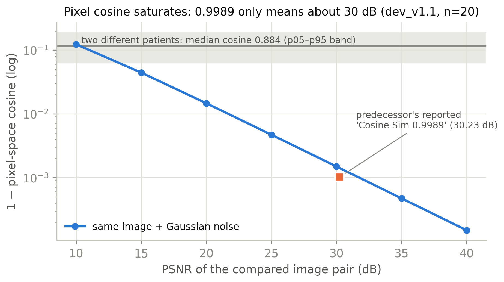

* `[事實]` 前作程式計算的是 base 流程輸出與加解密流程輸出的影像 cosine，沒有用到任何 latent；解密端的 `samples` 是第 3 步的偽健康影像（`reports/metric_semantics.md` §1）。
* `[事實]` 影像只會正向縮放時，cosine 就能等於 1：y=0.5x 時 cosine=1，PSNR 卻只有 10.79 dB（W1-T6）。
* `[推定]` 在加性、近正交誤差下，像素 cosine 只是 PSNR 的單調函數（W1-F2）。因此論文不得把前作的 0.9989 稱為 latent 一致性或零失真。

#### (d) 可逆性基線與存檔歸因（E2.5、AF-024）

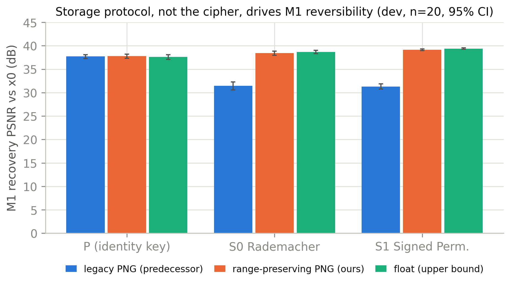

| 還原對 x0 PSNR（dB，20 張平均 [95% CI]） | legacy PNG（前作） | range-preserving PNG（本專案） | float（上限） |
|---|---|---|---|
| P（恆等金鑰） | 37.71 [37.25, 38.07] | 37.81 [37.32, 38.19] | 37.62 |
| S0 Rademacher | 31.47 [30.60, 32.30] | 38.44 [37.98, 38.85] | 38.70 |
| S1 Signed Perm. | 31.30 [30.75, 31.89] | 39.17 [38.98, 39.34] | 39.40 |

（數值出自 W1-T8；legacy PNG 與 float 欄併自 E2.5 run，見 W1-T7。）

* `[事實]` 保存精確 latent（T1）時，S0/S1 的 transform 逐位元可逆，生成器輸入與 P 相同，還原即為 42.23 dB；這是依構造成立，不是另外量測（W1-T7）。T1 的損失全部來自 DDIM 反演與生成本身。
* `[事實]` 加密匿名影像的值域約為 [−0.53, 1.0]，不在 [0,1]（`results/AF024_m1_storage_per_sample.csv` 的 `storage_lo`／`storage_hi`）。legacy PNG 讀回時等於對整張圖做一次未保存的亮度／對比仿射，再經反演與金鑰反運算放大（`reports/metric_semantics.md` §7）。
* `[事實]` S0/S1 的匿名影像對 x0 只有約 5.3–5.4 dB，視覺上已打亂（W1-T7、W1-F4）。
* `[結論]` 前作的可逆性瓶頸是存檔流程造成的工程失真，不是翻號／置換加密的限制（使用者 2026-10-10 裁決，AUD-20261010-05）。

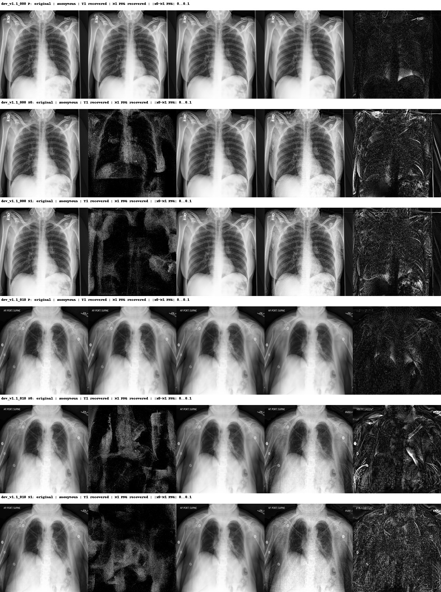

#### (e) latent 與影像指標的脫鉤（E1.4、E2.5）

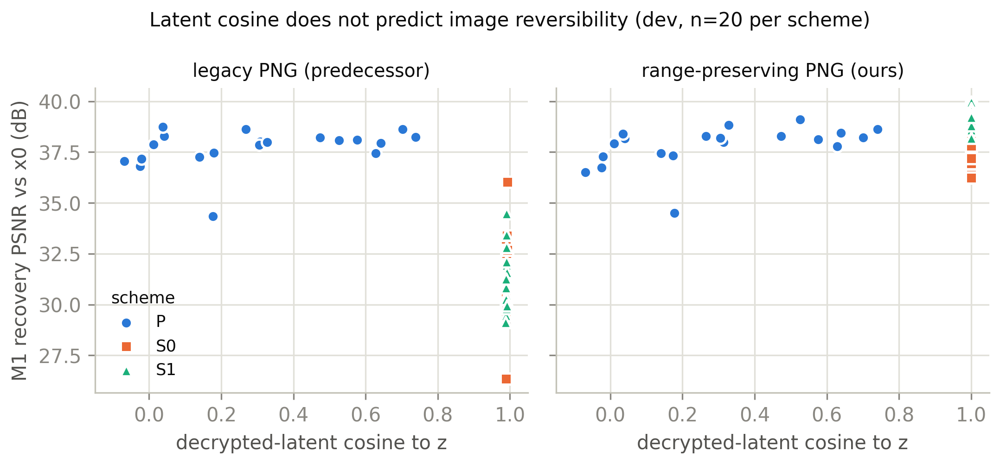

* `[事實]` 推論流程的 re-inversion latent cosine：第二次 inversion 共用同一份 t=0 雜訊時為 0.906，屬樂觀上限；雜訊未知時只有 0.371（W1-T10）。
* `[事實]` 稽核方的方向敏感度診斷顯示：P 的 re-inversion 誤差（RMSE 約 1.13）與大幅白雜訊同級，影像卻幾乎不變；S0 的解密誤差小很多（RMSE 0.132），影像影響卻與同大小白雜訊相當（AUD-20261010-02 §2）。
* `[推定]` 生成器是多對一的；誤差落在不敏感方向時，latent 差很多、影像幾乎一樣。各方向等權的 latent 距離因此無法預測影像可逆性。

#### (f) 可重現性與成本（E0.1、E1.2、E2.3）

* `[事實]` E0 canonical preflight 中，SOT-WHT 在 d=4,096 的 float32 bit-exact 為 100/100，d=65,536 為 97/100，float64 MaxAbs 2.44e-14；WHT 保留 norm，norm-only gallery Top-1=1.0（W1-T3）。舊的 31/32、98/100 與 Householder 表已標為 historical。
* `[事實]` 學長加密流程每張影像一個完整來回：batch 1 為 15.55 s，batch 8 為 11.07 s（W1-T9）。正式實驗固定 batch 1，N=200 的 E2–F9 預算上限為 22.29 GPU 小時（`reports/compute_budget.md`）。
* `[事實]` E2.3 cache 以 batch 1 抽樣重算，security_v1 20/20、dev 5/5 逐位元相同（W1-T5）。

### 1.4 論文可用素材（`appendix/week1/`）

| 編號 | 內容 | 建議用途 | 建議章節 |
|---|---|---|---|
| W1-F1 | 三種存檔協定下的 M1 還原 PSNR | 正文 | Results／可逆性歸因 |
| W1-F2 | 像素 cosine 對 PSNR、不同病人基準與前作 0.9989 | 正文 | 對前作指標的評析 |
| W1-F3 | 解密 latent cosine 對影像 PSNR（兩種存檔） | 正文 | Results／指標選擇 |
| W1-F4 | P/S0/S1 定性對照（原圖、匿名、T1、M1、差異） | 正文 | Results／定性比較 |
| W1-F5 | 恆等金鑰 P smoke（含局部幻覺觀察） | 附錄 | P 基線 |
| W1-F6 | 推論流程 smoke | 僅內部 | — |
| W1-T1 | 環境、checkpoint、diffusion 與前處理設定 | 附錄 | Experimental setup |
| W1-T2 | dev_v1.1／security_v1 組成與 split hash | 正文 | 資料 |
| W1-T3 | E0 canonical preflight | 附錄 | 前置可行性 |
| W1-T4 | E2.2 前作逐位元重現 | 附錄 | 前作重現 |
| W1-T5 | E2.3 latent cache 與重算 | 附錄 | 可重現性 |
| W1-T6 | 像素 cosine 基準與反例 | 正文 | Metric semantics |
| W1-T7 | E2.5 前作可逆性基線主表 | 正文主表 | Results |
| W1-T8 | AF-024 三種存檔對照（W1-F1 的數值表） | 正文 | Results／可逆性歸因 |
| W1-T9 | 加密流程計算成本 | 附錄 | 計算成本 |
| W1-T10 | 推論流程 re-inversion（共用／未知雜訊） | 僅內部 | — |

完整圖說草稿、來源 SHA-256 與 run ID 見 `appendix/week1/MANIFEST.csv`。

### 1.5 決策紀錄

| 日期 | 決定 | 出處 |
|---|---|---|
| 10-08 | `[決定]` Pillow 回復為學長 requirements 的 8.4.0；所有指令經 `scripts/run_cfg_ddim.sh`（停用 user-site） | AF-004 |
| 10-08 | `[決定]` formal split 採方案 (a)：重現學長抽樣並排除其病人 | AF-012 |
| 10-08 | `[決定]` formal N 維持 200；擴大時另建 `security_v2` | AF-016 |
| 10-08 | `[決定]` 實作方可代寫 WORKFLOW／PROPOSAL，內容須與使用者裁決一致 | AUD-20261008-03 |
| 10-09 | `[決定]` 主表沿用學長生成設定 guidance −1（y=0 條件、無 CFG 混合），不改成無條件 | AF-018、AUD-20261009-02 |
| 10-09 | `[決定]` 由 Claude 擔任實作與測試方，依 loop spec 逐子任務 commit | PROGRESS 2026-10-09 |
| 10-10 | `[決定]` T2-WB `Inconclusive` 規則：攻擊成功照實報告；未成功才看各方案專屬正控制 | AUD-20261010-02 |
| 10-10 | `[決定]` 影像指標維持不 clip，只在報告中註明 | AF-023 第 6 點 |
| 10-10 | `[決定]` M1 存檔須保存影像實際值域；前作 ~31 dB 歸因於存檔流程 | AUD-20261010-05、AF-024 |
| 10-10 | `[決定]` P/S0/S1/S2a/S2 兩種存檔欄都跑；對外以 range-preserving 欄為主結果 | PROGRESS 2026-10-10 |
| 10-10 | `[決定]`（實作方）正式 pass 固定 batch 1 | `reports/compute_budget.md` |

### 1.6 稽核狀態

* 稽核輪次：AUD-20261008-01 至 AUD-20261010-07，共 13 輪。
* Finding：AF-001～AF-025 共 25 筆，已關閉 23 筆。
* 仍開立：
  * AF-024（MAJOR）：只剩 HMAC 涵蓋 lo/hi，排在 D5。
  * AF-025（MAJOR）：保存值域也會幫到攻擊者，A4／D7 須兩欄並列並測 norm 與 lo/hi 旁道。稽核方 dev 實測，norm-only T2-WB 從 legacy PNG 的 1–2/20 升到 range-preserving 的 14–18/20（AUD-20261010-07），處置方向待使用者裁決。

### 1.7 限制與未解問題

* dev 只有 20 張；E2.5 與 AF-024 的結論在 dev 上成立，正式數字以 security_v1（N=200）為準。
* T2-WB 攻擊尚未在 security_v1 實測；本週只建立了它的前提，即攻擊者能取得的 latent 保真度。
* `[觀察]` M1 還原影像在少數病例出現原圖沒有的細小字樣狀紋理（W1-F4、W1-F5），屬生成模型的局部幻覺，尚未量化。
* runtime 數字在 GPU 獨占時量測；與其他程序共用 GPU 時速度約慢 2.4 倍（`results/perf_probe_batch1.json`）。
* AF-025 的處置方向待使用者裁決，候選包括把 lo/hi 放進加密 payload、加入以金鑰導出的 norm 擾動，或接受為已知限制。

### 1.8 下週計畫（Week 2，10-12～10-18）

* A3.1–A3.4：前作金鑰空間、小空間暴力搜尋、S0/S1 不變量、T1 gallery linkage。
* A4.1–A4.5：T2-WB inversion 與 magnitude gallery（兩種存檔欄，加測 norm-only 與 lo/hi 旁道）、KPA、CPA、tamper baseline。
* P3.1、P4.1：攻擊示意圖與 M1 攻擊素材包。

---

## Week 2（2026-10-12～10-18）｜Track A 攻擊：金鑰空間、幅值不變量與 T1／T2-WB／KPA／CPA／tamper（A3、A4、P3、P4）

### 2.1 範圍與狀態

| 子任務 | 內容 | 稽核判定 | 主要 commit |
|---|---|---|---|
| A3.1 | 前作有效金鑰空間審計（上界 vs 攻擊工作量） | Achieved（AUD-20261012-03） | `0a1042e`、`39b290c` |
| A3.2 | 小空間暴力搜尋＋唯密文可區分性 | Achieved（AUD-20261012-03） | `da7d940`、`deb1c3b`、`1ee1994` |
| A3.3 | S0／S1 幅值與範數不變量量化 | Achieved（AUD-20261011-01） | `ab2a221` |
| A3.4 | T1 精確 latent magnitude gallery linkage | Achieved（AUD-20261011-01） | `188eaf9`、`401c4e9` |
| A4.1 | T2-WB inversion（匿名影像重新反演） | Achieved（AUD-20261012-05） | `ed60420`、`cd6ba7e`、`4eb26b0` |
| A4.2 | T2-WB magnitude gallery（兩種存檔、norm 旁道） | Achieved（AUD-20261012-05／-13-01） | `859dc8e`、`a5b8896` |
| A4.3 | 已知明文攻擊（KPA）還原金鑰 | Achieved（AUD-20261012-05） | `6213025` |
| A4.4 | 選擇明文攻擊（CPA）重建解密映射 | Achieved（AUD-20261013-01） | `7b7b9b8`、`b1423f2` |
| A4.5 | 竄改測試（container／latent 與部署路徑） | Achieved（AUD-20261013-01） | `9323734`、`3208e8d`、`764b432` |
| P3.1 | 攻擊示意圖（固定 dev 病例） | Achieved（MINOR 殘留，AUD-20261012-04） | `91bf0ff`、`257160e`、`e8e1ac3` |
| P4.1 | Track A 攻擊素材包（claim→證據） | Achieved（AUD-20261013-01） | `04a9025`、`341e319` |

* **G1：稽核方判定可進入**（A3／A4 findings 全關閉，AUD-20261013-01）；正式 Gate 複驗排在 Week 3 初。
* 本週涵蓋 A3–P4 工作：`188eaf9`（A3.4，10-10）起至 `9750d8f`（HEAD，10-13），其中 `f3df7d6` 為 Week 1 摘要 commit（A3 的程式在 Week 1 摘要前已先行提交）。

### 2.2 本週重點

1. `[事實]` **前作的有效金鑰遠小於名目空間。** S0 金鑰上界 32 bits、S1 64 bits（password 模式為兩組獨立 32-bit 種子）；但已知一對明密文時完整配對搜尋為 0 bits——加密是逐座標 `c = P(k⊙z)`，在 mask=1 的座標上 `k=sign(c⊙z)` 直接讀出（W2-T1）。唯密文 seed 搜尋也只有 S0≈2^32、S1≈2^33（W2-T1）。
2. `[事實]` **幅值與範數是金鑰無關的不變量。** S0 的逐座標 |z|、S1 的 sorted|z| 在合成與真實 latent 上皆逐位元相等（最大差 0.0），||z|| 的 float64 相對誤差 ≤8.02e-16；負控制（不同 latent）差值明顯非零（W2-T2）。這直接構成無金鑰的鏈結攻擊面。
3. `[事實]` **精確 latent（T1）下 magnitude linkage 達上限。** security_v1 200×200 gallery，S0 以 |z|、S1 以 sorted|z| 的 Top-1 皆 1.00，random 基線 1/200、shuffle 負控制 ≤0.01（W2-F1、W2-T3）。
4. `[事實]` **只拿到匿名影像重新反演（T2-WB）仍可鏈結。** 前作實際部署的 legacy PNG 下，S0 以 |z| Top-1=1.00、S1 以尺度不變 sorted|z| Top-1=0.465；range-preserving 參考欄 S1 升到 0.995（W2-F3、W2-T5）。攻擊者重新反演所得 latent 對原 latent cosine 為 legacy 0.990／range 0.9997（W2-T4）。
5. `[事實]` **一對（S0）或兩對（S1）已知明文即可還原整把金鑰；固定金鑰下單次查詢即可重建解密映射。** KPA：S0 單一對逐位元還原並對 held-out 密文精確解密，S1 因 float32 幅值重複需兩對（W2-T6）；CPA：對全新明文的重建 max-abs 誤差 0.0（W2-T7）。
6. `[事實]` **前作沒有任何完整性檢查。** container／latent 層 30 種竄改全部被接受（無拒絕），端到端部署路徑翻一個存檔像素同樣被接受且輸出有限（W2-T8、W2-T9）。
7. `[結論]`（方法學）**尺度不變 scorer 是必要的（AF-033）。** 未正規化的 sorted_abs 受共用尺度偏差影響，會低估 S1 legacy 的可鏈結性（0.19）；改用除以自身 L2 範數的 sorted_abs_unit 後得到 0.465，且規則在 dev 上凍結、不看 formal（W2-T5）。

### 2.3 實驗結果與分析

#### (a) 金鑰空間與唯密文可區分性（A3.1、A3.2）

* `[事實]` S0 金鑰由 `sha256(pw)[:4]` 產生的 32-bit 種子決定，S1 的符號與置換在 password 模式下來自兩組獨立 32-bit 種子（`+'_permutation'`），上界 64 bits；integer-seed 模式兩者共用一個 32-bit 種子（W2-T1，附前作行號）。
* `[事實]` 唯密文下，單一密文 latent 對真實種子的分數遠高於錯誤種子：S0 的真實種子 37.0σ、S1 置換階段 14.6σ，相對錯誤候選 max ≤4.2σ（reduced space，W2-T1 basis）。全樣本檢查 E7：S0 200/200、S1 置換階段 199/200 security_v1 latent 超過 2^32 門檻（最弱 security_v1_0018）。
* `[推定]` 外推到 2^32／2^33 個錯誤候選（Gaussian-tail）；此為外推，非逐一列舉（W2-T1）。
* `[決定]` method note 與表格欄位區分「金鑰上界」與「攻擊工作量」，`kpa_full_pair_search_bits=0`（AF-026，AUD-20261012-03）。

#### (b) 幅值不變量（A3.3）

* `[事實]` S1 的逐座標幅值在 ≥0.99997 的座標被置換改變（幅值確實被打散），但 sorted|z| 仍逐位元相等；float32 範數相對誤差 ≤3.68e-07，以 `math.fsum` 計的平方和精確相等（W2-T2）。
* `[推定]` 這些不變量不依賴金鑰，使無金鑰的幅值比對成為可行攻擊面；A3.4／A4.2 以 gallery 實測（W2-T2 conclusion）。

#### (c) T1 精確 latent linkage（A3.4）

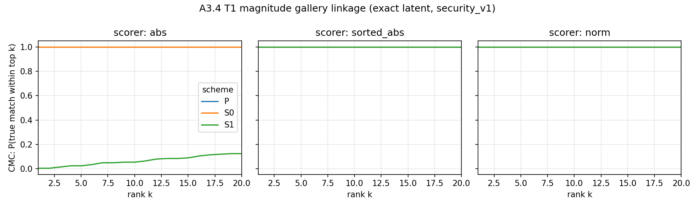

* `[事實]` P／S0／S1 在指定 scorer（S0=abs、S1=sorted_abs）下 Top-1=1.00、mAP=1.00、中位 rank 1；唯一例外是 S1+abs（未排序），Top-1=0.005 等同隨機，印證置換確實打散了逐座標幅值（W2-T3）。
* `[事實]` norm-only 在 T1（精確 latent）下 P／S0／S1 皆 Top-1=1.00——精確 latent 的範數逐位元保存（W2-T3）。

#### (d) T2-WB 重新反演 linkage（A4.1、A4.2）

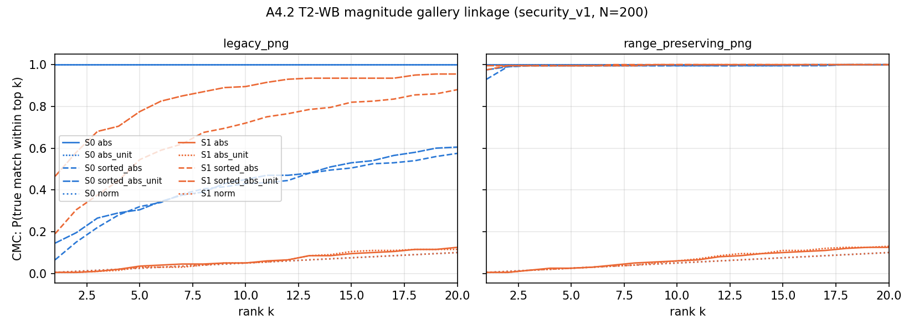

| T2-WB Top-1（security_v1 200×200，指定 scorer） | legacy PNG（前作部署） | range-preserving PNG（參考） |
|---|---|---|
| S0（abs） | 1.000 [0.981, 1.000] | 1.000 [0.981, 1.000] |
| S1（sorted_abs_unit，尺度不變） | 0.465 [0.397, 0.534] | 0.995 [0.972, 0.999] |
| norm-only（校正後） | 不顯著 | S0 0.255／S1 0.285（attack_success） |

（數值出自 W2-T5；校正 norm-only 以 dev 凍結的 norm bias 比例校正後比對。）

* `[事實]` 攻擊者重新反演所得 latent 的保真度：legacy PNG cosine 0.990、|z| Pearson 0.975；range-preserving cosine 0.9997、Pearson 0.999（W2-T4）。存檔保存值域同時提高攻擊者的 latent 品質。
* `[事實]` 校正後 norm-only 僅在 range-preserving 欄顯著（S0 0.255／S1 0.285），legacy 欄不顯著；S0／S1 在 legacy 欄的 norm-only 與正控制皆判 `linkage_not_significant_positive_control_passed`（W2-T5）。
* `[決定]` 前作部署欄為 legacy PNG（不保存值域），range-preserving 僅作「存檔方式影響」參考；S0／S1 的保存 vs 不保存對比**不用來裁決 AF-025**，依據是 D7 的 S2a／S2 跨存檔攻擊（AUD-20261012-05）。

#### (e) KPA／CPA（A4.3、A4.4）

* `[事實]` KPA：d=65536 真實 latent，S0 單一對即逐位元還原金鑰、held-out 密文解密 bit-exact；S1 單一對因 114–150 個 float32 幅值並列座標無法定序（held-out 不匹配率 ~0.001），兩對即精確還原（W2-T6）。
* `[事實]` CPA：固定金鑰前提下，d=4096 全基底查詢可重建整個解密線性映射；但前作逐座標結構使實際只需 1 次查詢，對全新明文 max-abs 誤差 0.0（d=4096 與 d=65536 真實金鑰皆然，W2-T7）。
* `[決定]` CPA d=65536 改為實測、S2 的 WHT 推論標 `[推定]`；補負控制（金鑰 A 的映射解金鑰 B、per-query 換金鑰、S1 查全 1 無法得 π）（AF-035，AUD-20261013-01）。

#### (f) 完整性（A4.5）

* `[事實]` container／latent 層：S0／S1 × 5 種竄改（翻符號、高斯雜訊、改存檔 hi、改存檔像素、legacy 存檔像素）× 3 筆，共 30 列全部 accepted、無拒絕（W2-T8）。
* `[事實]` 部署路徑：匿名影像→legacy 存檔→DDIM 反演→逆金鑰→生成，翻一個存檔像素 +128，2 筆皆 accepted、輸出有限、與未竄改部署不同（PSNR 49.8／53.5 dB，W2-T9）。
* `[結論]` 前作沒有 nonce、沒有 MAC，無法偵測任何竄改（T4）。

### 2.4 論文可用素材（`appendix/week2/`）

| 編號 | 內容 | 建議用途 | 建議章節 |
|---|---|---|---|
| W2-F1 | T1 magnitude gallery CMC | 正文 | Results／T1 linkage |
| W2-F2 | 攻擊示意圖（固定 dev 病例、幅值差 symlog） | 正文 | Method／攻擊示意 |
| W2-F3 | T2-WB magnitude gallery CMC | 正文 | Results／T2-WB linkage |
| W2-T1 | 前作有效金鑰空間審計 | 正文 | Results／金鑰空間 |
| W2-T2 | S0／S1 幅值與範數不變量 | 正文 | Results／不變量 |
| W2-T3 | T1 magnitude gallery 主表 | 正文主表 | Results |
| W2-T4 | T2-WB 攻擊者 latent 保真度 | 附錄 | Results／T2-WB |
| W2-T5 | T2-WB magnitude gallery 主表（含 norm 校正） | 正文主表 | Results |
| W2-T6 | KPA 金鑰還原 | 正文 | Results／KPA |
| W2-T7 | CPA 解密映射重建 | 正文 | Results／CPA |
| W2-T8 | 竄改 baseline（container／latent） | 正文 | Results／完整性 |
| W2-T9 | 竄改 deployment（端到端） | 附錄 | Results／完整性 |
| W2-T10 | Track A 攻擊素材包 11 條 claim | 正文 | Method／攻擊素材包 |

完整圖說草稿、來源 SHA-256 與 run ID 見 `appendix/week2/MANIFEST.csv`。

### 2.5 決策紀錄

| 日期 | 決定 | 出處 |
|---|---|---|
| 10-11 | `[決定]` AF-026 須在 A3.1 判 Achieved 前關閉；AF-027 須在 G1 前完成 | AUD-20261011-01 |
| 10-11 | `[決定]` S1 唯密文可區分性以 reduced space 實驗佐證，外推標 `[推定]` | AUD-20261011-02 |
| 10-12 | `[決定]`（實作方）開啟 subagent 可不逐次詢問；>30 分鐘 GPU 須先取得使用者 go／no-go | `CLAUDE.md`、[[working-rules]] |
| 10-12 | `[決定]` T2-WB 指定 scorer 改用尺度不變版（abs_unit／sorted_abs_unit），規則在 dev 凍結 | AF-033 |
| 10-12 | `[決定]` AF-025 處置改依 D7 的 S2a／S2 跨存檔攻擊結果與使用者裁決；S0／S1 對比不作依據 | AUD-20261012-05 |

### 2.6 稽核狀態

* 稽核輪次：AUD-20261011-01 至 AUD-20261013-01，共 10 輪。
* 本週開立 finding：AF-026～AF-036 共 11 筆。
* 已關閉：AF-026、AF-027、AF-028、AF-029、AF-031、AF-032、AF-033、AF-034、AF-035、AF-036（AUD-20261013-01 判 A3／A4 findings 全關閉）。
* 仍開立（皆屬後續階段）：
  * AF-024（MAJOR）：只剩 HMAC 涵蓋 lo/hi，排在 D5。
  * AF-025（MAJOR）：處置依 D7 的 S2a／S2 跨存檔攻擊比較與使用者裁決。
  * AF-030（MAJOR，SPEC）：S2 金鑰材料須直接由 CSPRNG 產生、password 模式用記憶體困難 KDF，排在 D5／D6。
* `[結論]` 稽核方判定 A4.1–A4.5、P4.1 全部 Achieved，可進入 G1 與 Week 3 D5（AUD-20261013-01）。

### 2.7 限制與未解問題

* 唯密文 seed 搜尋的 2^32／2^33 工作量是 Gaussian-tail 外推，非逐一列舉（W2-T1）。
* KPA／CPA 的 d=65536 結果各 3 筆真實 latent，屬診斷規模；主結論（S0 一對、S1 兩對、CPA 1 次查詢）在 d=4096 合成與 d=65536 真實上一致（W2-T6、W2-T7）。
* T2-WB 的 range-preserving 欄是前作未採用的存檔方式，只作對照；AF-025 尚未裁決，須待 D7 的 S2a／S2 結果。
* P3.1 圖仍有 MINOR 殘留（AF-028 第 4 點：第二列宜改畫同一人 z−S0／z−S1 恆為 0 的對照），不影響結論，於論文製圖時處理。
* lo/hi 旁道在每病人單筆 record 下標 `not_evaluable`，需不同影像的具標籤 enrollment 才能評估。

### 2.8 下週計畫（Week 3，10-19～10-25）

* G1：Week 2 baseline 的正式 Gate 複驗。
* D5：S2 金鑰管線（HKDF／CSPRNG、nonce、container、HMAC；對應 AF-024、AF-030）。
* 準備 D6／D7：S2a／S2 的跨存檔（保存值域 vs 不保存）攻擊比較，作為 AF-025 的裁決依據。

---

## Week 3（2026-10-19～10-25；於 10-13 提前完成 D5）｜Track D 防禦基礎：金鑰管線、nonce 與 authenticated container（D5）

### 3.1 範圍與狀態

| 子任務 | 內容 | 稽核判定 | 主要 commit |
|---|---|---|---|
| D5.1 | 隨機 master key 與明確的 password mode | Achieved（AUD-20261013-03） | `9e578dd` |
| D5.2 | HKDF-SHA256 domain separation | Achieved（AUD-20261013-03） | `9e578dd` |
| D5.3 | ChaCha20 signs 與無 modulo bias permutation | Achieved；AF-037 須在 D6 整合前修正 | `9e578dd` |
| D5.4 | 持久化 atomic nonce registry | Achieved（AUD-20261013-03） | `9e578dd`、`16ff619` |
| D5.5 | strict authenticated container schema | Achieved（AUD-20261013-03） | `9e578dd` |
| D5.6 | HMAC-SHA256 與 verify-before-open | Achieved；AF-024 CLOSED | `9e578dd`、`16ff619` |
| D5.7 | no-pickle raw key format | Achieved（AUD-20261013-03） | `9e578dd` |

* **D5.1–D5.7：Achieved；稽核判定 `PASS WITH FINDINGS`**（AUD-20261013-03），可以進入 D6。
* 本週 D5 程式與 clean evidence：`9e578dd..16ff619`。A4.6、協作規則與 sandbox 維護不列入本 D5 週報的研究成果。

### 3.2 本週重點

1. `[事實]` **S2 的金鑰材料已改為標準密碼學管線。** 預設 master key 由 OS CSPRNG 產生，完整 HKDF-SHA256 subkey 直接驅動 ChaCha20；沒有把 HKDF 輸出截成 Python／NumPy／Torch 的短 seed。master key 與 subkey 為 256 bits，per-image nonce 為 128 bits（W3-T1）。
2. `[事實]` **nonce reuse 由持久化 constraint 阻止，而非只靠碰撞機率。** clean-HEAD evidence 中 100,000 個 nonce 全部唯一、collision=0，且同一 master-key scope 的顯式重用被拒絕；registry 不記錄 raw nonce／key（W3-T2）。
3. `[事實]` **容器把 M1 值域 metadata 納入完整性保護。** MAC 涵蓋 nonce、parameters、AAD、storage protocol、quantization、float32 lo/hi、payload hash 與 ciphertext bytes；只有驗證成功才會呼叫 opener（W3-T1、W3-T3）。
4. `[事實]` **tamper matrix 全部符合預期。** 未竄改容器接受且 opener 呼叫一次；wrong key 與其餘 12 種 tag／header／metadata／ciphertext 竄改全部拒絕，opener 次數為零，對外錯誤統一為 `authentication failed`（W3-T3）。
5. `[結論]` D5 已補上前作最明確的工程缺口：短 seed、跨影像固定金鑰材料、沒有 nonce reuse 防護、沒有完整性驗證與 pickle-capable key loading。這是 D6 實作 SOT transform 的底層元件，**尚不能單獨宣稱 S2 端到端安全**。

### 3.3 實驗結果與分析

#### (a) 金鑰來源、domain separation 與 CSPRNG（D5.1–D5.3）

* `[事實]` 預設路徑只接受固定長度的隨機 master key；password mode 是明確選項，使用 scrypt，且 manifest 會記錄參數。round 的 sign-pre、perm、sign-post 與 MAC 使用不同 label，避免跨用途重用 subkey（W3-T1）。
* `[事實]` permutation 使用 ChaCha20 byte stream 驅動 Fisher–Yates，抽樣採 rejection sampling；AST guard 同時禁止 crypto key path 呼叫非密碼學 seed API（W3-T1；AUD-20261013-03）。
* `[限制]` AF-037 發現 ChaCha20 IV 目前把 image nonce 的前段解讀成初始 counter；極端 counter 會造成決定性的可用性失敗。它 fail closed、不影響機密性，但必須在 D6 使用此 PRNG 前固定 counter、更新向量並複驗。

#### (b) per-image nonce registry（D5.4）

| clean-HEAD nonce evidence | 結果 |
|---|---|
| 隨機發行 | 100,000／100,000 唯一 |
| 碰撞 | 0 |
| 同 scope 顯式重用 | 拒絕 |
| 相同 nonce、不同 master scope | 可登記 |
| artifact 保存 raw nonce／key | 否 |

（數值與 provenance 出自 W3-T2。）

* `[事實]` SQLite `PRIMARY KEY(scope, nonce)` 提供跨 thread／process／restart 的 atomic check-and-insert；scope 是 master-key keyed fingerprint，不存 raw master key（W3-T1、W3-T2）。
* `[限制]` registry 的存在不會自動約束所有呼叫端；D6 必須讓正式加密流程只能使用 `NonceRegistry.issue()` 發出的 nonce，否則仍可能繞過 reuse gate（AUD-20261013-03）。

#### (c) authenticated container 與 HMAC（D5.5–D5.6）

* `[事實]` container 採 strict schema 與 canonical JSON；canonical 欄位禁止 float，M1 lo/hi 以精確 float32 bit pattern 表示。HMAC-SHA256 驗證成功後才進行 PNG lo/hi 一致性檢查與 plaintext opener（W3-T1）。
* `[事實]` W3-T3 的每個失敗案例皆 `accepted=False`、`opener_calls=0`，包含只改 record lo/hi、只改 PNG lo、同步改 PNG 與 record lo、以及 ciphertext byte。這關閉了 AF-024 剩餘的「HMAC 必須涵蓋 lo/hi、驗證前不得讀回」要求。
* `[結論]` 相較 Week 2 前作 baseline 的「竄改照常解密」，D5 已建立可測試的 fail-closed 邊界；但 D6 還要證明 transform 與 container 在真實 S2 流程中沒有繞過此邊界。

#### (d) key file 與可重現性（D5.7）

* `[事實]` key file 僅接受 raw key bytes，以 mode 0600 建立並用 `O_EXCL` 拒絕覆寫；長度不符或 trailing bytes 皆拒絕，loader 不使用 pickle／`torch.load`／`np.load`（W3-T1）。
* `[事實]` D5 正式 evidence 由 clean tracked HEAD 產生，記錄 source commit 與 script SHA-256；稽核方獨立重跑 security suite、KDF／ChaCha 向量、nonce 與容器控制流均通過（AUD-20261013-03）。
* `[限制]` AF-038 指出新增的密碼套件與相依套件尚未凍結到 Week 3 環境快照；須在 D6 前補齊，不覆寫 Week 1 baseline。

### 3.4 論文可用素材（`appendix/week3/`）

| 編號 | 內容 | 建議用途 | 建議章節 |
|---|---|---|---|
| W3-T1 | D5.1–D5.7 key pipeline／container 設計摘要 | 正文 | Method／S2 key pipeline |
| W3-T2 | nonce registry clean-HEAD evidence | 正文 | Results／nonce reuse |
| W3-T3 | authenticated container tamper matrix | 正文主表 | Results／完整性 |

本週沒有需要新增的圖。完整 caption、來源 SHA-256 與輸出 SHA-256 見 `appendix/week3/MANIFEST.csv`；連續重建兩次逐位元相同。

### 3.5 決策紀錄

| 日期 | 決定 | 出處 |
|---|---|---|
| 10-13 | `[決定]` 預設使用隨機 master key；password mode 只作明確選項，安全性仍取決於密碼熵 | D5.1、PROGRESS |
| 10-13 | `[決定]` 使用 `cryptography` 的 HKDF、ChaCha20 與 HMAC primitive，不自行實作密碼 primitive | D5 實作紀錄 |
| 10-13 | `[決定]` AF-025 不在 D5 裁決；待 D7 實測 S2a／S2 攻擊效果後再決定保護強度 | 使用者裁決、AUD-20261013-03 |
| 10-13 | `[決定]` AF-037 必須在 D6 接入 PRNG 前修正，避免先凍結錯誤 test vector | AUD-20261013-03 |

### 3.6 稽核狀態

* 稽核輪次：AUD-20261013-03；判定 `PASS WITH FINDINGS`，D5.1–D5.7 全部 Achieved，可進入 D6。
* AF-024：**CLOSED**。M1 lo/hi 已被 HMAC 涵蓋，只改 lo/hi 會在 opener 前被拒絕。
* AF-030：D5 部分完成；維持 **OPEN** 到 D6 證明 SOT 直接使用完整 CSPRNG material，並完成 wrong-key／wrong-nonce sanity control。
* AF-037：**OPEN／MINOR／CORRECTNESS**。ChaCha20 初始 counter 與 nonce 切分須修正後再接入 D6。
* AF-038：**OPEN／MINOR／REPRO**。須鎖定新增相依套件、建立 Week 3 環境快照並讓 run manifest 記錄密碼套件版本。
* AF-025：仍為 **OPEN**，關閉時點在 D7 與使用者裁決。

### 3.7 限制與未解問題

* D5 驗證的是獨立密碼與容器元件；尚未完成 D6 的 SOT transform 整合，因此不得宣稱已抵禦所有 KPA／CPA／T2-WB 或達到正式密碼學安全定義。
* AF-037 與 AF-038 必須先修復；尤其 AF-037 若拖到 D6 後才改，會使 D6 test vector 與證據全部重凍結。
* password mode 的現行 scrypt 成本低於稽核建議；預設隨機 key 不受此問題影響。若論文要主張 password mode 強度，需提高成本或改用 Argon2id，並報告效能取捨。
* nonce registry 目前是可用元件，不是 `seal_container` 的強制依賴；D6 的公開加密 API 必須消除繞過 registry 的路徑。
* canonical MAC 保護語意內容，但語意相同的非 canonical JSON 仍可能有不同檔案 hash；若後續 PACS 以檔案 hash 去重，需另決定是否強制輸入 bytes 本身為 canonical form。

### 3.8 下週計畫（Week 4）

* 先關閉 AF-037、AF-038：修正 ChaCha IV/counter、更新 frozen vector、鎖定依賴與新增 Week 3 environment freeze。
* D6.1–D6.4：把 D5 的 HKDF／CSPRNG material、per-image nonce 與 SOT transform 接成 S2a／S2，並確保正式入口不能繞過 nonce registry 或 authenticated container。
* 完成 AF-030 剩餘驗收：wrong-key／wrong-nonce sanity control 與 crypto path 靜態 guard。
* GPU 工作先跑小型 smoke 並估時；任何預估超過 30 分鐘的任務先交由使用者裁決。

---

## Week 4（2026-10-26～11-01；於 10-14 提前完成 D6）｜SOT structured transform 與 authenticated S2 整合（D6）

### 4.1 範圍與狀態

| 子任務 | 內容 | 稽核判定 | 主要 commit |
|---|---|---|---|
| D6.1 | normalized FWHT／SOT 與逆運算 | Achieved（AUD-20261014-01） | `9577ed5`、`b442b5a` |
| D6.2 | d=1,024 顯式矩陣正交性與多輪公式 | Achieved（AUD-20261014-01） | `b442b5a` |
| D6.3 | 合成 Gaussian 分布診斷 | Achieved（AUD-20261014-01） | `b442b5a` |
| D6.4 | 真實 latent 動差與匿名影像 quality | Achieved（AUD-20261014-01） | `b442b5a`、`abba1bc` |
| D6.5 | R=1–4／permutation on-off 消融與 dev 選型 | Achieved（AUD-20261014-01） | `173226e` |
| D6.6 | trace／basis／sparsity 結構診斷 | Achieved（AUD-20261014-01） | `b442b5a` |
| D6.7 | M1/M2 authenticated S2 dev integration | Achieved（AUD-20261014-01） | `9577ed5`、`4c99e2f`、`33df546` |
| 延伸比較 | P／S0／S1／S2a／S2 固定病例比較 | Achieved（實作方） | `ee4749c`、`4e979fb` |

* **G3：PASS**；D6.1–D6.7 全部 Achieved，AF-030 CLOSED（AUD-20261014-01）。
* 本週 D6 稽核範圍：`644bcfc..33df546`；五方法展示為 D6 完成後的延伸素材。

#### 更正 Week 3 狀態

* Week 3 發布時尚未複驗的 AF-037、AF-038，已在 AUD-20261013-05 全部 **CLOSED**，D5 最終判定為 **PASS**。依週報規範不回寫 Week 3 舊文，改於此處保留狀態演進。

### 4.2 本週重點

1. `[事實]` **SOT 數值實作正確，但 float32 不逐位元可逆。** d=65,536、R=1–4、有無置換的 float64 往返 MaxAbs 最差為 2.66e-15；float32 bit-exact rate 僅 8.60%–17.22%。d=1,024 顯式矩陣的正交誤差為 0、spectral norm error 為 8.88e-16（W4-T1）。
2. `[事實]` **Gaussian 理論不能直接外推到真實 latent。** 合成 N(0,1) 變換後 KS p=0.121（W4-F1、W4-T2）；真實 latent 的 mean shift 絕對值約 0.139–0.141、variance shift 約 0.0197，但 norm ratio 仍接近 1（W4-T3）。
3. `[決定]` **D7 暫選 R=1、permutation off。** 在 20 張 dev 中 original-|z| 與 sorted-|z| Top-1 均為 0.05，即 1/20 random baseline；置換使 CPU transform median 從 1.83 ms 增至 62.63 ms，未改善這兩種 scorer（W4-T4）。
4. `[事實]` **正交變換仍完整洩漏 norm。** 八組 R/P 的 norm-only Top-1 全為 1.0；增加輪數或 permutation 都無法消除此不變量（W4-T4）。此限制留待 D7 與 AF-025 裁決。
5. `[事實]` **authenticated S2 dev integration 通過。** 四病例 M2 decrypted latent MaxAbs 平均 7.75e-7；M1 decrypted latent cosine 平均 0.999811，重構影像 PSNR 39.37 dB、SSIM 0.9720，且四例均先驗證再 inversion（W4-F2、W4-T7）。
6. `[事實]` **固定積水病例中，S2a 與 S2 像素結果相同。** 兩者皆為 PSNR 38.345 dB、SSIM 0.9684；S2 的額外價值是 authentication／tamper rejection，而不是改變影像（W4-F3、W4-T8）。

### 4.3 實驗結果與分析

#### (a) 變換正確性與分布（D6.1–D6.4）

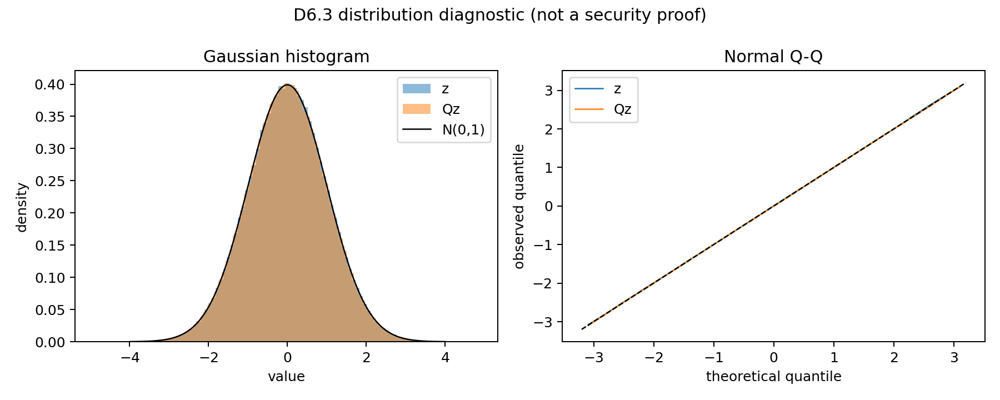

* `[事實]` D6.1 所有設定通過 float64 MaxAbs ≤1e-12 的預設門檻；float32 往返 MaxAbs 為 7.15e-7–1.43e-6，證明應以容差而非 bit-exact 作正確性判準（W4-T1）。
* `[事實]` 合成 Gaussian 變換後 mean=-0.00202、variance=0.99799、skew=-0.00201、excess kurtosis=-0.00115（W4-T2）。這只支持「與 Gaussian 相容」的診斷，不是機密性或匿名性的證明。
* `[事實]` 真實 latent 的同向量 cosine 均接近 0，而 norm ratio 的最大偏差為 3.58e-7；SOT 改變方向與座標統計，但正交性必然保留範數（W4-T3）。
* `[事實]` 20 張 × 8 組匿名影像的平均 PSNR 對 x0 約 5.21–5.35 dB、SSIM 約 0.0076–0.0128（W4-T6）。這表示匿名影像與原圖差異大，不表示仍具醫療可讀性。

#### (b) R／P 選型與結構限制（D6.5–D6.6）

* `[事實]` R=1/P off 已使 original-|z| 與 sorted-|z| Top-1 降至 dev random baseline 0.05；增加 R 沒有穩定改善，卻增加運算與 float32 誤差（W4-T4）。
* `[事實]` permutation on 在 R=1 的 median runtime 為 62.63 ms，off 為 1.83 ms；因此 dev 規則選擇成本較低的 R=1/P off（W4-T4）。
* `[限制]` dev 僅 n=20，0.05 的解析度不足以排除小幅殘留洩漏。trace、basis probe、sparsity 等結果只作結構診斷（W4-T5）；正式鑑別由 D7 的 N=200 與 adaptive probes 完成。

#### (c) S2 端到端整合（D6.7）

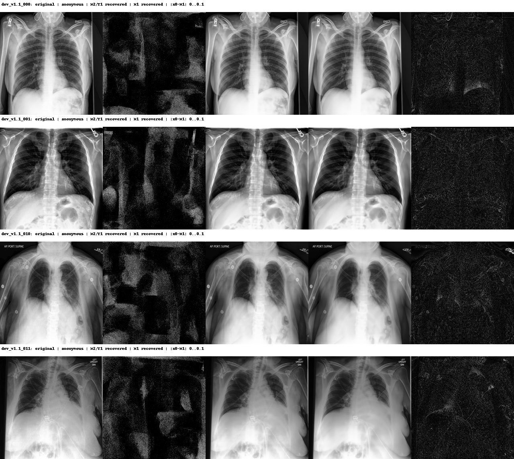

* `[事實]` S2 seal 強制使用 persistent nonce registry；open 固定先驗證 tag 才 decode／inversion／inverse。稽核方另以 wrong key、payload tamper 與跨 M1/M2 nonce reuse 獨立複驗，全部 fail closed（AUD-20261014-01；W4-T7）。
* `[事實]` 四病例 M1 PSNR 範圍 39.05–39.63 dB、SSIM 0.9630–0.9801；M2 decrypted latent cosine 平均約 1.0（W4-T7）。這是 dev integration 證據，不是 formal security 結果。

#### (d) 五方法固定病例展示

| 方法 | storage | PSNR (dB) | SSIM | L∞ | 最大 uint8 pixel 誤差 |
|---|---|---:|---:|---:|---:|
| P | legacy／丟值域 | 38.291 | 0.9713 | 0.1026 | 26 |
| S0 | legacy／丟值域 | 32.558 | 0.9428 | 0.6144 | 157 |
| S1 | legacy／丟值域 | 31.946 | 0.8865 | 0.4793 | 122 |
| S2a | range-preserving | 38.345 | 0.9684 | 0.4269 | 109 |
| S2 | range-preserving＋認證 | 38.345 | 0.9684 | 0.4269 | 109 |

（固定 `dev_v1.1_010` 單病例；完整精度與 runtime 見 W4-T8。）

* `[限制]` 此圖依使用者指定讓 P/S0/S1 使用 legacy、S2a/S2 使用 range-preserving，因此差異同時包含 transform 與 storage protocol，不能當成只隔離演算法的因果消融（W4-T8）。
* `[事實]` 五法 x0 raw-pixel cosine 均在 0.9990–0.9998，但 PSNR 橫跨 31.95–38.35 dB、L∞ 橫跨 0.103–0.614，重申 cosine 在高相似區會飽和（W4-T8）。

### 4.4 論文可用素材（`appendix/week4/`）

| 編號 | 內容 | 建議用途 | 建議章節 |
|---|---|---|---|
| W4-F1 | 合成 Gaussian 變換前後分布 | 附錄 | Results／distribution diagnostic |
| W4-F2 | S2 四病例 dev integration 圖 | 正文 | Results／S2 integration |
| W4-F3 | 五方法原圖／匿名圖／重構圖 | 正文 | Results／five-method comparison |
| W4-T1 | SOT 往返與正交性 | 附錄 | Method／SOT correctness |
| W4-T2 | Gaussian 統計與 KS 診斷 | 附錄 | Results／distribution diagnostic |
| W4-T3 | 真實 latent 動差與 norm | 正文 | Results／real-latent diagnostics |
| W4-T4 | R／P 消融、攻擊與 runtime | 正文主表 | Results／R/P ablation |
| W4-T5 | 結構診斷 | 附錄 | Results／structure diagnostic |
| W4-T6 | 160 次匿名生成 quality | 正文 | Results／anonymous-image quality |
| W4-T7 | authenticated S2 dev integration | 正文主表 | Results／S2 integration |
| W4-T8 | 五方法固定病例定量表 | 正文 | Results／five-method comparison |

完整 caption、來源 SHA-256、run ID 與輸出 SHA-256 見 `appendix/week4/MANIFEST.csv`；連續重建兩次逐位元相同。

### 4.5 決策紀錄

| 日期 | 決定 | 出處 |
|---|---|---|
| 10-14 | `[決定]` D7 候選固定為 R=1、permutation off；若 adaptive／structured probe 顯示弱點則重開 | D6.5、AUD-20261014-01 |
| 10-14 | `[決定]` AF-025 不以 D6 dev norm 結果直接關閉；依 D7 的 S2a／S2 跨存檔 formal 結果再裁決 | 使用者裁決、AUD-20261014-01 |
| 10-14 | `[決定]` 五方法展示中 P/S0/S1 用 legacy；S2a/S2 用 range-preserving，並明列此非單因子消融 | 使用者指定、W4-T8 |

### 4.6 稽核狀態

* AUD-20261013-05：D5 最終 **PASS**；AF-037、AF-038 CLOSED。
* AUD-20261014-01：D6.1–D6.7 **PASS**、G3 **PASS**，新 finding 0；AF-030 CLOSED。
* 目前只剩 AF-025 OPEN：正交變換的 norm leakage 與 storage trade-off 須由 D7 formal 攻擊結果和使用者裁決處理。

### 4.7 限制與未解問題

* D6.5 是 dev n=20 選型，不足以量測低於 5% 的殘留 linkage；R=1/P off 仍是候選，不是最終安全結論（W4-T4）。
* 所有正交方案都保留 L2 norm，D6 的八組 norm-only Top-1 均為 1.0；D7 必須在 N=200、兩種存檔與 adaptive calibration 下重測（W4-T4）。
* 匿名圖對原圖的低 PSNR／SSIM只代表差異大，不代表臨床價值或隱私充分；本週未做病灶分類／定位效用實驗（W4-T6）。
* 五方法表只有一張預先固定病例，適合定性展示，不可取代正式 N=200 統計（W4-F3、W4-T8）。
* 本方法不宣稱 IND-CPA、perfect security、lossless 或 AES 等級；D7 仍須測 T1/T2-WB、KPA/CPA、geometry、structured probe、repeat 與 tamper。

### 4.8 下週計畫（Week 5）

* D7.1–D7.3：以 security_v1 N=200 對 S2a／S2 重跑 T1、T2-WB 與保存／不保存值域比較，包含 norm-only adaptive calibration。
* D7.4–D7.7：cross-nonce KPA/CPA、geometry、structured probes、repeatability 與 authenticated tamper。
* 依 D7 formal 結果提交 AF-025 的保護強度選項給使用者裁決；必要時重開 R／P 選型。

---

## Week 5（2026-11-02～11-08；於 10-15 提前完成 D7 與 AF-025 補驗）｜S2 攻擊重跑、defense package 與固定 norm 修補（D7、P7、AF-025）

### 5.1 範圍與狀態

| 子任務 | 內容 | 稽核判定 | 主要 commit |
|---|---|---|---|
| D7.1 | S2 v1 的 T1／T2-WB formal 資料與雙存檔反演 | Achieved（AUD-20261014-02） | `f365944`、`03505c0` |
| D7.2 | original／sorted magnitude gallery attacks | Achieved（AUD-20261014-02） | `e2e29d2`、`03505c0` |
| D7.3 | adaptive norm attack 與 AF-025 量化 | Achieved（AUD-20261014-02） | `e2e29d2`、`03505c0` |
| D7.4–D7.8 | cross-nonce、geometry、structured probe、repeat、tamper | Achieved（AUD-20261014-02） | `e2e29d2`、`03505c0` |
| P7.1 | defense claim→evidence 素材包 | Achieved（AUD-20261014-02）；AF-025 延伸已複驗（AUD-20261015-01） | `03505c0`、`9c0f381` |
| AF-025 | 固定 norm S2 v2 與 formal 補驗 | **CLOSED**（AUD-20261015-01） | `78a9ba3`、`202c7fc`、`9c0f381` |

* **G4：通過**（AUD-20261014-02）。
* 本週實作 commit 範圍：`e2e29d2..9c0f381`。

### 5.2 本週重點

1. `[事實]` **S2 v1 已消除前作的主要 magnitude linkage，但仍完整保留 norm。** 在 formal security_v1 N=200 中，T1 original-|z|／sorted-|z| Top-1 分別為 0.010／0.005；T2-WB original-|z| 在兩種存檔皆為 0.010，多數其餘 scorer 為 0.005，而隨機基準為 0.005（W5-T2）。相反地，T1 norm-only Top-1 為 1.000（W5-T3）。
2. `[事實]` **保存值域提高反演品質，也讓 v1 的 norm 旁道可被利用。** T2-WB latent cosine 從 legacy 的 0.990134 提高到 range-preserving 的 0.999798（W5-T1）；用 dev-only bias 校正後，v1 range-preserving norm-only Top-1 為 0.250、Top-5 為 0.745，而 legacy Top-1 仍為 0.005（W5-T3）。
3. `[事實]` **per-image nonce 阻止已測的映射與 geometry 跨影像轉移。** d=1,024 的 same-nonce CPA／KPA 正控制 cosine 為 1.0，但跨 nonce cosine 約 0.00105、RMSE 1.412（W5-T4）；fixed-Q distance-signature Top-1 為 1.000，改成 per-image-Q 後為 0.005（W5-T5）。
4. `[事實]` **S2 的隨機性與完整性行為符合設計。** 同一 latent 重複變換的 nonce 與 protected payload 均 100/100 唯一（W5-T7）；S2 七種容器竄改全數拒絕，S2a 的無認證正控制不拒絕（W5-T8）。
5. `[決定]` **AF-025 採固定 norm v2，而不是接受 v1 的 norm leakage。** transform 前縮放到公開常數 C=248.261，真實 norm 與 M1 lo/hi 僅放在 AEAD private metadata；補驗後 T1 與 T2-WB norm-only Top-1 均為 0.005（W5-F2、W5-T9）。
6. `[事實]` **修補未破壞合法端的 latent 重構。** fixed-norm v2 的合法 private-range latent cosine 平均為 0.999797，95% CI [0.999794, 0.999800]，最小值 0.999729（W5-T10）。此數字只證明 latent 路徑正控制，影像品質仍須由 Q8 正式評估。

### 5.3 實驗結果與分析

#### (a) D7.1–D7.3：T2-WB 品質、magnitude 與 norm

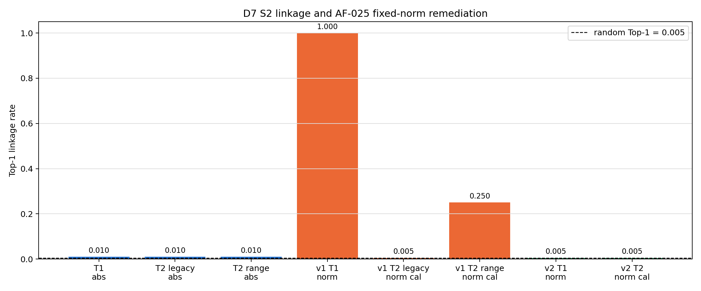

* `[事實]` D7.1 的兩種 storage 都完成 formal N=200；correct-decrypt gallery 正控制 Top-1 均為 1.0（W5-T1、W5-T13），所以低 magnitude linkage 不能歸因於整條 query pipeline 失效。
* `[事實]` S2 v1 的 original／sorted magnitude scorer 在 T1 與 T2-WB 大致落於 0.005–0.010 Top-1（W5-T2），相較前作 S0/S1 的已知不變量已有明顯改善；但這不代表沒有其他 adaptive attack。
* `[事實]` norm 是 v1 的反例：exact latent 可直接以 norm 完整鏈結；range-preserving storage 又使 T2-WB norm 估計足夠穩定，經只用 dev 凍結的校正後達 0.250 Top-1（W5-T3）。這是 AF-025 必須修補而不能只增加 SOT 輪數的實驗依據。

#### (b) D7.4–D7.7：nonce 隔離、geometry 與 probes

* `[事實]` d=1,024 full-basis CPA 與 full-rank KPA 在 same nonce 下可重建映射，最大誤差不超過 7.55e-15；把同一映射套到另一 nonce 後不再有效（W5-T4）。此為 synthetic diagnostic，不能外推為 d=65,536 端到端安全證明。
* `[事實]` fixed-Q 幾乎完整保存 pairwise cosine／distance，distance-signature Top-1 為 1.000；per-image-Q 的 pairwise cosine 最大差為 0.145，指定 linkage Top-1 回到 0.005（W5-T5）。因此每影像 nonce 是必要條件，不能退回全資料共用 transform。
* `[事實]` basis、constant、sparse probes 均產生有限輸出，且 v1 norm ratio 都是 1.0（W5-T6）。這些 probe 用來揭露結構與回歸錯誤，不構成安全證明。
* `[事實]` v1 重複 100 次的 off-diagonal ciphertext cosine 平均約 3.70e-5、最大約 0.0132（W5-T7）；fixed-norm v2 分別約 1.64e-5、0.0152，且仍為 100/100 nonce／payload 唯一（W5-T12）。

#### (c) D7.8：認證與竄改

* `[事實]` S2 對 tag、nonce、ciphertext、version、parameters、AAD 與 storage 共七類竄改全數 fail closed；S2a latent-value tamper 則被接受且輸出改變 0.03125（W5-T8）。authentication 改善的是完整性與錯誤處理，不會改變 S2a/S2 的匿名像素或 confidentiality。

#### (d) AF-025 裁決與 fixed-norm v2 補驗

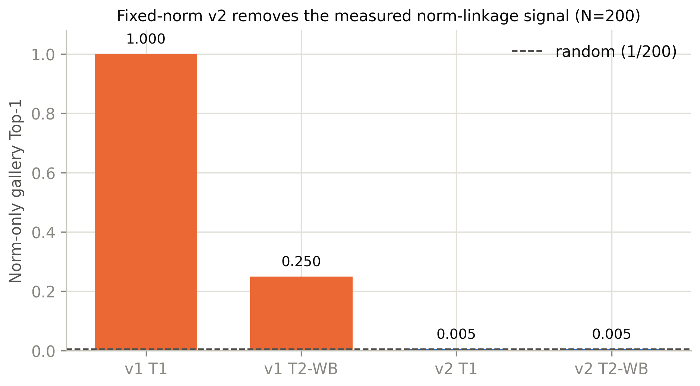

* `[決定]` 使用者於 2026-10-14 採固定 norm 方案：公開 protected norm 固定為 C=248.261；原始 norm 與合法 M1 重構需要的 lo/hi 改由 private AEAD metadata 保存，public PNG／storage record 不揭露 lo/hi。
* `[事實]` formal N=200 中，v2 的 T1 norm-only Top-1／Top-5 為 0.005／0.025；T2-WB raw 為 0.005／0.025，dev-calibrated 為 0.005／0.035；各列的隨機與負控制 Top-1 都是 0.005（W5-T9）。這支持「指定 norm linkage 已在此資料與威脅模型下降至隨機基準」，不支持 IND-CPA 或未知攻擊皆無效。
* `[事實]` float32 protected norm 對 C 的最大偏差為 1.49e-5；四種 float64 structured probe 的最大偏差約 1.93e-12（W5-T9、W5-T11）。因此固定 norm 不是只在表面 metadata 宣告，而是實際進入 transform 的 latent 已被正規化。
* `[事實]` v2 formal 每張平均匿名生成 7.744 s、攻擊者 inversion 7.679 s、合法端 inversion 7.679 s（W5-T10）。三個 diffusion 階段主導整體時間；這些數字不能單獨分離 fixed-norm、KDF、AEAD 與 HMAC 的微小成本，該分解留到 Q8.4。

#### (e) P7.1 defense package

* `[事實]` defense package 現有 10 條 claim，每條均包含 headline、來源檔 SHA-256 與適用範圍（W5-T13）。其中同時保留 v1 norm limitation 與 v2 remediation，避免用修補後結果覆蓋原始失敗證據。

### 5.4 論文可用素材（`appendix/week5/`）

| 編號 | 內容 | 建議用途 | 建議章節 |
|---|---|---|---|
| W5-F1 | D7／AF-025 gallery-linkage 總覽 | 正文 | Results／security evaluation |
| W5-F2 | v1 與 fixed-norm v2 的 norm attack 比較 | 正文 | Results／AF-025 remediation |
| W5-T1 | S2 v1 T2-WB 反演品質與 runtime | 正文 | Results／T2-WB inversion |
| W5-T2 | magnitude linkage 主表 | 正文主表 | Results／magnitude linkage |
| W5-T3 | S2 v1 norm leakage 主表 | 正文主表 | Results／AF-025 diagnosis |
| W5-T4 | cross-nonce KPA／CPA | 附錄 | Results／cross-nonce diagnostic |
| W5-T5 | fixed-Q／per-image-Q geometry | 正文 | Results／pairwise geometry |
| W5-T6 | v1 structured probes | 附錄 | Results／structured probes |
| W5-T7 | v1 同明文重複變換 | 附錄 | Results／repeat transform |
| W5-T8 | S2／S2a tamper matrix | 正文 | Results／integrity |
| W5-T9 | fixed-norm v2 linkage 主表 | 正文主表 | Results／AF-025 remediation |
| W5-T10 | v2 合法重構、攻擊者觀測與 runtime | 正文 | Results／correctness and cost |
| W5-T11 | v2 fixed-norm probes | 附錄 | Results／structured probes |
| W5-T12 | v2 同明文重複變換 | 附錄 | Results／repeat transform |
| W5-T13 | defense claim→evidence 索引 | 正文 | Method／defense package |

完整 caption、來源 SHA-256、run ID 與輸出 SHA-256 見 `appendix/week5/MANIFEST.csv`；連續重建兩次逐位元相同。

### 5.5 決策紀錄

| 日期 | 決定 | 出處 |
|---|---|---|
| 10-14 | `[決定]` D7 階段超過 30 分鐘的 GPU 任務已預先同意；仍須回報 run 狀態 | 使用者指示、PROGRESS W5 |
| 10-14 | `[決定]` AF-025 不接受 v1 norm limitation，採 option 2 固定 norm | AUD-20261014-04、使用者裁決 |
| 10-14 | `[決定]` 固定公開 C=248.261；真實 norm 與 M1 lo/hi 放入獨立 domain 的 AEAD private metadata | WORKFLOW §2.5、W5-T9 |
| 10-14 | `[決定]` vLLM 保持運行；先以小型 smoke 驗證 VRAM 共存，再執行 formal | 使用者裁決、PROGRESS W5 |
| 10-15 | `[決定]` formal N 維持 200，不因攻擊結果擴大樣本 | WORKFLOW §3.4、W5-T9 |

### 5.6 稽核狀態

* AUD-20261014-02：D7.1–D7.8、P7.1 **PASS**，G4 **PASS**，新 finding 0。
* AUD-20261014-03：獨立比較 AF-025 候選，建議固定 norm 方案；屬裁決證據，不取代 formal 補驗。
* AUD-20261014-04：記錄使用者正式採固定 norm。
* AUD-20261014-05：攻擊文件／工具範圍確認，未開新 finding。
* AUD-20261015-01：fixed-norm v2 獨立複驗 **PASS**，新 finding 0；AF-025 **CLOSED**。稽核方獨立確認 T1／T2-WB norm 結果、public PNG／record 不公開 lo/hi、HKDF domain separation、M1／M2 驗證順序與合法還原，且目前沒有未關閉的 MAJOR／MINOR finding（W5-F2、W5-T9～W5-T13）。

### 5.7 限制與未解問題

* D7 只涵蓋本研究列出的 magnitude、norm、geometry、cross-nonce、structured probe 與 tamper 測試；低於 random baseline 的觀察不等於 IND-CPA、perfect security 或對所有未知攻擊安全（W5-T2～W5-T9）。
* D7.4 的完整映射實驗是 d=1,024 synthetic diagnostic，尚未在 d=65,536 端到端情境顯式重建矩陣（W5-T4）。
* fixed-norm v2 的 formal 補驗確認 latent 正控制與指定 norm attack，但尚未完成 N=200 的影像 PSNR／SSIM／L∞ 主表；W5-T10 的 latent cosine 不可取代 Q8.1 影像品質。
* public PNG 不含 lo/hi 會使未持有 private metadata 的第三方無法恢復實際值域；這是刻意的隱私／部署取捨，PACS 如何綁定 public image 與 private recovery record 仍需在部署章節說明。
* runtime 來自與既有 vLLM 共用 GPU 的單次 formal run（W5-T10）；其數值包含資源競爭可能性，Q8.4 須把 diffusion 與 crypto 元件分開量測。
* AF-025 已經獨立複驗並關閉，但其結論仍限定於已測 norm attack 與本研究威脅模型；不得擴張成一般 IND-CPA 或未知攻擊皆無效（W5-T9）。

### 5.8 下週計畫（Week 6）

* Q8.1：完成 P/S0/S1/S2 的 formal reconstruction fidelity，報 latent 與影像指標及 CI。
* Q8.2：量測匿名影像差異、LPIPS、cosine 與 nearest-neighbor rank，並避免把影像差異直接等同臨床效用或隱私。
* Q8.3：正確／錯誤 key 與 nonce 並列，保留定量結果與固定案例圖。
* Q8.4–Q8.5：分解 transform、KDF、AEAD／MAC、diffusion 的 median／p95 runtime 與各類 storage overhead。
* P8.1：依預先固定、median、worst 三類病例建立 visual grid；先完成 pilot 並凍結設定，再進 Week 7 formal run。

---

## Week 6（2026-11-09～11-15；於 10-15 提前完成）｜重構品質、匿名性、錯誤金鑰、成本與固定選圖（Q8、P8）

### 6.1 範圍與狀態

| 子任務 | 內容 | 稽核判定 | 主要 commit |
|---|---|---|---|
| Q8.1 | P／S0／S1／S2 reconstruction fidelity 與 paired CI | Achieved（pilot；AUD-20261015-04、-05） | `e0723aa`、`74e495e`、`d791290`、`8d9e0b3` |
| Q8.2 | public-view 影像差異與 cosine nearest-neighbor | Achieved（pilot；AUD-20261015-04、-05） | `74e495e`、`8d9e0b3` |
| Q8.3 | S2 wrong-key／wrong-nonce 與 fail-closed 順序 | Achieved（pilot；AUD-20261015-04、-05） | `74e495e`、`8d9e0b3` |
| Q8.4 | transform、storage、diffusion、container runtime | Achieved（pilot；AUD-20261015-04、-05） | `74e495e`、`8d9e0b3` |
| Q8.5 | M1／M2 storage 分項 | Achieved（pilot；AUD-20261015-04、-05） | `74e495e`、`8d9e0b3` |
| P8.1 | fixed-label／lower-median／worst visual grid | Achieved（pilot；AUD-20261015-04、-05） | `74e495e`、`8d9e0b3` |

* Week 6 的工程與 N=20 dev pilot 已完成，且最新 mixed-deployment 版本通過獨立稽核；正式樣本數仍為 N=200，留在 Week 7，故本週不宣告 formal 統計結論。
* 最終主比較固定為 **P／S0／S1 使用前作 `legacy_png_handoff`，S2 使用 `range_preserving_private_range_v2`**；舊四方法全 range-preserving 結果保留為 storage-controlled attribution，不覆寫。

### 6.2 本週重點

1. `[事實]` **mixed-deployment 清楚呈現舊、新完整部署的重構差異。** M1 重構對 x0 的平均 PSNR 為 P=`37.708`、S0=`31.467`、S1=`31.305`、S2=`39.275 dB`；S2−S0 為 `+7.808 dB`，95% patient-bootstrap CI `[+6.980,+8.658]`（W6-T1）。
2. `[事實]` **+7.808 dB 不是 S2 加密本身的效果。** 在全 range-preserving attribution 中，P／S0／S1 為 `37.809／38.439／39.168 dB`；相對各自 range cell，legacy 使 P／S0／S1 約下降 `0.10／6.97／7.86 dB`，指出主要差異來自保存值域（W6-T1）。
3. `[事實]` **N=20 public-view linkage 只足以辨識 P 明顯未匿名化。** cosine NN Top-1／Top-5 為 P=`1.00/1.00`、S0=`0.05/0.25`、S1=`0.10/0.45`、S2=`0.00/0.15`；random expectation 為 `0.05/0.25`，不可由此宣稱 S0、S1、S2 彼此有顯著差異（W6-T2）。
4. `[事實]` **S2 的錯誤憑證路徑 fail closed。** wrong key 與 wrong nonce 都是 20/20 拒絕，Wilson 95% CI 下界 `0.839`，且驗證失敗時 inverter 呼叫數為 0（W6-T3）。
5. `[事實]` **四方法 runtime 接近是 diffusion 支配，而非密碼操作完全沒有成本。** cached latent→M1 median 約 `7.80 s`，M1→reconstruction 約 `15.52–15.67 s`；S2 seal/open median 僅 `7.96/3.78 ms`（W6-T4）。
6. `[事實]` **S2 以較大的容器換取認證與私有值域 metadata。** M1 平均總量 P／S0／S1／S2 為 `32,728／53,248／54,083／74,625 bytes`，S2 約為 P 的 `2.29×`（W6-T5）。

### 6.3 實驗結果與分析

#### (a) Q8.1：合法重構品質與 storage attribution

* `[事實]` mixed 主欄的 PSNR／SSIM／LPIPS／L∞ 分別為：P=`37.708/0.97486/0.06227/0.23219`、S0=`31.467/0.92721/0.11697/0.55780`、S1=`31.305/0.89795/0.16593/0.41613`、S2=`39.275/0.97271/0.06233/0.15722`（W6-T1）。LPIPS 使用官方 AlexNet backbone 並對輸入 clip 至 [0,1]；其餘指標使用未裁切 float，兩者不能誤稱看見完全相同的像素。
* `[事實]` S2−S0 paired 差異為 PSNR `+7.808 dB`、SSIM `+0.04550`、LPIPS `−0.05464`、L∞ `−0.40059`（W6-T1）。這回答「舊 S0 部署換成新 S2 部署」的端到端差異，但同時改變 cipher、fixed-norm metadata 與 storage。
* `[事實]` storage-controlled attribution 的 S0／S1 range PSNR 為 `38.439／39.168 dB`，比各自 legacy 主欄高 `6.972／7.863 dB`（W6-T1）。因此論文應把 mixed 主比較與 attribution 並列，不能把約 8 dB 寫成 SOT 或 AEAD 的單獨貢獻。

#### (b) Q8.2–Q8.3：public-view 匿名性與錯誤憑證

* `[事實]` public-view P 的 NN Top-1 為 1.00，顯示 identity baseline 可被逐張鏈結；S0／S1／S2 的 Top-1 為 0.05／0.10／0.00（W6-T2）。由於 gallery 只有 20 張，單一命中即改變 0.05，正式比較必須等待 N=200。
* `[事實]` `public_available` 有刻意的部署資訊差異：P／S0／S1 是前作 legacy q/255，S2 只有 range-preserving q/255，所需 lo/hi 已加密（W6-T2）。因此此欄代表實際公開面，不是所有方法共享同一像素域的純演算法消融。
* `[事實]` bypass-auth 反事實診斷顯示錯誤條件會產生失真輸出；真正部署路徑在 inversion 前即拒絕 wrong key／nonce，20/20 rejected 且 inverter calls=0（W6-T3）。安全結論應引用 fail-closed 結果，不把未驗證旁路當實際功能。

#### (c) Q8.4–Q8.5：runtime 與 storage

* `[事實]` deployment cached latent→M1 median 為 P／S0／S1／S2=`7.797／7.796／7.807／7.802 s`，M1→reconstruction=`15.645／15.671／15.670／15.518 s`（W6-T4）。四方法都執行相同數量的 DDIM 階段，所以 GPU diffusion 的秒級成本掩蓋 transform、codec 與 authentication 的毫秒級差異。
* `[事實]` S2 M1 的 `74,625 bytes` 包含 image payload、nonce、tag、manifest、加密 private metadata 與編碼 overhead；P 的 `32,728 bytes` 只有 image payload，兩者並非同功能容器（W6-T5）。M2 的 raw latent 與 S2 authenticated container 也應分開報告，不能只比較單一總檔案大小。

#### (d) P8.1：固定規則定性展示

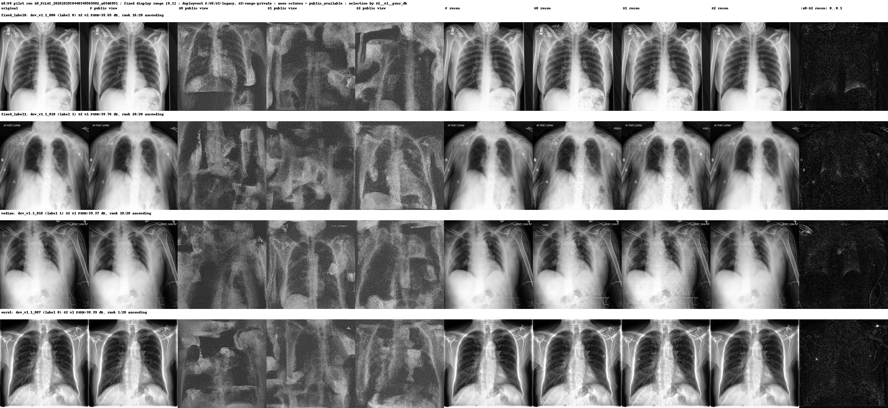

* `[事實]` fixed label-0／label-1 病例為 `dev_v1.1_000`／`dev_v1.1_010`；S2 M1 PSNR 的 lower-median 為 `_018`（rank 10，`39.373 dB`），worst 為 `_007`（rank 1，`38.390 dB`）（W6-T6）。重複角色不另換樣本，完整規則已寫入表中。
* `[事實]` 圖中 P／S0／S1 panel 已換成 legacy public view 與 legacy reconstruction，S2 panel 維持 private-range 結果；選樣 JSON 在修改前後逐位元相同，故 storage 補跑沒有重新挑選較有利病例（W6-F1、W6-T6）。

### 6.4 論文可用素材（`appendix/week6/`）

| 編號 | 內容 | 建議用途 | 建議章節 |
|---|---|---|---|
| W6-F1 | mixed-deployment 四病例原圖／公開匿名圖／合法重構圖 | 正文 | Results／end-to-end comparison |
| W6-T1 | fidelity、paired CI 與 range attribution | 正文主表 | Results／fidelity |
| W6-T2 | public-view 影像差異與 NN linkage | 正文 | Results／anonymity |
| W6-T3 | wrong-key／wrong-nonce 與 fail-closed | 正文 | Results／authentication |
| W6-T4 | runtime／GPU memory 分項 | 正文 | Results／runtime |
| W6-T5 | M1／M2 storage 分項 | 正文 | Results／storage |
| W6-T6 | P8 deterministic selection protocol | 附錄 | Results／qualitative selection |

完整 caption、來源 SHA-256、run ID 與輸出 SHA-256 見 `appendix/week6/MANIFEST.csv`；連續重建兩次逐位元相同。

### 6.5 決策紀錄

| 日期 | 決定 | 出處 |
|---|---|---|
| 10-15 | `[決定]` Week 6 先以 dev N=20 跑通；formal 樣本數仍為 N=200 | 使用者裁決、WORKFLOW Week 6–7 |
| 10-15 | `[決定]` Q8／P8 主欄改為 P／S0／S1 legacy、S2 private-range preserving | 使用者裁決、WORKFLOW §2.3、W6-T1 |
| 10-15 | `[決定]` 舊全 range 結果保留為 attribution，不刪除、不冒充主部署比較 | AUD-20261015-05、W6-T1 |
| 10-15 | `[決定]` P8 採 fixed label、lower-median、worst 的固定規則，不人工挑最佳案例 | WORKFLOW P8.1、W6-T6 |

### 6.6 稽核狀態

* AUD-20261015-04：原 N=20 Q8.1–Q8.5／P8.1 pilot **PASS**，新 finding 0；獨立重算 fidelity、linkage、storage、LPIPS provenance 與 P8 selection。
* AUD-20261015-05：mixed-deployment supplement 與合併分析 **PASS**，新 finding 0；獨立確認 parent hash binding、P／S0／S1 legacy 數值、S2 arrays 不變、range attribution 與 P8 panel 來源。
* Week 6 pilot 已完成稽核；目前沒有因本週工作新增的未關閉 MAJOR／MINOR finding。正式 N=200 結果尚未產生，不能引用 pilot 稽核作 formal 結論。

### 6.7 限制與未解問題

* 所有主要統計來自 dev_v1.1 N=20、`formal=false`；CI 能描述 pilot 波動，但不取代 Week 7 的 security_v1 N=200 formal analysis（W6-T1～W6-T5）。
* mixed 主欄是實際舊／新部署比較，不是單因子實驗；S2 相對 S0 的 +7.81 dB 大部分由 storage protocol 改善，不可宣稱為加密演算法單獨提升（W6-T1）。
* cosine nearest-neighbor 只量測指定 gallery linkage；低命中率不等於不可辨識、臨床隱私充分或一般密碼學安全（W6-T2）。
* 匿名圖是否保留積水辨識、分類或定位效用不在 Q8／P8 的測項內；低 PSNR、高影像差異與視覺格都不能替代臨床效用實驗（W6-F1、W6-T2）。
* runtime 來自共用 GPU 的單輪 pilot，適合解釋成本量級與組成，不宜當成跨硬體 benchmark；Week 7 仍須保留 median／p95 與環境記錄（W6-T4）。
* S2 storage 較大是功能組合的結果；若要回答各元件增量，必須引用 nonce、tag、manifest、metadata、payload 等分項，而非只報總比值（W6-T5）。

### 6.8 下週計畫（Week 7）

* 以 frozen mixed-deployment 設定對 security_v1 N=200 執行 formal parent／legacy supplement，保留 parent hash binding 與 S2 arrays 不重算原則。
* 完成 paired test、effect size、bootstrap CI、multiple-comparison 規則與 claim→evidence matrix；正式結論只引用 formal artifact。
* 補齊 M1／M2 與 AEAD-reference 的誤差、runtime、storage 歸因，並把「部署比較」和「storage-controlled attribution」分開呈現。
* 正式 GPU 任務預估超過 30 分鐘；啟動前依專案規則另報目的、預估時間與小型替代方案，取得使用者明確裁決。

---

## Week 7（2026-10-15～10-20）｜formal 主結果凍結、誤差歸因與金鑰診斷、下游定位與 T2-BB inner-risk（F9、Q10、Q11、T2-BB）

> 範圍涵蓋 `PROGRESS.md` 自「2026-10-15 · Track F · F9 CPU」至「2026-10-20 · Track T2-BB」的全部條目。其中數條 PROGRESS 標頭誤植為「W8」（AF-040、T2-BB），實際屬本週，已併入本段（使用者 2026-10-20 確認）。附錄素材於 `appendix/week7/`（MANIFEST 已釘每檔與來源 SHA-256），編號 `W7-T<k>`／`W7-F<k>`。

### 7.1 範圍與狀態

| 子任務 | 內容 | 稽核判定 | 主要 commit |
|---|---|---|---|
| F9.1–F9.5 | formal mixed-deployment 品質五表＋paired 統計＋claim matrix 填滿＋frozen security 組裝 | Achieved；G5 已通過 | `ed99ce6`、`0ab73a0`、`f405d38` |
| AF-039 | formal 統計表加存檔欄＋同存檔（加密-only）配對 family | 已處理，待稽核複驗 | `d661df2` |
| Q10.1–Q10.4 | 誤差歸因、數值精度、AEAD-ref、M1/M2 對照（CPU） | 完成 | `e5a17c9` |
| Q10.5 | 單 bit 金鑰雪崩診斷（optional，CPU） | 完成 | `8ccec2a` |
| Q11 | 下游病灶定位 parity demo（S0/S1/S2，GPU N=10）＋contribution.md | 完成 | `341e339` |
| AF-040 | numeric-precision note 與資料一致、attribution 逐法精確 | 已處理，待稽核複驗 | `d3acc44` |
| T2-BB | inner-risk anon↔anon linkage pilot（P2 另表）＋參考文件 | 完成（pilot 定稿） | `c8a6a34`、`a6d9245` |
| 附錄（BDIA 2×2） | BDIA CPU 腳手架＋smoke（GPU run 待使用者 go，與 F9/G5 無相依） | 腳手架完成 | `4296965`、`b4100ef`、`fca5ccd`、`4fd2c5d` |

### 7.2 本週重點

1. [結論] **加密本身幾乎不損品質，+7.7 dB 幾乎全來自存檔協定。** formal 同存檔配對（same_storage family）PSNR S2−S0 中位 +0.30 dB、S2−S1 +0.035 dB（p_holm=0.30 不顯著）；部署對照（含存檔差異）S2−S0 中位 +7.68 dB（r=1.0）。兩 family 各自獨立 Holm，統計表每列自標存檔（W7-T2）。
2. [事實] **S2 認證 fail-closed、合法還原無損。** wrong-key／wrong-nonce 各 200/200 拒絕、驗證失敗時 inverter 零呼叫（W7-T4）；transform-only latent cosine=1.000000、float32 worst max_abs 1.55e-6（W7-T9）。
3. [結論] **前作 0.9989 是影像空間殘差，非 transform 性質。** 誤差階梯顯示加密層 latent cosine=1.0，M1 影像缺口來自 sampler 反轉＋8-bit 量化，大部署差來自 legacy 存檔（W7-T8）；M2 payload 6 種全 byte-exact、5 類竄改全 fail-closed（W7-T10）。
4. [事實] **KDF 對 master key 具良好雪崩。** 單 bit 翻轉 → derived sign-subkey Hamming 0.505、permutation change ~1.0、ciphertext |cos| 3.1e-3（W7-T11、W7-F1）；定位為診斷，不以金鑰空間作安全論證。
5. [結論] **換加密流程對下游定位透明。** Q11 跨法 parity 中 S2−S0 與前作自身 S0−S1 同量級（還原圖 46.0 vs 46.4 dB），非準確度 benchmark（W7-T12、W7-F2）。
6. [結論] **T2-BB：前作對 inner-risk linkage 透明但訊號弱、S2 回隨機、學習式無法改善。** S0/S1 range cos AUC 0.657 = plaintext cos 0.659（正交映射保內積），線性上界僅 ~0.66；S2 per-image nonce 降至隨機；學習式 pilot efficacy=false（過擬合）（W7-T13、T14、T15）。

### 7.3 實驗結果與分析

**(a) formal 品質主結果（W7-T1、W7-T2）。** marginal M1 重構 PSNR：P 37.46／S0 31.15／S1 31.42／**S2 38.82** dB（patient-cluster bootstrap CI，N=200）。端到端 S2−S0 +7.68 dB 同時含存檔協定效應；加密-only（雙方保值域）隔離後 S2−S0 僅 +0.30 dB（mean +0.54），S2−S1 不顯著，SSIM/LPIPS/L∞ 多為 honest null。**限制**：mixed 為實際舊／新部署比較，非單因子加密消融；index.md 與統計表存檔欄已明載，不得歸因為加密演算法單獨提升。

**(b) 誤差歸因與數值精度（W7-T8、W7-T9、W7-T10）。** 階梯：crypto transform-only（無損，cosine=1.0）→ M2 精確 latent 天花板（全方法同，殘差＝VAE＋8-bit）→ M1 sampler（honest 主殘差）→ M1 legacy 存檔（純存檔損失）→ conditioning（deferred GPU，交叉引用 BDIA 附錄，不杜撰）。**限制**：magnitude/precision/AEAD 為指定量測，非通用安全證明。

**(c) 金鑰雪崩（W7-T11、W7-F1）。** 支持「金鑰材料與影像無關且良好擴散」的構造論述（與 per-image nonce、CSPRNG 金鑰一致）；僅刻畫 S2/S2a 金鑰排程，非安全證明。

**(d) 下游定位 parity（W7-T12、W7-F2）。** 還原圖與偽健康圖三法逐列幾乎無法區分；heatmap 熱點位置一致、強度略有差異。**限制**：無 ground-truth mask（前作外部測試集原始影像與醫師座標不可得），只能宣稱「保留／不劣化」，非定位準確度提升；為單次 GPU 浮點量測，不保證跨次 bit-identical。

**(e) T2-BB inner-risk（W7-T13～T15）。** 步驟 1 影像層 DenseNet121 Top-1 0.550／AUC 0.811（訊號存在，屬 outer-risk 上界）；步驟 2 新增原始帶符號 cos scorer 證實前作透明性（cos(anon)=cos(plaintext)），但 cos/abs/norm 線性上界皆 ~0.66、弱；S2 回隨機；學習式 shadow 攻擊（200 病患）train loss→0.0048 但 shadow-val AUC 0.48、efficacy=false（過擬合）。**限制**：N=20(victim)/200(shadow pilot) 規模小；記憶化／訓練集重疊以 disjoint split 控制；結論限於固定統計＋pilot 學習式攻擊者，非通用安全證明。判定 pilot 定稿，不補跑 1000（期望值低）。

### 7.4 論文可用素材（`appendix/week7/`）

| 編號 | 內容 | 建議用途 | 建議章節 |
|---|---|---|---|
| W7-T1 | formal fidelity（N=200，五指標＋CI） | 正文主表 | Results／fidelity |
| W7-T2 | formal paired 統計（兩 family，存檔自標） | 正文主表 | Results／statistics |
| W7-T3 | formal anonymity（public-view linkage） | 正文 | Results／anonymity |
| W7-T4 | formal wrong-key／nonce（authenticated open） | 正文 | Results／authentication |
| W7-T5 | formal runtime 分解 | 附錄 | Results／runtime |
| W7-T6 | formal storage 分項 | 附錄 | Results／storage |
| W7-T7 | claim→evidence matrix（10 假設全 supported） | 正文 | Discussion |
| W7-T8 | 誤差歸因階梯 | 正文 | Results／error attribution |
| W7-T9 | transform round-trip 精度掃描 | 附錄 | Results／numeric precision |
| W7-T10 | AEAD-reference round-trip＋竄改 | 附錄 | Results／AEAD |
| W7-T11、W7-F1 | 金鑰雪崩表＋雙直方圖 | 附錄 | Results／key avalanche |
| W7-T12、W7-F2 | 下游定位 parity 表＋10 張 grid | 附錄 | Results／downstream utility |
| W7-T13～T15 | T2-BB 影像控制／latent linkage／學習式攻擊 | 附錄 | Results／T2-BB inner-risk |

### 7.5 決策紀錄

| 日期 | 決定 | 出處 |
|---|---|---|
| 10-15 | `[決定]` 先背景跑 Q8 formal parent（N=200），停在 legacy supplement 前等同意；Week 7 sampler 維持 DDIM+非對稱 | 使用者裁決 |
| 10-16 | `[決定]` 同意啟動 legacy supplement（formal）；BDIA 2×2 附錄「有時間才跑」，升為正式方法需回 Cowork，附錄只背書「品質更好＋安全相同」 | 使用者裁決、skill §9 |
| 10-17 | `[決定]` 補 Q10.5 optional partial-key 診斷 | 使用者裁決 |
| 10-19 | `[決定]` 整理 contribution.md＋跑 Q11 下游定位 parity（CFG 接還原影像，非還原 latent） | 使用者裁決 |
| 10-20 | `[決定]` T2-BB 以最弱～學習式攻擊者光譜做 pilot；efficacy=false 故不補跑 1000；pilot 定稿 | 使用者裁決、protocol §10 |

### 7.6 稽核狀態

* G5 主表凍結**已通過**（使用者 2026-10-20 確認）。
* AF-039（MINOR/EVIDENCE）：已以已凍結資料補同存檔 family 與存檔欄，mixed 主數字逐格不變，待稽核複驗轉 CLOSED。
* AF-040（MINOR/REPRO）：numeric-precision note 已改為由計算值格式化、attribution 逐法精確，無量化結論改變，待稽核複驗。
* claim matrix 10 假設全 supported、0 pending。

### 7.7 限制與未解問題

* 所有 formal 統計來自 security_v1 N=200、mixed deployment；+7.7 dB 大部分為存檔效應，加密本身增益小（同存檔 S2−S0 +0.30 dB）。
* Q11 無定位 ground-truth，只能宣稱保留／不劣化；GPU 浮點單次量測不保證跨次 bit-identical。
* T2-BB 規模小（victim 20／shadow pilot 200），結論限於固定統計＋pilot 學習式攻擊者。
* conditioning 軸（y=0 vs 無條件）對 M1 保真的正式數字待 BDIA 2×2 附錄 GPU run；誤差階梯 stage5 現為 deferred。

### 7.8 下週計畫

* 待稽核複驗 AF-039／AF-040 後關閉。
* BDIA 2×2 安全＋品質附錄 GPU run 待使用者 go（指令模板見 PROGRESS 2026-10-16 條目）；完成後回填誤差階梯 stage5 與附錄。
* 其餘依 WORKFLOW 後續子任務推進。

---

## Week 8（2026-10-19～10-24）｜重現凍結與稽核回應、P2 附錄（匿名圖 linkage、方向≠大小、實驗矩陣）

> 本週以「收尾」為主：P11 重現/表圖/claim audit/freeze、回應三個 MINOR finding（AF-040/041/042/043），並補齊 P2 附錄素材（T2-BB 匿名圖 linkage、latent 方向≠大小 demo、RQ4 端到端彙整）。無模型/密碼變更，無量化主結論改動。

### 8.1 範圍與狀態

| 子任務 | 內容 | 稽核判定 | 主要 commit |
|---|---|---|---|
| AF-040 | Q10.2 精度註記與資料漂移修正（float32 1.55e-6／float64 3.05e-15）＋ stage-1 bit-exact 精確化 | 待複驗（提交修正） | `fix: AF-040` |
| T2-BB inner | 匿名圖 anon↔anon linkage pilot 定稿（image control／latent linkage／學習式） | Achieved（AUD-20261022-01 相關） | 見 W7-T13/14/15 |
| T2-BB-M1-frozen | 實際公開 PNG 的黑箱 linkage pilot（N=20）＋單元測試（W8-T3） | PASS（AUD-20261022-01） | `464e4a7` |
| P11.1 | 最終實驗矩陣（34 cells，run id/provenance；W8-T1） | Achieved | `d41e2b0` |
| P11.4 | 機械性向量匯出（PDF，無損；W8-F1/F2） | Achieved | 見 P11 收尾 |
| AF-043 | exact-recovery 詞表缺口＋一處影像端過度宣稱修正 | 待複驗 | `fix: AF-043` |
| P2 direction | latent 誤差「方向≠大小」demo（並排生成圖；W8-F3） | done | — |
| P2 RQ4 | 端到端可逆性彙整（密碼層 vs 影像層、雙框架）寫入 `results_index.md` | done | d7b7e2f |

### 8.2 本週重點

* [事實] **P11 最終實驗矩陣凍結**：34 cells（RQ1–4 主結果 + P2/appendix），每 cell 附 run id/provenance，`n` 由實表讀取不手抄（W8-T1）。
* [事實] **AF-040 修正**：`table_numeric_precision.json` 的 note 改由計算欄位格式化，float32 worst **1.55e-6**、float64 **3.05e-15**，與 CSV 一致；稽核獨立重算 1.45e-6／2.90e-15（浮點容差內）。無 CSV 數字或下游結論改變。
* [事實] **層 A（省 reinvert pass）定量定案**：reinvert ablation A≈B，PSNR **47.5 dB**、cos **0.9999**，B（分岔）**1.50×** 更快（W8-F2）。→ 成為 W9 4-pass pipeline 的依據。
* [事實] **latent 方向≠大小**：S0 實際解密誤差雖大，落在生成器不敏感方向，影像保真不由 latent cos/rmse「大小」決定（W8-F3）。
* [事實] **稽核措辭收斂（AF-041/042/043）**：把介面-/表徵-特定的 null 與影像端 exact-recovery 宣稱限縮到有證據範圍；底層數字全部未變。

### 8.3 實驗結果與分析

**P11 重現與凍結（W8-T1）**
* 34 cells 矩陣由已凍結、已稽核來源組裝（攻防 claim 包的 run_id、F9.5 claim matrix、Q8_FORMAL、P2/appendix）；負結果明標 `done_negative`（如 T2BB 學習式 efficacy=false），無 cell 因壞結果缺席。

**層 A reinvert ablation（W8-F2）**
* 解密得 `x_rec_T` 後直接分岔（無條件→還原圖、CFG→偽健康圖），省掉「把 x_rec 重新 inversion」那趟：A（不分岔）vs B（分岔）psnr 47.5 dB、cos 0.9999、heatmap 位置一致，B 1.50× 更快。→ 6-pass→4-pass 無實質保真代價。

**sampler ablation（W8-T2）**
* BDIA/DDIM 2×2（N=200，legacy backward）：sampler 軸 m1 PSNR Δ<0.4 dB，NFE parity 1996 → 當時結論「精確反演在 single-shot 無實質增益」。**更正見下**。

**實際公開 M1 PNG 的黑箱 linkage（W8-T3）**
* 威脅模型 T2-BB/no-model/no-key/no-plaintext/anonymous-PNG-only（N=20 pilot）：target 端只匯出攻擊者可見灰階 PNG（真值表留在匯出目錄外、S2 master key 每輪隨機不落盤只記 SHA-256），scorer 只讀匯出目錄用凍結 encoder（densenet121-imagenet／rad-dino）評分。
* [事實] P 對照**有訊號**（rad-dino AUC 0.976、densenet AUC 0.81），S0/S1/S2 **全塌到 ~隨機**（AUC 0.43–0.56、top1 ≤0.1，random 0.05，null_auc_mean≈0.50）→ 釋出的匿名 PNG 不可被凍結 encoder 連結。單元測試 4 passed（完美檢索 + 竄改/truth-leak/path-escape 拒絕）。

**P2 RQ4 端到端彙整**
* `results_index.md` 新增節，將可逆性拆成 (a) 密碼層 transform-only（S0/S1 bit-exact、S2 max_abs 8.3e-7）、(b) as-shipped 部署、(c) 同存檔 encryption-only、(d) M2 byte-exact 上界，避免把存檔協定效應誤歸因為加密。

### 8.4 論文可用素材（`appendix/week8/`）

| 編號 | 內容 | 建議用途 | 建議章節 |
|---|---|---|---|
| W8-T1 | 最終實驗矩陣（34 cells，run id/provenance） | 正文 | Discussion／實驗凍結 |
| W8-T2 | BDIA/DDIM 2×2 保真消融（N=200） | 附錄 | Results／sampler ablation |
| W8-T3 | 實際公開 M1 PNG 黑箱 linkage（N=20，4 法×2 encoder） | 正文 | Results／T2-BB inner-risk |
| W8-F1 | P8 視覺 grid 向量匯出（PDF，無損） | 正文 | Results／visual grid |
| W8-F2 | reinvert ablation grid 向量匯出（PDF） | 附錄 | Results／層 A |
| W8-F3 | latent 方向≠大小 demo（並排生成圖） | 附錄 | Results／metric semantics |

### 8.5 決策紀錄

* [決定]（使用者 2026-10-22）修 AF-041/042：null 結果措辭綁定前提、補 identity-cipher latent-view 控制。
* [決定]（使用者 2026-10-24）修 AF-043：claim-audit 詞表補 exact-recovery，改以逐項人工處置為準。
* [決定]（實作方 2026-10-24）RQ4 端到端用「密碼層 vs 影像層、雙框架」呈現，用語避開無損/lossless 等無證據字樣。

### 8.6 稽核狀態

* AF-040（MINOR/REPRO/Q10.2）：修正提交，待複驗（note 數量級與 CSV 一致）。
* AF-041（MINOR/DOC）、AF-042（MINOR/METHOD）：措辭/控制修正入庫，待複驗。
* AF-043（MINOR/DOC）：詞表 + 影像端過度宣稱修正，重掃 0 影像端過度宣稱，待複驗。
* AUD-20261022-01：T2-BB-M1-frozen public/private truth isolation、checkpoint binding PASS。

### 8.7 限制與未解問題

* [已解決] T2-BB-M1-frozen 實作方檔案（table/scripts/test/env）於 `464e4a7` 入庫，已納入 appendix（W8-T3）並在 8.3 回填 AUC。稽核方 `audit/t2bb_m1_recompute.*` 仍為稽核方所有（實作方未碰）。
* 樣本數：T2-BB inner/M1-frozen 為 pilot（victim 20×2），非 formal N=200；若新 pipeline（DPM++）定案，此 linkage 屬影像空間、需在新設定重跑（見 `new_model.md §11.1`）。
* BDIA 2×2 的「<0.4 dB」結論為 legacy backward 下所得；W9 已以對齊 respaced 版改寫（見 8.8／W9）。

### 8.8 下週計畫（Week 9）

* [事實] W9 已完成加速取樣器線：對齊 respaced DDIM 基準、BDIA 對齊重做、**DPM-Solver++(2M) 定為部署取樣器**（N=100，5×，端到端 ~44 dB；見 `new_model.md §10`）。
* [決定] 新標準 pipeline：**DPM++ N=100 + 4-pass（層 A）**；切換後重做清單見 `new_model.md §11`（RQ4 重報、層 A 等價 ablation、影像空間安全平價檢查 T2BB-3/4+MC-2）。
* [待辦] 先 commit T2-BB-M1-frozen（8.7）再補入 appendix；依 §11 推進三項必做重做。
