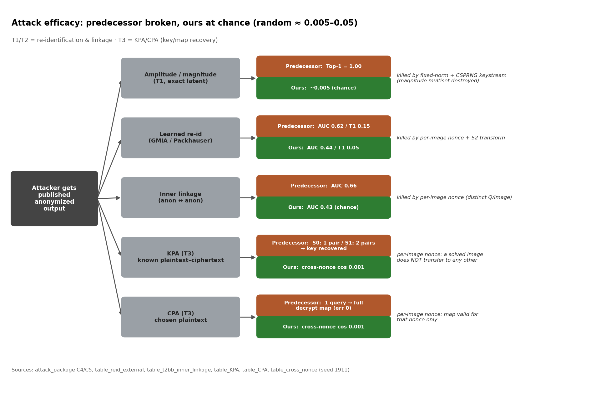
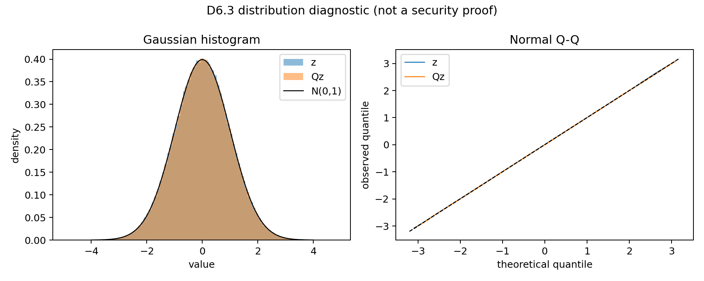
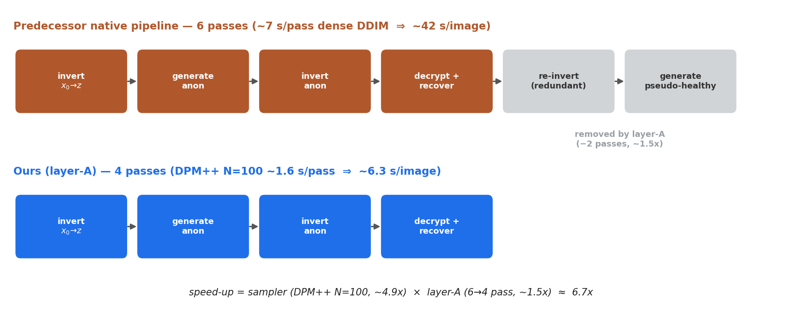
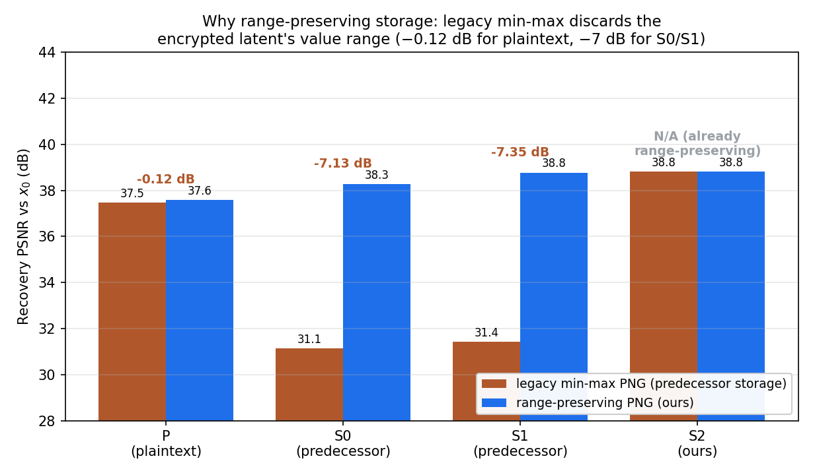
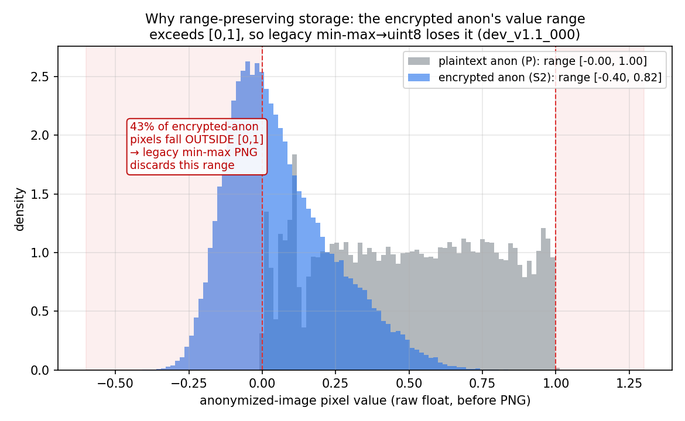
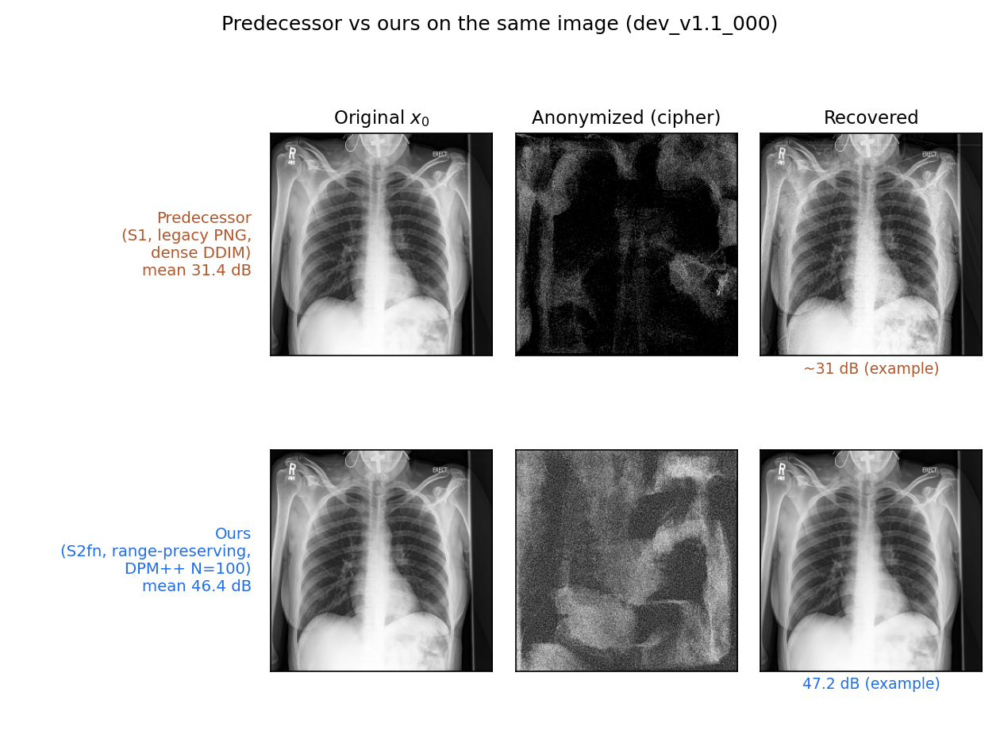
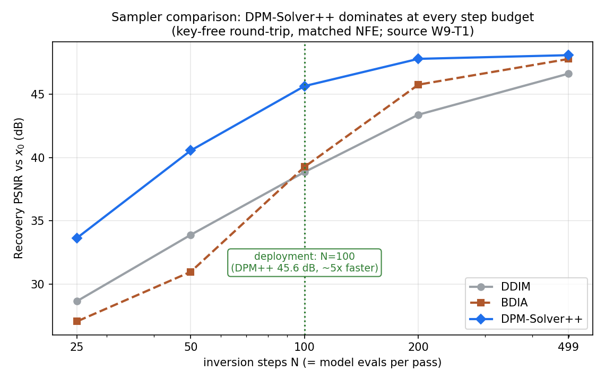

# 口試報告大綱：方法設計與實驗結果

> 目的：先就「攻擊模型 → 我們的方法 → 實驗與結果」向教授報告，確認沒問題再整理其他章節。
> 標籤：`[事實]` 已量測（附來源）／`[限制]` 誠實邊界／`[需畫]` 待製圖。素材路徑列在每節末，做投影片可直接取用。

---

## 0. 一頁定位（30 秒）
問題（醫療影像去識別需「可逆」）→ 學長方案（線性自逆潛空間加密）→ **破綻**（線性/幅值結構可攻擊、跨影像擴散、存檔丟值域）→ 我們一句話的修補：**per-image nonce + S2 fixed-norm + null 對齊 + range-preserving 存檔**。

## 1. 威脅模型分類（放在攻擊之前當座標系）
- T1 精確 latent 外洩｜**T2-WB 影像+模型反轉（主威脅 P0）**｜T2-BB 僅影像｜T3 KPA/CPA｜T4 竄改。
- 素材：`reports/t2bb_inner_linkage_protocol.md`。

## 2. 攻擊模型介紹（流程 / 流程圖 / 情境 / 效果）
每種攻擊配一張「攻擊成功率」數字，並掛回 T1–T4：
- **幅值 / 線性結構攻擊**：破學長構造的核心（「為何需要我們」）。
- **再識別攻擊**（GMIA / Packhauser 風格、學習式 Siamese shadow-1000）。[事實] MC-2 三通道 + AF-045 部署版：S2 latent-view 0.445 vs S0 0.616，部署版學習式 top-1 掉到隨機。
- **anon↔anon 內部連結攻擊**。[事實] S2 cos 0.433（≈隨機）vs S0/S1 transparent 0.657。
- 結論句：這些攻擊在學長方案成立，在我們方案掉到隨機水準。


*圖 2-1：三種攻擊的 predecessor vs ours 成功率，及各自被什麼機制擋下。來源：attack_package C4/C5、table_reid_external、table_t2bb_inner_linkage（seed 1911）。*

- 素材：`presentation/assets/table_cross_nonce.csv`、`appendix/week9/tables/W9-T10_mc2_learned_attack_deploy.csv`。

## 3. 我們的方法改善了什麼
S2 構造逐件對應它擋住哪個攻擊：
- **per-image nonce** — 真正阻止跨影像擴散的是它（不是正交旋轉、不是金鑰空間；§8 規範）。
- **fixed-norm（鎖 norm）** — 維持高斯、消幅值攻擊。[事實] 見下方高斯分布圖。
- **null backward 對齊** — forward/backward 同步（取代舊 y=0），保真度 +1~4 dB。
- HKDF 域分離 / AEAD metadata / HMAC 外層 — 對應 T3/T4。
- 【框架】**可逆性一律報兩個空間**（latent cosine + 影像 PSNR），開場就講，預先堵「學長只報 latent 0.9989、image 只有 30 dB」的點。


*圖 3-1：S2 固定 norm 後 protected latent 仍維持高斯分布（D6.3）。*


*圖 3-2：我們 4-pass vs 學長原生 6-pass（含被 layer-A 砍掉的 re-invert + 偽健康圖），與 §4.6 共用。*

## 3.5 設計動機與學術依據（每個選擇的「為什麼」）
> 補這節是為了讓三個關鍵設計不像憑空冒出：range-preserving 來自一個觀察實驗、S2 有文獻脈絡、sampler 有公式與出處。

### (a) 為什麼提出 range-preserving 存檔 — 動機觀察實驗（AF-024 / AUD-20261010-04）
- **觀察**：加密後的 latent 值域被「攤開」得比明文寬很多；學長 legacy 存檔是 per-image min-max → uint8 **截斷**，把原始值域丟掉，讀回時又強制 min-max 回 [0,1]。
- **分解實驗**（稽核 `audit/e2_png_handoff_decomposition.py`，4 張 dev；dev-20 §7.5 複驗）：把 ~31 dB 的重建損失拆成「值域丟失(min-max)」vs「8-bit 量化」兩段 → **幾乎全部來自值域丟失**（量化僅 ≤0.46 dB/方案平均；`metric_semantics.md §7.3`）。
- **關鍵對比數字**：legacy min-max 對**明文**只掉 **−0.12 dB**，對**加密方案**掉 **−7.1~7.4 dB**（cipher 攤開值域所致，`table_error_attribution.csv`）。這就是「值域分佈差異 → 必須保值域」的直接證據。
- **決定**：range-preserving PNG 保存 lo/hi（float32 IEEE-754 位元樣式），round-half-to-even 量化，讀回 `x̂=q/255·(hi−lo)+lo` 還原真值域。

*圖 3.5-1：各方案 legacy vs range-preserving 的 PSNR 長條，明文只掉 −0.12 dB、S0/S1 掉 −7 dB（來源 table_error_attribution）。*


*圖 3.5-2：明文 anon 落在 [0,1]、加密 anon 有 ~38% 超出 [0,1]（smoke dev_v1.1_000 實測）——legacy min-max 會丟掉這段值域。*

- 素材：`paper_assets/tables/table_m1_storage_comparison.csv`、`table_error_attribution.csv`、`audit/out/e2_png_handoff_decomposition.json`、`reports/metric_semantics.md §7`。

### (b) S2 的想法來自哪裡 — 設計依據與文獻（PROPOSAL §4.3 / §5）
- **問題起點**：學長 S0/S1 是 sign-flip / permutation 的**線性自逆**變換 → 被逐元素與排序**幅值攻擊**破解。
- **設計脈絡**：改採文獻既有的 **Hadamard–Rademacher 原語**組成 key-derived structured orthogonal transform（§4.3）；正交 → 保範數 → 若 z~N(0,I)，變換後仍 N(0,I)（分布不變）。
- **逐層補強**：per-image **nonce**（真正擋跨影像擴散，§5.2）＋ 固定 norm C=248.261（AF-025，消 norm 旁道）＋ HKDF 子鑰 ＋ ChaCha20-Poly1305 AEAD ＋ 外層 HMAC-SHA256（完整性/來源）。
- **誠實邊界**（§5.1 / §25）：**不**宣稱等同 AES/AEAD/一般 IND-CPA；S2 是 structured obfuscation + authenticated metadata。金鑰空間大 ≠ 安全（§8 規範）。
- **文獻依據**（對應 refpaper/，完整對照見文末附錄）：旋轉/幾何擾動隱私法（S0/S1 脈絡與其攻擊）、Householder 正交參數化、Probabilistic Encryption（為何需隨機化/per-image nonce）、Kerckhoffs 原則、NIST SP 800-108 / RFC 5869 (HKDF) / SP 800-38（密碼原語）、RiDDLE / G2-Face / FIT（可逆去識別同儕）。

### (c) Sampler 的公式與學術來源
各 sampler 的更新式、出處與對應實作檔見**文末附錄「Sampler 公式與來源」**。重點：DDIM/DPM-Solver++ 為基礎方法（原論文**不在** refpaper，需補 canonical 引用）；BDIA、BELM 的 PDF 已在 refpaper。

## 4. 實驗設計與結果

### 4.1 主結果：學長版 vs 我們版 保真度 ★（含存檔/baseline 修正）
> **重要：baseline 用學長「真實原始設定」~31 dB，不是明文 P 的 37.46 dB。**

| 設定 | PSNR | SSIM | 說明 |
|---|---|---|---|
| **學長原始部署** S1 cipher + legacy min-max PNG + dense DDIM | **31.42 dB** | 0.895 | 忠於原設定，對應其論文 ~30 dB（S0 31.15） |
| **我們部署** S2fn + range-preserving PNG + DPM++ N=100 null | **46.42 dB** | 0.995 | **+15.0 dB** end-to-end |
| （參考）明文上限 P（legacy PNG，無加密） | 37.46 dB | 0.973 | **天花板，非學長系統**；勿當 baseline |

差異表指標：PSNR / SSIM / MAE / MSE(RMSE) / LPIPS。


*圖 4.1-1：**同一張 dev_v1.1_000**，學長 S1 ~31 dB vs 我們 S2fn ~46 dB（original｜匿名密文｜重構）。學長側為 E2.5 真實面板裁切。*

- 其他配圖：`assets/E2.5_roundtrip_grid.png`、`assets/deploy_s2_grid.png`、`assets/AF017_P_anonymization_smoke.png`。

**+15 dB 誠實分解（口試必講，避免過度宣稱）** — 來源 `paper_assets/tables/table_error_attribution.csv`：
```
學長原始 S1  31.4 dB
  → range-preserving 存檔（取代 legacy min-max）   +7.4 dB  → 38.8
  → 加密本身 S2 vs S0/S1（同存檔）                 ≈ 0 dB   → 38.8   ← 安全幾乎免費
  → DPM++ N=100 + null 對齊（取代 dense DDIM y=0）  +7.6 dB  → 46.4
我們部署 S2fn 46.4 dB
```
一句話：37.46 → 31.4 的落差幾乎全是「加密後 latent 被 legacy min-max 量化丟掉值域」造成（明文只掉 −0.12 dB，加密掉 −7.1~7.4 dB）；我們的 range-preserving 存檔救回這段，加密本身在保真度上幾乎零成本。
- 素材：`paper_assets/rq4_formal/table_fidelity.csv`（我們 N=200）、`paper_assets/q8_formal/table_fidelity.csv`（學長 S0/S1/P）、`table_error_attribution.csv`。

### 4.2 Sampler 比較（DDIM / BDIA / DPM++）
> BELM **不列**（目前僅 2 張 smoke、數字不收斂）。


*圖 4.2-1：DDIM/BDIA/DPM++ 的 PSNR–N 曲線，DPM++ 每個步數皆最佳，標註 N=100 部署點（來源 W9-T1）。*

- [事實] 各 N 的 PSNR + 每-pass 秒數（`presentation/assets/W9-T1_sampler_comparison.csv`、`paper_assets/deploy_dpm_sweep/sweep.csv`）。DPM++ 全面最佳：N=100 時 45.6 dB vs DDIM 38.9 dB、BDIA 39.3 dB。
- BDIA/DDIM × asym/symnull 2×2 ablation（NFE parity 1996）：sampler delta < 0.4 dB，佐證「增益不是靠偷步數」。素材 `paper_assets/tables/table_bdia_2x2.csv`。

### 4.3 DPM++ 不同 N
- [事實] N=25/50/100/200/499 完整掃描，P 與 S2fn 皆有（`deploy_dpm_sweep/sweep.csv`）。
- 決策：**部署選 N=100**——~5× 快、保真度已飽和（S2fn 47 dB）；同算力 N=499 可到 54 dB 但不值得。

### 4.4 安全性驗證（#3 的「結果」面）
- [事實] keyspace / nonce 不重複 / cross-nonce / repeat / tamper 五表，證明 nonce、KPA/CPA、T4 竄改主張。
- 素材：`assets/table_keyspace.csv`、`table_cross_nonce.csv`、`table_repeat.csv`、`table_tamper.csv`、`table_A4.6_reconstruct.csv`。
- [限制] §8：金鑰空間大 ≠ 安全；正交旋轉不解 KPA——擋跨影像擴散的是 per-image nonce。

### 4.5 下游效用保留（強貢獻，正交於保真度）
- [事實] 分類效用（No Finding vs Pleural Effusion）：**real→rec ≈ real（AUROC ~0.91），anon ≈ 隨機（~0.50）**；fine-tune 版一致（0.888 vs 0.886）。
- [事實] torchxrayvision referee 11 病理保留（零 retrain，獨立驗證）。
- 回答教授常問「復原後還能不能診斷、匿名圖會不會洩漏」。
- 素材：`assets/W9-T8_referee_pathology.csv`、`paper_assets/classification_utility/`。

### 4.6 效率 / 時間
- 三層講法：
  - 單階段：學長 dense ~7s／張 vs 我們 DPM++ ~1.6s／張
  - 管線 pass 數：學長原生 **6-pass** vs 我們 layer-A **4-pass**
  - 端到端：**~42s vs ~6.3s，約 6.7×**（= sampler ~4.9× × layer-A ~1.5×）；見 §3 圖 3-2（pipeline 4-pass vs 6-pass）
- 同步數（N=499）時我們與學長單階段相同（~7s）——時間優勢不是偷步數。

## 5. 定位與誠實限制（收尾）
- 與 GMIA / RiDDLE / Packhauser 的威脅模型對比：我們**可逆 + 內部風險消除**。素材 `presentation/assets/comparison.csv`。
- [限制] 病灶定位（CheXlocalize effusion）在學長與我們**都是隨機水準**——主動講，別被口委挖。
- [限制] HF 高頻保真為 proxy；referee 為獨立但非臨床判讀。

---

## 附：素材清單（`presentation/assets/`）
`D6.3_gaussian_distribution.png`、`E2.5_roundtrip_grid.png`、`deploy_s2_grid.png`、`AF017_P_anonymization_smoke.png`、
`W9-T1_sampler_comparison.csv`、`W9-T7_hf_fidelity.csv`、`W9-T8_referee_pathology.csv`、
`table_keyspace.csv`、`table_cross_nonce.csv`、`table_repeat.csv`、`table_tamper.csv`、`table_A4.6_reconstruct.csv`、`comparison.csv`、
**新圖**：`fig_storage_motivation.png`（§3.5a）、`fig_anon_value_range.png`（§3.5a）、`fig_sampler_nsweep.png`（§4.2）、`fig_pipeline_passes.png`（§3／§4.6）、`fig_attack_flow.png`（§2）、`fig_fidelity_sidebyside.png`（§4.1）

> 六張新圖由 `scripts/plot_presentation_figures.py` 產生（讀凍結表，數字不手抄）；其中值域直方圖與 §4.1 並排所需的 anon/recon 浮點陣列，由 1-image smoke `scripts/smoke_presentation_panels.py`（GPU、dev_v1.1_000）dump。

## 附：Sampler 公式與來源
> 符號（VP diffusion）：timestep t，ᾱ=abar[t]，α=√ᾱ，σ=√(1−ᾱ)，σ̄=σ/α；ε_θ(x,t) 為模型雜訊預測。全部在同一 pixel-space CFG-DDIM 模型與 respaced timestep grid 上，不改 `past/SourceCode/`。

| Sampler | 更新式（本專案實作所用） | 性質 | 學術來源 | 實作檔 |
|---|---|---|---|---|
| **DDIM**（respaced, η=0） | x_{t_prev}=√ᾱ_prev·x̂0 + √(1−ᾱ_prev)·ε_θ；x̂0=(x_t−σ·ε_θ)/α；沿用學長 `p_mean_variance`/`_predict_eps_from_xstart`，只把 ᾱ 跳到下一個*排程*timestep | 確定性、1 eval/step | Song, Meng, Ermon, **DDIM**, ICLR 2021（**不在 refpaper，需補**） | `scripts/respaced_ddim_sweep.py` |
| **BDIA**（γ=1） | generate: X[i−1]=X[i+1]+G(X[i])−R(X[i])；invert: X[i+1]=X[i−1]+R(X[i])−G(X[i])（leapfrog，邊界步為純 DDIM） | 代數上精確可逆、1 eval/step、NFE 同 DDIM | Zhang et al., **BDIA: Exact Diffusion Inversion via Bi-directional Integration Approximation**, ECCV 2024（refpaper 112） | `scripts/exact_inv_sweep.py` |
| **DPM-Solver++(2M)** | 二階 multistep：用前兩步 ε 的線性組合在 σ̄（=σ/α）座標上外推，單步一次 model eval | 二階、少步高保真（部署 N=100） | Lu et al., **DPM-Solver++**, 2022, arXiv:2211.01095（**不在 refpaper，需補**） | `scripts/exact_inv_sweep.py::DPMSolverpp` |
| **BELM**（O-BELM，**已從實驗移除**，僅列為參考） | 兩步法 Eqs.(18) decode / (19) exact inverse，首點由一步 DDIM bootstrap | 精確可逆 multistep；本專案僅 smoke（n=2 未收斂） | Zhang et al., **BELM**, NeurIPS 2024, arXiv:2410.07273（refpaper 113） | `scripts/belm_sampler.py` |

相關反演/引導文獻（脈絡用）：EDICT（111）、FreeInv（114）、There and Back Again（115）；CFG（111）/ CFG++（113）。註：我們用 unconditional null 生成，CFG++ 的 off-manifold 修正**不適用**（§8 規範，勿誤引為我們用到）。

## 附：學術依據對照（refpaper/）
| 主題 | 對應我們的設計 | refpaper 檔名 |
|---|---|---|
| 旋轉擾動隱私 | S0/S1 線性變換的脈絡與其可攻擊性 | `104_A Random Rotation Perturbation Approach...`、`Privacy-Preserving Data Classification with Rotation Perturbation`、`109_Geometric data perturbation...` |
| 正交參數化 | S2 structured orthogonal transform | `106_...Householder Reflections` |
| 隨機化/語意安全 | 為何需 per-image nonce（非保密、而是打破跨影像複用） | `Probabilistic Encryption` |
| Kerckhoffs 原則 | 只有 master key 保密、其餘公開（威脅模型前提） | `La cryptographie militaire` |
| KDF / 密碼模式 | HKDF 域分離、ChaCha20 / AEAD | `RFC 5869 HKDF`、`NIST.SP.800-108r1`、`Recommendation for Block Cipher Modes of Operation` |
| 可逆去識別同儕 | 威脅模型/方法對照（§5 定位） | `112_RiDDLE...`、`113_G2face...`、`109_Password-conditioned Anonymization...（FIT）` |
| 診斷/再識別/記憶化 | 攻擊與效用章節的對照 | `111_...patient re-identification...`、`112_...Anonymization of Chest Radiographs...`、`114_GENERATIVE MEDICAL IMAGE ANONYMIZATION...（GMIA）`、`114_...Latent Diffusion Models Memorize...` |

## 附：製作狀態
- ✅ §2 攻擊流程圖 → `fig_attack_flow.png`
- ✅ §3／§4.6 pipeline 4-pass vs 6-pass → `fig_pipeline_passes.png`
- ✅ §3.5a range-preserving 動機（長條＋直方圖）→ `fig_storage_motivation.png`、`fig_anon_value_range.png`
- ✅ §4.1 學長 vs 我們 並排（同一張圖）→ `fig_fidelity_sidebyside.png`
- ✅ §4.2 sampler 掃描 → `fig_sampler_nsweep.png`
- ✅ DDIM（arXiv:2010.02502）、DPM-Solver++（arXiv:2211.01095）PDF 已下載至 `refpaper/`。
- [可選] 若要更多樣本，可加大 §4.1 的病患數（現為單張代表例）。
