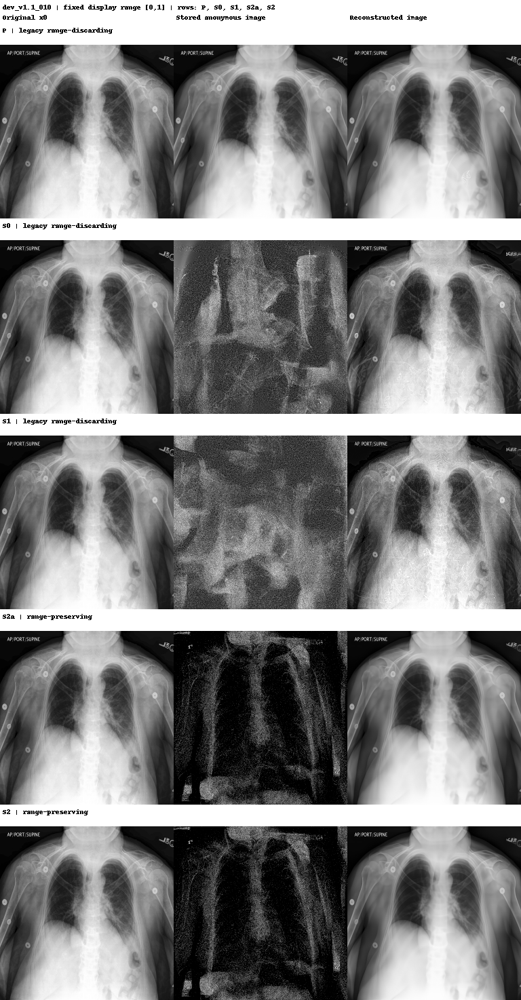

# P／S0／S1／S2a／S2 單圖比較

固定樣本：`dev_v1.1_010`（label=`pleural_effusion`，未依結果挑圖）。

依本次比較規則，P 也使用 legacy range-discarding PNG，作為與學長流程一致的無加密基準；因此此圖是完整 pipeline 比較，不是只隔離 transform 的公平消融。

| method | storage_protocol | psnr_db | ssim | l_inf_float | max_pixel_error_uint8_levels | x0_vs_reconstruction_raw_pixel_cosine | p_output_vs_reconstruction_raw_pixel_cosine |
|---|---|---|---|---|---|---|---|
| P | legacy_png/v1_minmax_truncate_discard_range | 38.291449 | 0.971341 | 0.102551 | 26 | 0.999796 | 0.999942 |
| S0 | legacy_png/v1_minmax_truncate_discard_range | 32.557876 | 0.942833 | 0.614379 | 157 | 0.999182 | 0.999004 |
| S1 | legacy_png/v1_minmax_truncate_discard_range | 31.945721 | 0.886501 | 0.479302 | 122 | 0.999044 | 0.998676 |
| S2a | range_preserving_png/v1 | 38.345202 | 0.968392 | 0.426926 | 109 | 0.999799 | 0.999916 |
| S2 | range_preserving_png/v1 | 38.345202 | 0.968392 | 0.426926 | 109 | 0.999799 | 0.999916 |

## Cosine 對照的正確解讀

學長論文 Signed Permutation 報告 cosine=`0.998978`、PSNR=`30.23 dB`。但是原評估程式比較的是 Base `samples` 與加解密流程 `samples` 的 raw-pixel cosine，不是 x0 對重構圖，也不是 latent cosine。上表因此把 `x0_vs_reconstruction_raw_pixel_cosine` 與較接近前作比較概念的 `p_output_vs_reconstruction_raw_pixel_cosine` 分欄，不能直接把兩者與 0.998978 當成相同 estimand。

PSNR、SSIM、L∞、MSE/MAE 都直接使用未 clip 的 float 輸出；`max_pixel_error_uint8_levels` 才先 clip 到 [0,1] 並以 8-bit 灰階計算。L∞ 與 float 最大 pixel error 在數學上是同一個量，因此 CSV 同時保留兩個名稱但數值相同。

S2a 與 S2 在未竄改輸入下逐位元相同；S2 的額外價值是 HMAC、metadata authentication 與 verify-before-inversion，不是提升影像品質。
